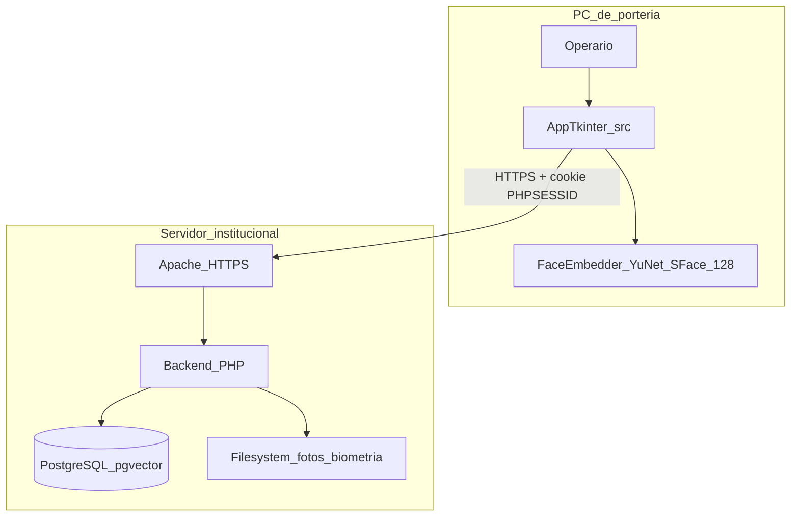
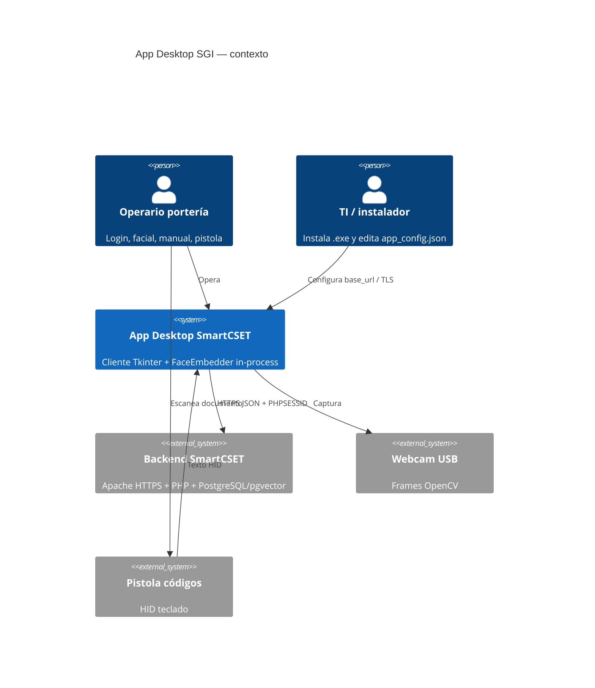
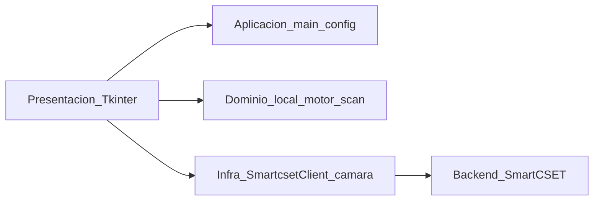
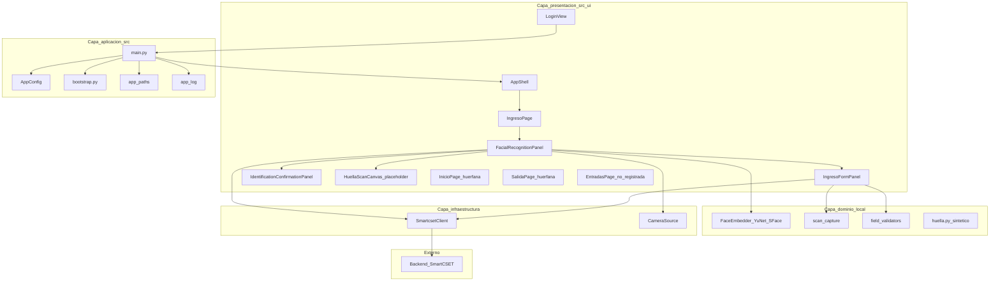
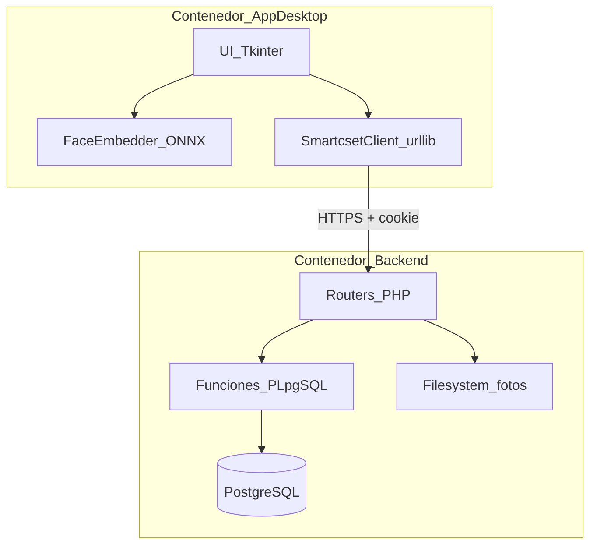
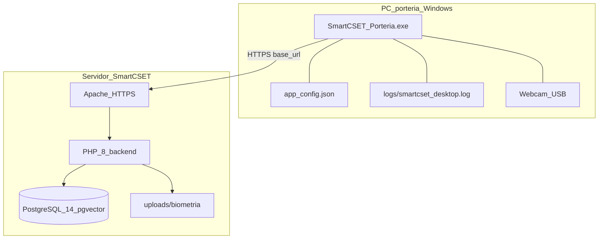
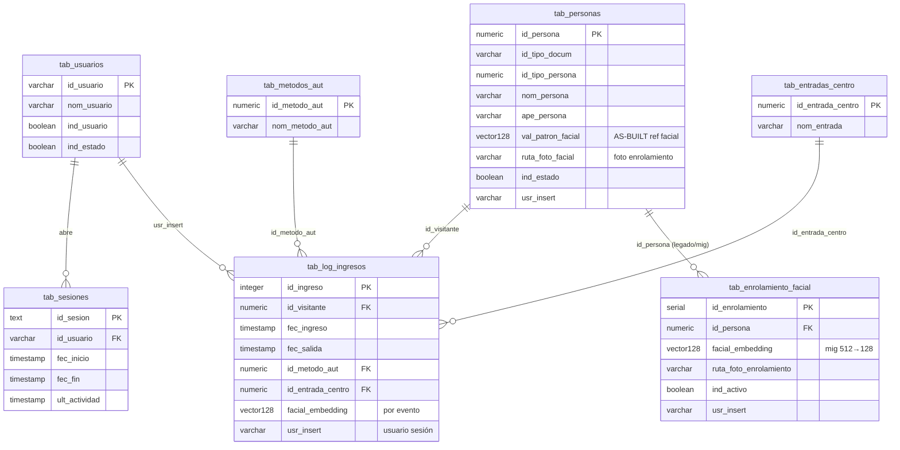
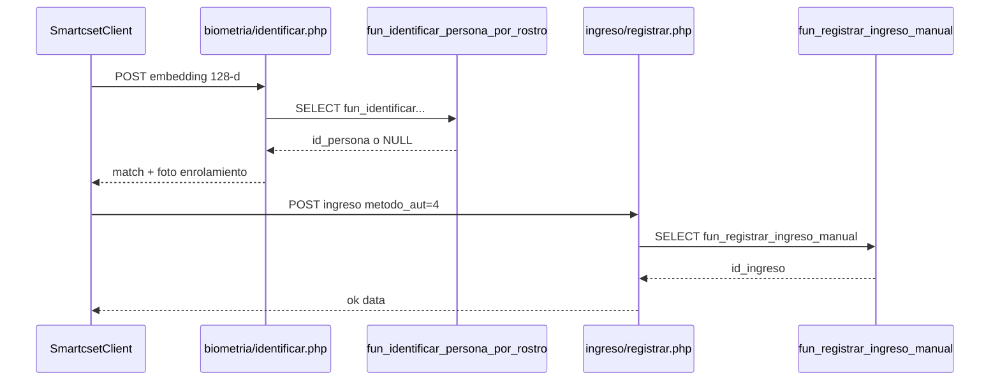

# Documentación Técnica — App de Escritorio SGI (SmartCSET)

| Campo | Valor |
|-------|-------|
| **Módulo** | `app_desktop` |
| **Tipo** | Documentación técnica monolítica as-built |
| **Responsable** | Equipo de Desarrollo |
| **Última revisión** | 2026-09-14 |
| **Estado** | Publicado |
| **Ejes MSPI** | 3, 5, 6, 7, 8 |
| **Estándares aplicados** | arc42 · C4 Model · ADR · ISO/IEC/IEEE 29148 · ISO/IEC 25010:2023 · ISO/IEC 27001:2022 Anexo A · Diátaxis · 7 reglas de redacción SmartCSET |
| **Fuente de código** | `app_desktop/src/` 
| **Alcance** | Cliente de portería Windows + endpoints/tablas/funciones que consume en el backend SmartCSET |

Este documento es **autocontenido**. Consolida arquitectura, requisitos, decisiones, API, base de datos (alcance desktop), operación, guías de usuario, historial y anexos MSPI. Las afirmaciones técnicas se verifican contra el código en `app_desktop/src/` y `app_desktop/tests/` a la fecha de revisión.

**Hechos as-built de cierre (2026-09-14):**

- Código en `src/`; entrada `src/main.py`; tests en `tests/` (**35** casos unittest).
- Post-login: `AppShell` navega solo a `ingreso` (sin sidebar). Páginas `inicio` / `salida` / `entradas` existen en código pero no están expuestas al operario.
- Motor facial **in-process**: YuNet + SFace, embedding **128** dimensiones.
- Huella: UI + endpoints + templates sintéticos; **sin lector hardware** (`capturar_desde_lector` → `NotImplementedError`).
- Cliente HTTP stdlib (`urllib`), sesión PHP (`PHPSESSID`), timeout 15 s, `verify_tls` configurable.
- Empaque: `SmartCSET_Porteria.exe` (PyInstaller onefile).

---

## Tabla de contenidos

1. [PARTE A — Arquitectura (arc42)](#parte-a--arquitectura-arc42)
2. [PARTE B — Requisitos (ISO/IEC/IEEE 29148)](#parte-b--requisitos-isoiecieee-29148)
3. [PARTE C — Decisiones ADR](#parte-c--decisiones-adr)
4. [PARTE D — API / contrato HTTP](#parte-d--api--contrato-http)
5. [PARTE E — Base de datos (alcance desktop)](#parte-e--base-de-datos-alcance-desktop)
6. [PARTE F — Operación](#parte-f--operación)
7. [PARTE G — Usuario (Diátaxis)](#parte-g--usuario-diátaxis)
8. [PARTE H — Historial](#parte-h--historial)
9. [PARTE I — Anexos](#parte-i--anexos)

---

# PARTE A — Arquitectura (arc42)


## 1. Introducción y objetivos


### 1.1 Propósito de este documento

Describe, en estilo arc42-lite, la arquitectura **as-built** del cliente de escritorio de portería SmartCSET (`app_desktop/`). Refleja el código en `src/`.

### 1.2 Qué es el sistema

SmartCSET App de Escritorio es un **cliente de portería** para centros de formación SENA. El personal de control de acceso registra ingresos y salidas mediante:

- Reconocimiento facial (YuNet + SFace 128, in-process)
- Registro manual de usuarios por documento
- Lectura por pistola (QR / barras / PDF417)

**No es un sistema independiente.** Es un cliente del ecosistema SmartCSET (junto a web y móvil): habla HTTPS con el backend PHP y persiste en la misma PostgreSQL institucional.

### 1.3 Objetivos de negocio

| Objetivo | Cómo lo cumple hoy |
|----------|-------------------|
| Flujo dedicado en portería | App Tkinter a pantalla completa, sin pestañas de navegador |
| Acelerar identificación en horas pico | Facial + confirmación visual + auto-registro (~2,5 s) |
| Biometría en el PC de portería | Enrolamiento e identificación con cámara local; vector en pgvector |
| Un solo puesto operativo | Cámara + formulario + pistola en una pantalla; huella solo UI placeholder |

### 1.4 Objetivos de calidad (resumen)

- **Disponibilidad operativa:** si falla cámara o match facial, el formulario manual sigue usable.
- **Auditoría real:** `usr_insert` = usuario de sesión PHP (no genérico).
- **Misma regla de negocio que web:** ingreso único por día, catálogos y permisos del servidor.
- **Despliegue simple en Windows:** `SmartCSET_Porteria.exe` (PyInstaller onefile).

Detalle en la sección 10 (requisitos de calidad) de este documento.

### 1.5 Stakeholders

| Stakeholder | Interés |
|-------------|---------|
| Operario de portería | Login, identificar/enrolar, registrar ingreso/salida, captura manual |
| Administrador del sistema | CRUD de entradas (código existe; **no expuesto** en UI actual) |
| Backend SmartCSET | Autenticación, reglas, persistencia, biometría |
| TI / instalador | URL en `app_config.json`, `.exe`, cámara y red |
| Cumplimiento MSPI / SENA | Datos biométricos sensibles; ejes 3, 5, 6, 7, 8 |

### 1.6 Criterios de éxito (as-built)

1. Login contra `/auth/v1/login.php` con sesión PHP real.
2. Ciclo facial enrolar → identificar → ingreso/salida con `metodo_aut=4`.
3. Sin match facial, captura manual operativa.
4. Fallo de cámara no bloquea portería (fallback manual).
5. Suite `python -m unittest` en `tests/` contra backend real (35 casos).

### 1.7 Fuera de alcance (explícito)

Base de datos propia; token de dispositivo móvil; motor biométrico en proceso HTTPS separado; SDK de huella real; cifrado E2 de fotos; consentimiento biométrico en UI; caché offline; dashboard/salida/entradas navegables en menú.

### 1.8 Documentos fuente

Visión y SRS: PARTE B de este documento; arquitectura: PARTE A; seguridad y trazabilidad: §8, §11 y PARTE I.


> **Corrección as-built (2026-09-14):** la suite unittest suma **35** casos (`test_smartcset_client.py` 18 + `test_scan_capture.py` 17), no 34.


## 2. Restricciones


### 2.1 Restricciones técnicas

| Restricción | Implicación as-built |
|-------------|---------------------|
| Sin frameworks web en cliente | UI = Tkinter + ttk (stdlib) |
| HTTP sin `requests` | `urllib` + `http.cookiejar` |
| Dependencias mínimas | Solo `opencv-python-headless`, `numpy`, `Pillow`, `tzdata` |
| Python 3.11+ con Tkinter | Desarrollo y bootstrap de `runtime/.venv` |
| Código en `src/` | Punto de entrada `src/main.py`; tests en `tests/` |
| Motor facial in-process | YuNet + SFace en el mismo proceso; **no** HTTPS loopback |
| Webcam requerida para facial | Flujo manual no depende de cámara |
| HTTPS al backend | Obligatorio; `verify_tls` configurable en JSON |
| Intranet SENA | Sin garantía de internet tras instalación |
| Empaquetado Windows | PyInstaller onefile → `SmartCSET_Porteria.exe` |

### 2.2 Restricciones organizativas / de proceso

- Misma consigna MSPI + Fase 0/1 que backend/web (desde 2026-07-09); no hay excepción “porque es desktop”.
- La app **no redefine** reglas de negocio: las hereda del backend (ingreso abierto, scope de entrada, menú portería).
- Operario **no** configura la URL del servidor; TI edita `app_config.json` una vez.
- Seed de laboratorio puede usar `verify_tls: false` (cert autofirmado); producción institucional exige `true` con cert válido.

### 2.3 Restricciones de convención (monorepo)

| Norma | Aplicación |
|-------|------------|
| PEP8 / `ruff check` | Código Python nuevo |
| Tests sin mocks de BD | Integración contra PostgreSQL + PHP reales |
| Sin Composer / sin deps PHP nuevas desde desktop | Cliente puro HTTP |
| Whitelist `id_metodo_aut` en servidor | 1 manual, 2 QR, 3 barras, 4 facial, 5 huella (placeholder) |

### 2.4 Restricciones de seguridad heredadas

- Autenticación = sesión web PHP (`PHPSESSID`), no token de `tab_dispositivos_porteria`.
- Rate limiting de login (E3) y hardening de sesión (E4) viven en el servidor.
- Validación MIME de fotos (E6) en `BiometriaPhotoService` del backend.
- Cifrado en reposo de fotos/vectores (E2) **diferido** institucionalmente.

### 2.5 Restricciones de UI actuales

- Post-login: navegación fija a pantalla de **ingreso** (sin sidebar).
- Páginas `Inicio`, `Salida` y `Entradas` tienen código pero están **huérfanas** (no menú / no registro completo).
- Área de huella = placeholder visual; `motor/huella.py` genera templates sintéticos.

### 2.6 Entorno de despliegue asumido

| Elemento | Valor típico |
|----------|--------------|
| SO portería | Windows 10/11 |
| Servidor lab | `https://10.5.213.111/smartcset` |
| Servidor institucional | `https://10.5.213.103/smartcset` |
| RAM mínima | 4 GB (8 GB recomendado) |
| Disco | ~500 MB (app + ONNX + venv en modo desarrollo) |


> **Nota as-built huella (2026-09-14):** el área de huella no es solo decoración: existen endpoints `biometria/huella_*`, UI de captura simulada y 3 tests. Sigue **sin SDK de lector físico**; el template es sintético.


## 3. Contexto y alcance


### 3.1 Contexto de negocio

La portería del centro SENA necesita un puesto dedicado que combine identificación biométrica y captura documental, conectado al SGI SmartCSET ya desplegado (Apache HTTPS + PHP + PostgreSQL/pgvector).

### 3.2 Diagrama de contexto (as-built)



### 3.3 Interfaces externas

| Interfaz | Dirección | Protocolo | Notas |
|----------|-----------|-----------|-------|
| Backend auth | App → servidor | HTTPS JSON | `login.php` / `logout.php`, `origen: "desktop"` |
| Portería / biometría | App → servidor | HTTPS JSON | Identificar, enrolar, consultar, registrar |
| Catálogos / entradas | App → servidor | HTTPS JSON | Tipos doc/persona, entradas; CRUD entradas solo admin |
| Cámara | SO → app | OpenCV | Frames en memoria |
| Pistola de códigos | Teclado HID → formulario | Texto | Parseo local en `scan_capture.py` |
| Lector de huella | — | — | **No integrado** (placeholder) |

Inventario de endpoints: PARTE D (contrato HTTP) de este documento.

### 3.4 Alcance incluido (as-built)

1. Login/logout con sesión PHP real.
2. Pantalla unificada post-login: cámara | formulario | huella (UI).
3. Facial: enrolamiento con foto JPG + identificación 128-d + confirmación visual.
4. Decisión automática ingreso vs salida vía consultar del backend.
5. Manual (`metodo_aut=1`) y pistola (`2`/`3`).
6. Empaquetado Windows onefile + `app_config.json` junto al `.exe`.

### 3.5 Alcance excluido / diferido

| Elemento | Estado |
|----------|--------|
| BD propia / modo offline | No implementado |
| Motor facial en proceso HTTPS separado | Diseño futuro (Fase 2); hoy in-process |
| SDK huella real | Placeholder |
| Cifrado E2 fotos | Diferido SENA |
| Consentimiento biométrico UI | Pendiente Fase 0 |
| Dashboard / Salida / Entradas en menú | Código huérfano |
| Token de dispositivo | Reservado a móvil |

### 3.6 Actores y responsabilidades

| Actor | Dentro del alcance | Fuera |
|-------|-------------------|-------|
| Operario | Operar ingreso unificado | Configurar servidor |
| TI | Instalar `.exe`, editar `app_config.json` | Cambiar reglas PL/pgSQL |
| Backend | Autorizar, validar, persistir | Renderizar UI Tkinter |

### 3.7 Frontera de confianza

- **Dentro del proceso:** embedding facial, cookie jar, frames de cámara.
- **Fuera del proceso (confianza servidor):** reglas de negocio, umbral coseno, MIME de fotos, menú portería, auditoría.
- **Riesgo de frontera:** `verify_tls: false` en lab debilita la confianza del canal; producción debe usar `true`.


### 3.8 Diagrama C4 — contexto (nivel 1)




## 4. Estrategia de solución


### 4.1 Idea central

**Cliente rico (thick client)** en el PC de portería: procesa biometría localmente (detección + embedding) y **orquesta** el resto por HTTPS hacia SmartCSET. No hay lógica de negocio crítica duplicada ni base de datos local.

### 4.2 Enfoque frente al diseño original

| Tema | Diseño en `REGLAS_APP_ESCRITORIO_SGI.md` §5.2 | As-built |
|------|-----------------------------------------------|----------|
| Procesos | App + motor HTTPS en loopback | **Un solo proceso** Python |
| App ↔ motor | HTTPS 127.0.0.1 + API key | Llamada directa a `FaceEmbedder` |
| Dimensión vector | 512 (borrador temprano) | **128** (SFace) |
| Código | Histórico `app/` | **`src/`** |

Justificación: reutilizar OpenCV ya cargado para la cámara; simplificar despliegue; no abrir superficie de red local. Separación en proceso HTTPS queda como endurecimiento Fase 2.

### 4.3 Pilares de la estrategia

1. **Sesión web real** — misma autenticación y auditoría que la UI web (`PHPSESSID`).
2. **Motor facial in-process** — YuNet (detección) + SFace (embedding 128).
3. **UI operativa mínima** — post-login solo pantalla de ingreso (sin sidebar).
4. **Fallback siempre disponible** — formulario manual + pistola aunque falle facial.
5. **Empaque onefile** — TI despliega `.exe` + edita JSON; operario solo inicia sesión.
6. **TLS configurable** — verificación estricta por defecto en diseño; lab puede desactivar explícitamente.

### 4.4 Descomposición en capas (estrategia)



- Presentación: captura intención del operario y muestra confirmación.
- Dominio local: solo lo que **debe** ocurrir en el PC (embedding, parseo pistola, validación de campos).
- Infraestructura: HTTP thread-safe, rutas frozen/dev, logs rotativos.
- Externos: PHP + PostgreSQL + filesystem de fotos.

### 4.5 Decisiones que anclan la estrategia

Índice completo: sección 9; textos ADR: PARTE C.

| ADR | Decisión |
|-----|----------|
| ADR-01 | Tkinter + stdlib HTTP |
| ADR-02 | Sesión web (no token dispositivo) |
| ADR-03 | Motor in-process |
| ADR-04 | SFace 128 dims |
| ADR-05 | URL preconfigurada fuera del login |
| ADR-06 | PyInstaller onefile |

### 4.6 Estrategia de evolución (consciente)

| Corto plazo (operativo) | Medio plazo (no hecho) |
|-------------------------|------------------------|
| Mantener pantalla unificada de ingreso | Exponer Inicio / Salida / Entradas si se pide |
| Placeholder huella | SDK hardware + `metodo_aut=5` real |
| Motor in-process | Proceso HTTPS loopback (Fase 2) |
| `verify_tls` editable | Forzar `true` en builds de producción |
| Tests integración 34 | CI + tests UI Tkinter |

### 4.7 Qué NO se hace a propósito

- No cachear vectores/fotos en disco del PC (solo RAM / UI).
- No seguir redirects HTTP automáticamente (evita HTML de login como JSON).
- No usar login compartido de registro standalone (inactivo en monorepo).


> Los ADR completos están en la [PARTE C](#parte-c--decisiones-adr) de este documento. Meta de tests: **35** casos (no 34).


## 5. Vista de bloques


### 5.1 Diagrama de bloques (capas as-built)



### 5.2 Contenedores lógicos

| Contenedor | Ubicación | Responsabilidad |
|------------|-----------|-----------------|
| Presentación | `src/ui/` | Login, shell, portería unificada, confirmación |
| Aplicación | `src/main.py`, `bootstrap.py`, `config.py`, `app_paths.py`, `app_log.py` | Ciclo de vida, venv, config, rutas, logs |
| Dominio local | `src/motor/`, `src/ui/scan_capture.py`, `field_validators.py` | Embedding, pistola, sanitización |
| Infraestructura | `src/smartcset_client.py`, `src/ui/camera.py` | HTTP sesión + cámara |
| Empaque | `packaging/` | Spec PyInstaller, hooks, scripts PowerShell |
| Pruebas | `tests/` | Unittest integración + parseo |

### 5.3 Componentes de presentación

| Componente | Archivo | Rol |
|------------|---------|-----|
| `LoginView` | `ui/login_view.py` | Credenciales → `client.login()` |
| `AppShell` | `ui/shell.py` | Topbar + área de contenido; **sin sidebar** |
| `IngresoPage` | `ui/pages/ingreso.py` | Host de `FacialRecognitionPanel` (ruta default) |
| `FacialRecognitionPanel` | `ui/facial_modal.py` | Orquesta cámara, facial, enrolar, modo acceso |
| `IngresoFormPanel` | `ui/ingreso_form_panel.py` | Manual / pistola |
| `IdentificationConfirmationPanel` | `ui/identification_confirmation_modal.py` | Foto servidor + confirmar/cancelar |
| `theme` / `responsive` | `ui/theme.py`, `ui/responsive.py` | Identidad y escalado |

**Huérfanas:** `InicioPage` y `SalidaPage` registradas en `_pages` pero sin navegación; `EntradasPage` ni siquiera registrada en `_pages`.

### 5.4 Dominio local — motor facial

| Pieza | Detalle |
|-------|---------|
| Detector | YuNet ONNX (`face_detection_yunet_2023mar.onnx`) |
| Reconocedor | SFace ONNX (`face_recognition_sface_2021dec.onnx`) |
| Dimensión | `EMBEDDING_DIMENSION = 128` |
| Umbral detección | `YUNET_SCORE_THRESHOLD = 0.22` |
| Max lado | 640 px |
| Ciclo de vida | Singleton `_get_embedder()` evita recargar ONNX |

Huella: `motor/huella.py` + `HuellaScanCanvas` — sintético / animación; no hardware.

### 5.5 Infraestructura — `SmartcsetClient`

- Stdlib HTTP, cookie jar, `RLock`, timeout 15 s.
- No sigue redirects 3xx.
- TLS vía `verify_tls` de `AppConfig`.
- Excepciones: `SmartcsetApiError`, `SmartcsetConnectionError`.

### 5.6 Integración con monorepo (bloques externos)

| Dominio servidor | Ruta monorepo |
|------------------|---------------|
| Auth | `backend/routers/auth/v1/` |
| Portería / biometría | `backend/routers/porteria/v1/` |
| Entradas | `backend/routers/entradas/v1/` |
| Servicios | `backend/services/porteria/` |
| SQL | `database/functions/porteria/` |
| Fotos | `frontend/web/public/uploads/biometria/` |

### 5.7 Relaciones de dependencia (reglas)

- UI llama a `SmartcsetClient`; **no** abre PDO ni SQL.
- Solo `FaceEmbedder` produce vectores; UI no implementa ONNX.
- Páginas huérfanas no deben asumirse en flujos de operación documentados.


### 5.8 Diagrama C4 — contenedores (nivel 2)




## 6. Vista de runtime


### 6.1 Arranque

```mermaid
sequenceDiagram
  participant User as Operario_TI
  participant Main as main.py
  participant Boot as bootstrap
  participant Cfg as AppConfig
  participant UI as LoginView
  participant Shell as AppShell

  User->>Main: python main.py / .exe
  Main->>Boot: ensure_venv()
  Note over Boot: frozen: no-op; else runtime/.venv
  Main->>Cfg: load app_config.json
  Main->>Main: setup_logging + SmartcsetClient
  Main->>UI: mostrar login
  UI->>Shell: on_success
  Shell->>Shell: navigate ingreso
```

Orden efectivo:

1. `bootstrap.ensure_venv()` (crea venv e instala deps si hace falta).
2. `AppConfig.load()` → `base_url`, `verify_tls`.
3. Logging rotativo (`smartcset_desktop.log`).
4. `SmartcsetClient(base_url, verify_tls)`.
5. `tk.Tk()` + tema + responsive.
6. `LoginView` → éxito → `AppShell.navigate("ingreso")`.

### 6.2 Login y sesión

1. Operario envía usuario/clave.
2. `POST /routers/auth/v1/login.php` con `origen: "desktop"`.
3. Servidor valida bcrypt, emite `Set-Cookie: PHPSESSID`.
4. Cliente exige cookie de sesión antes de continuar.
5. Errores: `SmartcsetApiError` (negocio) o `SmartcsetConnectionError` (red/TLS/URL).

### 6.3 Identificación facial y registro

```mermaid
sequenceDiagram
  participant Op as Operario
  participant UI as FacialRecognitionPanel
  participant Motor as FaceEmbedder
  participant Client as SmartcsetClient
  participant API as Backend_PHP
  participant DB as PostgreSQL

  Op->>UI: Identificar
  UI->>Motor: extraer frame
  Motor-->>UI: embedding 128
  UI->>Client: biometria_identificar
  Client->>API: POST biometria/identificar.php
  API->>DB: fun_identificar_persona_por_rostro
  DB-->>API: id_persona + distancia
  API-->>Client: persona + foto_base64
  Client-->>UI: match
  UI->>UI: IdentificationConfirmationPanel
  Note over UI: foto servidor primero; auto 2.5s
  UI->>Client: resolver modo + registrar
  Client->>API: ingreso/salida registrar.php
  API->>DB: fun_registrar_*
```

Notas runtime:

- Cámara corre en loop OpenCV; identificación usa el último frame.
- `_resolver_modo_acceso()` consulta backend para decidir ingreso vs salida.
- Registro facial usa `id_metodo_aut = 4`.
- Cancelar en confirmación **no** registra.

### 6.4 Enrolamiento

1. Documento en formulario + “Enrolar” (o flujo post-manual según UI).
2. `FaceEmbedder` → embedding + calidad; frame → JPG base64.
3. `POST biometria/enrolar.php`.
4. Servidor valida MIME (E6), guarda JPG, `fun_guardar_enrolamiento_facial` (4 args: incluye `ruta_foto_enrolamiento`).
5. `forzar=True` solo desde captura explícita de reemplazo.

### 6.5 Captura manual / pistola

1. Campos en `IngresoFormPanel` o escaneo HID.
2. `parse_captura_escaneo()` clasifica método 2 (QR) o 3 (barras/PDF417).
3. Consultar → confirmar → registrar con `metodo_aut` correspondiente (1 si teclado puro).

### 6.6 Cierre

- `WM_DELETE_WINDOW` / señales → `client.logout()` → destroy.
- `atexit` también intenta logout si no se hizo.
- Objetivo: no dejar sesión colgada en `tab_sesiones`.

### 6.7 Concurrencia

| Recurso | Protección |
|---------|------------|
| Opener + cookie jar | `threading.RLock` en cliente |
| Modelos ONNX | Singleton del embedder |
| UI Tkinter | Actualizaciones desde hilo principal (patrón de la app) |

### 6.8 Fallos y degradación

| Fallo | Comportamiento runtime |
|-------|------------------------|
| Sin cámara / motor caído | Formulario manual permanece |
| Sin match facial | Operario usa documento |
| Timeout HTTP (15 s) | Error de conexión visible |
| TLS inválido | Falla salvo `verify_tls: false` explícito |
| 403 portería | Usuario sin menú en servidor |


## 7. Vista de despliegue


### 7.1 Diagrama de despliegue



### 7.2 Nodos

| Nodo | Software | Artefactos |
|------|----------|------------|
| PC portería | Windows 10/11 | `.exe`, `app_config.json`, `logs/` |
| Servidor app | Apache + PHP 8+ | Routers auth/portería/entradas |
| Servidor BD | PostgreSQL 14+ | `vector`, `tab_enrolamiento_facial`, funciones portería |
| (Dev) Estación desarrollador | Python 3.11+ | `src/`, `runtime/.venv/`, `runtime/app_config.json` |

### 7.3 Modos de ejecución

| Modo | Cómo | `writable_root()` | `resource_root()` |
|------|------|-------------------|-------------------|
| Desarrollo | `python src/main.py` | `app_desktop/runtime/` | `app_desktop/src/` |
| Frozen | Doble clic `.exe` | Directorio del `.exe` | `_MEIPASS` PyInstaller |

Modelos ONNX en Windows empaquetado pueden resolverse hacia `%ProgramData%\SmartCSET\models\` para evitar paths no-ASCII.

### 7.4 Empaquetado

Desde `app_desktop/` (PowerShell):

```powershell
powershell -ExecutionPolicy Bypass -File packaging\build_exe.ps1
```

Resultado: `app_desktop/dist/SmartCSET_Porteria.exe` (onefile: código, ONNX, assets, seed de config).

Primer arranque del `.exe` siembra `app_config.json` (hook `pyi_runtime_hook_config.py`) si no existe.

### 7.5 Configuración por entorno

**Laboratorio (seed típico):**

```json
{
  "base_url": "https://10.5.213.111/smartcset",
  "verify_tls": false
}
```

**Producción institucional (objetivo):**

```json
{
  "base_url": "https://10.5.213.103/smartcset",
  "verify_tls": true
}
```

Desarrollo local suele usar `https://localhost/smartcset`.

### 7.6 Prerrequisitos en servidor

- Extensión `vector` y tabla `tab_enrolamiento_facial`.
- Funciones `fun_guardar_enrolamiento_facial` / `fun_identificar_persona_por_rostro` (firma correcta, vector 128).
- `id_metodo_aut = 4` en catálogo.
- Directorio `frontend/web/public/uploads/biometria/` escribible.
- Usuario con menú de portería (ej. `porteria`).

### 7.7 Checklist post-despliegue (resumen)

1. App abre; login OK.
2. Cámara en vivo; catálogos cargan.
3. Identificación / manual / logout sin sesión colgada.
4. Opcional: `id_metodo_aut = 4` y `usr_insert` real en BD.

Detalle operativo: PARTE F §F.1 (instalación) de este documento.

### 7.8 Actualización

- Reemplazar `.exe`; **conservar** `app_config.json` existente.
- En desarrollo: `git pull` + `python main.py` (bootstrap reinstala deps si cambió `requirements.txt`).


## 8. Conceptos transversales


### 8.1 Seguridad y sesión

- Autenticación: sesión PHP compartida con la web; cookie solo en memoria (`CookieJar`).
- Logout al cerrar ventana y en `atexit`.
- HTTPS obligatorio; verificación de certificado gobernada por `verify_tls` (override explícito en JSON, no silencioso).
- No se loguean documentos, embeddings ni fotos en texto plano.
- Confirmación visual post-match reduce registros erróneos (E1/E4).

Detalle: §8 (conceptos transversales) y PARTE F §F.3 (incidentes).

### 8.2 Datos sensibles (tratamiento transversal)

| Dato | En cliente | En servidor |
|------|------------|-------------|
| Embedding 128 | RAM + HTTPS | `tab_enrolamiento_facial` (pgvector) |
| Foto enrolamiento | Base64 en tránsito / UI | Filesystem `uploads/biometria/` |
| Documento | Formulario + payloads | `tab_personas` / logs |
| Sesión | Memoria | `tab_sesiones` |
| Huella | Placeholder sintético | Campo / endpoints de prueba |

Cifrado E2 en reposo: **no** implementado (diferido).

### 8.3 Logging y observabilidad

- Archivo: `smartcset_desktop.log`.
- Rotación: 2 MiB × 5.
- Nivel default: WARNING.
- Auditoría de negocio: canal servidor (`usr_insert`, SIEM/KPIs web) — la app no mantiene SIEM propio.

### 8.4 Manejo de errores

| Capa | Patrón |
|------|--------|
| HTTP | `SmartcsetApiError` / `SmartcsetConnectionError` |
| UI | Mensajes legibles al operario |
| Proceso | Hooks de excepción global en `main.py` |
| Biometría | Fallback a captura manual (RF-09) |

### 8.5 Validación e integridad de entrada

- Cliente: `field_validators` + parseo defensivo de pistola.
- Servidor: validación de payloads, MIME real en fotos (E6), reglas PL/pgSQL.
- Defensa en profundidad: la app **nunca** es la única barrera.

### 8.6 Identidad visual y UX

- Colores en `ui/theme.py` alineados con tokens corporativos del backend.
- Escalado básico por resolución (`responsive.py`).
- Layout post-login fijo de tres columnas (cámara | formulario | huella UI).
- Sin sidebar; topbar con usuario y Salir.

### 8.7 Empaquetado y rutas

Concepto transversal: el mismo código distingue:

- Recursos embebidos (`resource_root`) vs
- Datos escribibles (`writable_root`: config y logs).

Evita escribir dentro de `_MEIPASS` en modo frozen.

### 8.8 Pruebas como concepto de calidad

- Integración real sin mocks de BD.
- Limpieza en `tearDown` (`tests/common.py`).
- 35 casos: HTTP/biometría + parseo/validación.
- Sin CI ni tests UI Tkinter (deuda conocida).

### 8.9 Configuración

Único archivo de runtime relevante para TI: `app_config.json` (`base_url`, `verify_tls`). No hay feature flags locales para biometría o menús; el alcance de UI lo fija el código de `AppShell`.

### 8.10 I18N / mensajes

Mensajes de error de negocio vienen del servidor en español; la UI desktop también está en español. No hay capa i18n multi-idioma.


> Suite de pruebas: **35** casos. Sin CI ni tests UI Tkinter (deuda conocida).


## 9. Decisiones de arquitectura (índice)


### 9.1 Propósito

Índice de Architecture Decision Records (ADR) que anclan la arquitectura **as-built**. Los textos completos viven en `docs/adr/`; aquí solo el mapa y el estado.

### 9.2 Índice

| ID | Título | Estado | Enlace |
|----|--------|--------|--------|
| ADR-01 | Tkinter + HTTP stdlib (sin Electron/Qt/`requests`) | Aceptada | PARTE C `ADR-01-tkinter-stdlib` |
| ADR-02 | Sesión web PHP real (no token de dispositivo) | Aceptada | PARTE C `ADR-02-sesion-web-real` |
| ADR-03 | Motor facial in-process (no proceso HTTPS loopback) | Aceptada | PARTE C `ADR-03-motor-biometrico-in-process` |
| ADR-04 | Embedding SFace 128 dimensiones | Aceptada | PARTE C `ADR-04-sface-128-dims` |
| ADR-05 | URL del servidor preconfigurada (fuera del login) | Aceptada | PARTE C `ADR-05-url-preconfigurada` |
| ADR-06 | Empaquetado PyInstaller onefile | Aceptada | PARTE C `ADR-06-pyinstaller-onefile` |

### 9.3 Resumen ejecutivo

#### ADR-01 — Tkinter + stdlib HTTP

- **Contexto:** intranet SENA; minimizar deps y superficie de ataque.
- **Decisión:** UI Tkinter/ttk; cliente `urllib` + cookie jar.
- **Descartado:** Electron, Qt, `requests`.

#### ADR-02 — Sesión web

- **Contexto:** auditoría por usuario real; coherencia con web.
- **Decisión:** login a `auth/v1/login.php` con cookie `PHPSESSID`.
- **Descartado:** token de `tab_dispositivos_porteria` (móvil).

#### ADR-03 — Motor in-process

- **Contexto:** diseño original proponía 2 procesos + HTTPS 127.0.0.1.
- **Decisión:** `FaceEmbedder` en el mismo proceso que la UI.
- **Descartado (por ahora):** motor separado con API key; queda Fase 2.

#### ADR-04 — SFace 128

- **Contexto:** primer borrador asumía 512 dims sin modelo elegido.
- **Decisión:** YuNet + SFace ONNX vendorizados; vector 128; BD alineada.
- **Descartado:** Facenet512 / otras dims sin migración explícita.

#### ADR-05 — URL preconfigurada

- **Contexto:** operario no debe “configurar red”.
- **Decisión:** `base_url` (y `verify_tls`) en `app_config.json`; TI edita.
- **Descartado:** campo de servidor en pantalla de login.

#### ADR-06 — PyInstaller onefile

- **Contexto:** despliegue repetible en PCs de portería.
- **Decisión:** `SmartCSET_Porteria.exe` onefile con modelos/assets.
- **Descartado:** solo venv + `.bat` como entrega oficial.

### 9.4 Decisiones menores documentadas (sin ADR formal)

| Tema | Decisión as-built |
|------|-------------------|
| Post-login UI | Solo `ingreso`; sin sidebar |
| Foto en confirmación | Prioridad foto del servidor sobre frame vivo |
| TLS lab | `verify_tls: false` permitido explícitamente |
| Huella | Placeholder UI + template sintético |
| Código fuente | Árbol `src/` (no `app/`) |
| Foto enrolamiento | Opción A: archivo en servidor, no BYTEA |

### 9.5 Cómo agregar un ADR nuevo

1. Crear `docs/adr/ADR-0N-slug.md` con contexto, decisión, consecuencias.
2. Añadir fila en la tabla §9.2 de este índice.
3. Actualizar sección 4 si cambia el pilar arquitectónico.


Los textos completos de cada ADR están en la [PARTE C](#parte-c--decisiones-adr).


## 10. Requisitos de calidad


### 10.1 Árbol de calidad (as-built)

| Atributo | Meta operativa | Evidencia actual |
|----------|----------------|------------------|
| Funcionalidad | RF-01…RF-11 operativos | SRS + matriz trazabilidad |
| Disponibilidad operativa | Portería usable sin facial | Fallback manual RF-09 |
| Seguridad | Sesión + HTTPS + validación E6 | §8, tests biometría |
| Fiabilidad | Sin crashes por excepción no manejada | Hooks en `main.py`; logout al cerrar |
| Auditoría | Usuario real en BD | `usr_insert` = sesión |
| Mantenibilidad | PEP8, deps fijadas, código en `src/` | Política monorepo + `ruff` |
| Desplegabilidad | Un `.exe` + JSON | PyInstaller + manual instalación |
| Observabilidad | Logs rotativos sin PII biométrica | `app_log.py` |
| Rendimiento percibido | Cámara usable; ID facial interactiva | Manual M2/M3; sin bench formal |
| Usabilidad | Una pantalla post-login | Sin sidebar; topbar Salir |

### 10.2 Escenarios de calidad

#### Q-01 — Continuidad ante fallo biométrico

- **Estímulo:** cámara ausente o sin match.
- **Respuesta:** formulario y pistola siguen disponibles.
- **Medida:** M5 manual; no hay test UI automatizado.

#### Q-02 — Integridad del método de autenticación

- **Estímulo:** ingreso tras identificación facial.
- **Respuesta:** `id_metodo_aut = 4` en `tab_log_ingresos`.
- **Medida:** `test_ingreso_por_identificacion_usa_metodo_aut_biometrico`.

#### Q-03 — Confidencialidad en tránsito

- **Estímulo:** login e identificación.
- **Respuesta:** canal HTTPS; con `verify_tls: true` se valida el certificado.
- **Medida:** configuración + prueba manual M8; lab puede relajar.

#### Q-04 — Sesión no colgada

- **Estímulo:** cierre de ventana.
- **Respuesta:** `logout` + cookie clear.
- **Medida:** checklist post-install; tests de relogin.

#### Q-05 — Rechazo de foto inválida (E6)

- **Estímulo:** enrolar con base64 basura / sin foto.
- **Respuesta:** error servidor; no archivo corrupto.
- **Medida:** tests `test_enrolar_sin_foto_*`, `test_enrolar_foto_invalida_*`.

#### Q-06 — Parseo robusto de pistola

- **Estímulo:** PDF417 / QR / barras / basura RH.
- **Respuesta:** campos saneados; RH no como nombre/documento.
- **Medida:** 17 tests en `test_scan_capture.py`.

### 10.3 Requisitos no funcionales (mapa)

| ID | Requisito | Estado |
|----|-----------|--------|
| RNF-01 | HTTPS + TLS configurable | ✅ |
| RNF-02 | Timeout HTTP 15 s | ✅ |
| RNF-03 | Cliente HTTP thread-safe | ✅ |
| RNF-04 | No follow redirects | ✅ |
| RNF-05 | Logs rotativos 2 MiB × 5 | ✅ |
| RNF-06 | PEP8 | ✅ política |
| RNF-07 | Deps `==` en requirements | ✅ |
| RNF-08 | Tests sin mocks BD | ✅ |
| RNF-09 | Tema corporativo | ✅ |
| RNF-10 | Responsive básico | ✅ |

### 10.4 Metas de prueba

| Suite | Casos | Rol calidad |
|-------|------:|-------------|
| `test_smartcset_client.py` | 18 | Integración auth/portería/biometría/huella placeholder |
| `test_scan_capture.py` | 17 | Integridad de parseo y validadores |
| **Total** | **35** | Gate local pre-commit recomendado |

Ejecución: `cd app_desktop/tests && python -m unittest discover -v`.

### 10.5 Deudas que afectan calidad

- Sin CI → regresiones no bloquean merge automáticamente.
- Sin tests UI Tkinter → Q-01 y layouts dependen de prueba manual.
- Sin medición formal de latencia facial.
- `verify_tls: false` en seeds de lab debilita Q-03 si se copia a producción.
- Páginas huérfanas: código no ejercitado por operarios reales.

Trazabilidad RF↔tests↔MSPI: PARTE I §I.1.


### 10.8 Addendum ISO/IEC 25010:2023 — trazabilidad

Los **5 Pilares** SmartCSET (Coherencia, Congruencia, Funcionalidad, Estabilidad, Seguridad Total)
siguen siendo el criterio de aceptación interno. ISO/IEC 25010:2023 se aplica como capa de
trazabilidad adicional, sin reemplazar esos pilares.

| Característica ISO 25010 | Pilar / evidencia en app_desktop | Estado |
|--------------------------|----------------------------------|--------|
| Adecuación funcional | Funcionalidad — RF-01…RF-11 operativos; matriz PARTE I | Cubierto |
| Eficiencia de desempeño | Estabilidad — cámara usable; sin bench formal de latencia facial | Parcial |
| Compatibilidad | Congruencia — mismo backend web; sin matriz de SO/navegador (es desktop nativo) | Cubierto (desktop) |
| Usabilidad | Una pantalla post-login; sin auditoría WCAG formal | Brecha explícita |
| Fiabilidad | Hooks excepción + logout + fallback manual | Cubierto |
| Seguridad | Sesión PHP, HTTPS, E6 fotos; E2 diferido | Parcial (E2) |
| Mantenibilidad | `src/`, PEP8/`ruff`, deps fijadas, 35 tests | Cubierto |
| Flexibilidad | PostgreSQL único en servidor (ADR institucional); cliente acoplado a API SmartCSET | Decisión deliberada |
| Protección / seguridad física | Control físico del PC portería (fuera del software) | Fuera de alcance código |

**Hallazgos no forzados a “cubierto”:** usabilidad accesible (WCAG) sin investigar; cifrado E2
ausente; medición formal de rendimiento facial ausente.


## 11. Riesgos y deuda técnica


### 11.1 Riesgos activos

| ID | Riesgo | Impacto | Probabilidad | Mitigación actual | Residual |
|----|--------|---------|--------------|-------------------|----------|
| R1 | Falso positivo facial → ingreso erróneo | Alto | Media | Umbral coseno servidor + confirmación visual + auto-cancelable | Calibrar con rostros reales SENA |
| R2 | `verify_tls: false` en producción | Alto | Media | Documentado; override debe ser explícito | Error humano al copiar seed lab |
| R3 | Robo / acceso físico al PC portería | Alto | Baja | Sesión con timeout servidor; vector no en disco | Webcam y UI accesibles físicamente |
| R4 | Fuga de fotos JPG en filesystem servidor | Alto | Media | Permisos directorio; sin E2 | Sin cifrado en reposo |
| R5 | Suplantación / coerción en enrolamiento | Alto | Media | Operario presente | Sin consentimiento UI Ley 1581 |
| R6 | Backend o red caída | Alto | Media | Mensaje de error; no hay offline | Portería bloqueada sin servidor |
| R7 | Sesión colgada tras crash duro | Medio | Baja | Logout en close/atexit | Kill -9 sin atexit |
| R8 | Build `.exe` roto sin detección | Medio | Media | Build manual + checklist | Sin test de empaquetado en CI |
| R9 | Confusión por páginas huérfanas en código | Bajo | Alta | Documentar as-built | Deuda de navegación |
| R10 | Placeholder huella tomado por feature real | Medio | Media | Documentar RF-15 | Endpoints de prueba existen |

### 11.2 Deuda técnica (inventario)

| Deuda | Área | Prioridad | Notas |
|-------|------|-----------|-------|
| CI/CD ausente | E10 / calidad | Media | Suite 35 no corre en cada commit |
| Consentimiento biométrico UI | Fase 0 / Ley 1581 | Alta | Hueco crítico pre-producción con personas reales |
| Cifrado E2 fotos/vectores | E2 | Institucional | Diferido al SENA (2026-07-09) |
| Motor 2 procesos HTTPS | E1-A02 / Fase 2 | Baja | Diseño original no as-built |
| SDK huella real | RF-15 | Media | Templates sintéticos |
| Cache local de fotos | Ops | Baja | Mencionado en HANDOFF; código actual no escribe cache |
| Tests UI Tkinter | E10 | Media | Solo pruebas manuales M1–M8 |
| Semver / LICENSE módulo | Gobernanza | Baja / institucional | —
| Inicio / Salida / Entradas huérfanas | UX | Media | Código presente; sin menú |
| Rate limit específico identificación facial | E3 | Baja | Solo login IP heredado |
| Countdown visual de sesión | E4 | Baja | Timeout solo servidor |

### 11.3 Riesgos de congruencia (documentación vs código)

| Riesgo | Cómo evitarlo |
|--------|---------------|
| Asumir árbol `app/` | Fuente de verdad = `src/` |
| Asumir motor HTTPS separado | As-built = in-process |
| Asumir sidebar / dashboard | Post-login solo ingreso |
| Asumir huella productiva | Placeholder |
| Asumir E2 cumplido | Explícitamente diferido |

### 11.4 Plan de contención sugerido (no compromiso de sprint)

1. **Antes de prod con personas reales:** consentimiento UI + `verify_tls: true` + matriz Fase 0 biométrica.
2. **Corto plazo ingeniería:** CI que ejecute `unittest discover` contra lab.
3. **Medio plazo:** decidir si se eliminan o se exponen páginas huérfanas.
4. **Fase 2 seguridad:** evaluar motor facial en proceso aislado HTTPS loopback.

### 11.5 Indicadores de alerta operativa

- Login SSL fallando tras cambio de cert → revisar `verify_tls` y CA.
- `usr_insert = postgres` en ingresos → sesión/`app.usuario` rota en servidor.
- Match facial degradado → umbral, iluminación, calidad webcam.
- Sesiones activas huérfanas en SIEM → fallos de logout en clientes.

Fuentes: §8, §11, PARTE I §I.1 y suite `tests/` (35 casos).


### 11.7 Clasificación ISO/IEC 27001:2022 Anexo A

Clasificación de trazabilidad normativa sobre el registro de riesgos §11.1.
No constituye una auditoría SGSI nueva; no altera severidad/probabilidad ya asignadas.

| ID | Tema Anexo A | Justificación breve |
|----|--------------|---------------------|
| R1 | Tecnológico | Controles biométricos / umbral / UI de confirmación |
| R2 | Tecnológico | Configuración TLS del cliente |
| R3 | Físico | Acceso al puesto de portería |
| R4 | Tecnológico | Almacenamiento de fotos en filesystem servidor |
| R5 | Organizacional / Personas | Proceso de enrolamiento y consentimiento |
| R6 | Tecnológico | Dependencia de red/backend |
| R7 | Tecnológico | Gestión de sesión / cierre |
| R8 | Tecnológico | Pipeline de build |
| R9 | Tecnológico | Deuda de navegación / código muerto expuesto |
| R10 | Tecnológico | Feature placeholder confundible |

**Lectura agregada:** 8 tecnológicos, 1 físico, 1 organizacional/personas.
Deudas de §11.2 sin ID de riesgo (CI, semver, LICENSE) se tratan como mantenimiento/proceso
sin tema Anexo A directo.


## 12. Glosario


### 12.1 Términos de negocio

| Término | Definición |
|---------|------------|
| **SGI** | Sistema de Gestión de Ingresos (módulo de portería SmartCSET). |
| **Portería** | Puesto operativo de control de acceso del centro de formación. |
| **Operario** | Usuario principal de la app de escritorio. |
| **Ingreso abierto** | Fila en `tab_log_ingresos` con `fec_salida = fec_ingreso` (persona aún dentro). |
| **Enrolamiento** | Alta del vector facial de referencia (y foto) de una persona. |
| **Identificación** | Comparación de un embedding vivo contra enrolamientos almacenados. |
| **Novedad** | Flujo servidor cuando la persona no existe o requiere registro especial. |
| **metodo_aut** | Método de autenticación del evento: 1 manual, 2 QR, 3 barras, 4 facial, 5 huella. |

### 12.2 Términos técnicos de la app

| Término | Definición |
|---------|------------|
| **As-built** | Arquitectura realmente implementada (no aspiracional). |
| **arc42-lite** | Subconjunto práctico de secciones arc42 usado en `docs/arquitectura/`. |
| **src/** | Árbol de código fuente vigente del cliente desktop. |
| **SmartcsetClient** | Cliente HTTP stdlib con cookie jar y TLS configurable. |
| **AppShell** | Contenedor post-login (topbar + contenido); sin sidebar. |
| **FacialRecognitionPanel** | Núcleo UI de cámara, facial, enrolar y registro. |
| **FaceEmbedder** | Motor YuNet + SFace que produce embedding 128-d. |
| **Embedding / vector facial** | Lista de 128 floats que representa un rostro. |
| **In-process** | Motor biométrico en el mismo proceso Python que la UI. |
| **Frozen** | Ejecución empaquetada PyInstaller (`is_frozen()`). |
| **onefile** | Empaque de un solo `.exe` con deps embebidas. |
| **app_config.json** | Config local: `base_url`, `verify_tls`. |
| **writable_root** | Directorio escribible (config/logs): `runtime/` o carpeta del `.exe`. |
| **resource_root** | Recursos de solo lectura: `src/` o `_MEIPASS`. |
| **Página huérfana** | Código de página presente sin navegación/exposición UI. |
| **Placeholder huella** | UI + templates sintéticos sin SDK de lector. |

### 12.3 Términos de plataforma / seguridad

| Término | Definición |
|---------|------------|
| **PHPSESSID** | Cookie de sesión PHP compartida con la web. |
| **pgvector / HNSW** | Extensión y índice para búsqueda por similitud de embeddings. |
| **YuNet** | Detector de rostros ONNX (opencv_zoo). |
| **SFace** | Modelo de reconocimiento facial ONNX; salida 128-d. |
| **MSPI** | Modelo de Seguridad y Privacidad de la Información (MinTIC). |
| **E1…E11** | Entregables de blindaje técnico Fase 1 SmartCSET. |
| **E2** | Cifrado en reposo (pendiente/diferido para fotos biométricas). |
| **E6** | Validación de uploads (MIME real de fotos). |
| **E8** | Hardening de red / TLS. |
| **verify_tls** | Flag local que activa/desactiva verificación del certificado HTTPS. |
| **ADR** | Architecture Decision Record. |
| **RF / RNF** | Requisito funcional / no funcional. |

### 12.4 Acrónimos rápidos

| Sigla | Expansión |
|-------|-----------|
| SENA | Servicio Nacional de Aprendizaje |
| HTTPS | Hypertext Transfer Protocol Secure |
| ONNX | Open Neural Network Exchange |
| TLS | Transport Layer Security |
| UI | User Interface |
| BD | Base de datos |
| CI | Continuous Integration |
| MIME | Multipurpose Internet Mail Extensions |

### 12.5 Relación con otros glosarios

Este glosario prioriza términos necesarios para leer las secciones arc42 de `app_desktop`.


---

# PARTE B — Requisitos (ISO/IEC/IEEE 29148)

Cadena StRS → SyRS → SRS. Ningún requisito se inventa: se extraen del as-built verificado
(arquitectura §1–§11, matriz de trazabilidad, código en `src/`).

## B.1 StRS — Especificación de interesados

| ID | Interesado | Necesidad |
|----|------------|-----------|
| STR-01 | Operario portería | Registrar ingresos/salidas con identificación rápida y fiable en horas pico |
| STR-02 | Operario portería | Continuar operando si falla la cámara o el match facial |
| STR-03 | Administrador sistema | Misma autenticación y auditoría que la web (`usr_insert` real) |
| STR-04 | TI / instalador | Desplegar un entregable Windows sin instalar Python a mano |
| STR-05 | TI / instalador | Configurar URL/TLS una vez, sin que el operario edite red |
| STR-06 | Cumplimiento MSPI / SENA | Proteger datos biométricos y personales en tránsito y operación |
| STR-07 | Backend / Equipo de Desarrollo | No duplicar reglas de negocio en el cliente |
| STR-08 | Centro de formación | Un puesto dedicado (pantalla completa) frente al navegador genérico |
| STR-09 | Auditoría / SIEM | Trazar método de autenticación (manual/QR/barras/facial) por evento |

## B.2 SyRS — Especificación de sistema

### Requisitos funcionales de sistema

| ID | Requisito | Trazabilidad StRS |
|----|-----------|-------------------|
| SYS-F-01 | El sistema autentica al operario contra SmartCSET con sesión web | STR-03, STR-06 |
| SYS-F-02 | El sistema ofrece identificación facial local + registro remoto | STR-01, STR-08 |
| SYS-F-03 | El sistema permite enrolar rostro con foto de referencia | STR-01, STR-06 |
| SYS-F-04 | El sistema confirma visualmente el match antes de registrar | STR-01, STR-09 |
| SYS-F-05 | El sistema registra ingreso o salida según estado en servidor | STR-01, STR-07 |
| SYS-F-06 | El sistema acepta captura manual y pistola de códigos | STR-01, STR-02 |
| SYS-F-07 | El sistema degrada a manual si falla biometría | STR-02, STR-05 |
| SYS-F-08 | El sistema se empaqueta como ejecutable Windows configurado por TI | STR-04, STR-05 |

### Requisitos no funcionales de sistema

| ID | Requisito | Trazabilidad StRS |
|----|-----------|-------------------|
| SYS-NF-01 | Canal HTTPS hacia el backend; TLS verificable en producción | STR-06 |
| SYS-NF-02 | Timeout de red acotado; errores visibles al operario | STR-02 |
| SYS-NF-03 | Auditoría de usuario real en persistencia | STR-03, STR-09 |
| SYS-NF-04 | Sin base de datos local ni modo offline | STR-07 |
| SYS-NF-05 | Dependencias de terceros mínimas y fijadas | STR-04, STR-06 |
| SYS-NF-06 | Tests de integración reales (sin mocks de BD) | STR-07 |
| SYS-NF-07 | Logs locales sin volcar embeddings/fotos/documentos | STR-06 |
| SYS-NF-08 | UI en español alineada a identidad corporativa | STR-08 |
| SYS-NF-09 | Consentimiento biométrico UI y cifrado E2: diferidos / pendientes | STR-06 |

## B.3 SRS — Especificación de software

### Requisitos funcionales de software

| ID | Requisito | Implementación | SyRS |
|----|-----------|----------------|------|
| RF-01 | Login/logout sesión PHP | `login_view.py`, `smartcset_client.py`, `main.py` | SYS-F-01 |
| RF-02 | Pantalla portería unificada post-login | `shell.py`, `ingreso.py`, `facial_modal.py` | SYS-F-02 |
| RF-03 | Identificación facial 128-d | `motor/embeddings.py`, `facial_modal.py` | SYS-F-02 |
| RF-04 | Enrolamiento con foto JPG | `facial_modal.py`, `biometria_enrolar` | SYS-F-03 |
| RF-05 | Confirmación visual (foto servidor prioritaria) | `identification_confirmation_modal.py` | SYS-F-04 |
| RF-06 | Ingreso/salida vía API | `facial_modal.py`, `ingreso_form_panel.py` | SYS-F-05 |
| RF-07 | Captura manual | `ingreso_form_panel.py`, `field_validators.py` | SYS-F-06 |
| RF-08 | Pistola QR/barras/PDF417 | `scan_capture.py` | SYS-F-06 |
| RF-09 | Fallback si falla facial | formulario permanece usable | SYS-F-07 |
| RF-10 | Cierre de sesión al salir | `main.py` close/atexit → `logout` | SYS-F-01 |
| RF-11 | Empaquetado `.exe` | `packaging/SmartCSET_Porteria.spec` | SYS-F-08 |
| RF-12 | Dashboard inicio | `pages/inicio.py` — **no expuesto UI** | — |
| RF-13 | Página salida dedicada | **Eliminada 2026-10-15** (salidas vía lector/rostro/huella en Portería; manual solo en web) | — |
| RF-14 | CRUD entradas | `pages/entradas.py` — **no expuesto UI** | — |
| RF-15 | Huella hardware | placeholder sintético + endpoints prueba | — |

### Requisitos no funcionales de software

| ID | Requisito | Implementación | SyRS |
|----|-----------|----------------|------|
| RNF-01 | HTTPS + TLS configurable | `config.py`, `SmartcsetClient` | SYS-NF-01 |
| RNF-02 | Timeout HTTP 15 s | `_request` | SYS-NF-02 |
| RNF-03 | Cliente HTTP thread-safe | `threading.RLock` | SYS-NF-02 |
| RNF-04 | No seguir redirects 3xx | `_NoFollowRedirectHandler` | SYS-NF-01 |
| RNF-05 | Logs rotativos 2 MiB × 5 | `app_log.py` | SYS-NF-07 |
| RNF-06 | PEP8 / `ruff` | política `src/` | SYS-NF-05 |
| RNF-07 | Deps `==` en requirements | `requirements.txt` | SYS-NF-05 |
| RNF-08 | Tests sin mocks BD | `tests/` (35) | SYS-NF-06 |
| RNF-09 | Tema corporativo | `ui/theme.py` | SYS-NF-08 |
| RNF-10 | Responsive básico | `ui/responsive.py` | SYS-NF-08 |


---

# PARTE C — Decisiones ADR


## ADR-01 — UI Tkinter y HTTP con stdlib


### Contexto

La app de portería debe correr en PCs Windows del centro SENA, con instalación sencilla, pocas dependencias y sin cadena de suministro amplia (npm, Electron, frameworks GUI pesados). El cliente solo orquesta captura y llama al backend PHP existente; no necesita un stack web embebido.

Alternativas evaluadas: Electron/React, .NET WinForms/WPF, Qt, Tkinter + stdlib Python.

---

### Decisión

Usar **Python 3.11+ con Tkinter** (incluido en la instalación estándar de Windows) para la UI, y **`urllib` + `json` + `http.cookiejar` + `ssl` (stdlib)** para el cliente HTTP (`src/smartcset_client.py`).

Dependencias de terceros permitidas solo donde stdlib no alcanza:

| Paquete | Motivo |
|---------|--------|
| `opencv-python-headless` | Cámara + modelos YuNet/SFace |
| `numpy` | Tensores/frames del motor |
| `Pillow` | Conversión frame ↔ imagen/base64 |

No se introduce `requests`, frameworks GUI ni bundlers web.

---

### Consecuencias

**Positivas**

- Instalación y empaquetado más simples; menor superficie de vulnerabilidades de dependencias.
- Misma habilidad Python que el resto del tooling del monorepo (`scripts/`, tests).
- Alineado a MSPI Eje 5/7: inventario de componentes acotado y documentado.

**Negativas / trade-offs**

- UI menos “moderna” que web/Electron; hay que cuidar tema y responsive a mano (`src/ui/`).
- Tkinter en Windows requiere build de Python con Tcl/Tk; el `.exe` onefile debe empaquetar esos binarios.
- Sin hot-reload ni ecosistema de componentes; cambios de UX son más manuales.


## ADR-02 — Sesión web real (cookie PHPSESSID)


### Contexto

La portería web ya autentica con login AJAX, rate limiting (E3), sesiones en `tab_sesiones` y control de menú. Un token de “dispositivo compartido” o credencial fija de módulo rompería la trazabilidad (`usr_insert`) y duplicaría un canal de acceso paralelo al SIEM.

Alternativas: API key de dispositivo, JWT propio del desktop, login standalone compartido (patrón descartado del módulo registro — Bug 8).

---

### Decisión

La app usa el **mismo login web** (`POST /routers/auth/v1/login.php` con `origen: "desktop"`). Tras el éxito, el servidor emite cookie **`PHPSESSID`**; el cliente la conserva en memoria vía `http.cookiejar.CookieJar` y la reenvía en cada request.

Los endpoints de portería/biometría se protegen con `porteriaRequireSessionOrDevice()` en el **camino de sesión web** (no el de token de dispositivo móvil). Al cerrar la app se llama `logout()` para cerrar la sesión en servidor.

Implementación: `src/smartcset_client.py` — métodos `login`, `logout`, `has_session_cookie`.

---

### Consecuencias

**Positivas**

- Hereda E1/E3/E4 del backend: menú portería, bloqueo por IP, timeout de sesión.
- Auditoría real: `usr_insert` / `app.usuario` = usuario de portería, no genérico.
- Un solo modelo de identidad con la web y el SIEM (E11 pasivo).

**Negativas / trade-offs**

- Dependencia de cookies stateful; redirects HTML a login se interpretan como fallo de sesión/URL.
- Cookie no se escribe en disco plano (bien para seguridad); el operario debe re-autenticarse tras reinicio o expiración.
- El camino “device token” existe en backend pero **no** lo usa el desktop — no documentar como mecanismo de esta app.


## ADR-03 — Motor biométrico in-process


### Contexto

El diseño inicial proponía **dos procesos**: UI Tkinter + motor biométrico como servicio HTTPS en loopback (TLS local, vector 512-d). Eso aislaba OpenCV del hilo de UI y obligaba TLS también en app↔motor (E1-A02 extendido).

En la implementación, la cámara ya carga OpenCV en el mismo proceso; un segundo proceso duplicaría modelos ONNX, puertos, certificados locales y fallos de arranque.

---

### Decisión

Ejecutar el motor facial (**YuNet + SFace**) **in-process** dentro del mismo intérprete Python que la UI:

- Código: `src/motor/` (`FaceEmbedder`, modelos ONNX embebidos).
- Orquestación: `src/ui/facial_modal.py` / panel de reconocimiento.
- No hay `http.server` local ni puerto loopback para biometría.

Si el motor falla, la app mantiene **fallback manual** (formulario / pistola) — Pilar 4 Estabilidad.

---

### Consecuencias

**Positivas**

- Un solo proceso a desplegar y monitorear; empaquetado PyInstaller más simple.
- Sin superficie de red local (nada escuchando en 127.0.0.1 para embeddings).
- Reutiliza la misma instancia OpenCV de la cámara.

**Negativas / trade-offs**

- Un crash nativo de OpenCV puede tumbar toda la app (mitigado por hooks de excepción y fallback manual).
- No aplica el control “TLS loopback app↔motor” del diseño original (documentado como no implementado en §8 / ADR-03).
- Inferencia y UI compiten por el mismo proceso; hay que cuidar hilos/colas para no congelar Tkinter.


## ADR-04 — SFace con vector de 128 dimensiones


### Contexto

El diseño temprano (Bug 19) asumió embeddings de **512 floats** sin haber fijado el modelo. Al integrar **SFace** (`face_recognition_sface_2021dec.onnx` del zoo OpenCV) resultó que el modelo entrega **128 dimensiones**. Mantener 512 habría forzado otro modelo o padding incorrecto.

La migración `alter_tab_enrolamiento_facial_vector_128.sql` y el schema activo (`tab_personas.val_patron_facial VECTOR(128)`, `tab_log_ingresos.facial_embedding VECTOR(128)`) alinean BD y cliente **antes** de datos reales de producción.

---

### Decisión

- Modelo de reconocimiento: **SFace** (128-d); detección: **YuNet**.
- Contrato cliente↔servidor: arrays JSON de **exactamente 128** floats.
- Validación servidor: `BIOMETRIA_VECTOR_DIMENSION = 128` en `backend/services/porteria/biometria_service.php`.
- Umbral de distancia coseno por defecto en servidor: configurable; cliente puede enviar `umbral_distancia`.

**AS-BUILT:** la referencia por persona se persiste en `tab_personas.val_patron_facial` (VECTOR **128**), no en un vector de 512.

---

### Consecuencias

**Positivas**

- Coherencia extremo a extremo: motor → HTTP → PHP → pgvector.
- Tests con vectores sintéticos de 128 dims (`app_desktop/tests/`).
- Menor tamaño de payload y de índice frente a 512-d.

**Negativas / trade-offs**

- Documentación o ramas antiguas que digan “512” están **obsoletas**; no reintroducir esa cifra.
- Cambio de modelo futuro (otra dimensión) exige migración de columna + redeploy de funciones + cliente + tests — no es un flip de config.
- Enrolamientos hechos con dimensión incorrecta no hacen match; el síntoma típico es “siempre falla identificación”.


## ADR-05 — URL del servidor preconfigurada


### Contexto

El operario de portería no es administrador de red. Pedir la URL del backend en cada login induce errores tipográficos, apuntar a hosts incorrectos y soporte innecesario. El PC de portería es un puesto fijo hacia un servidor institucional conocido.

---

### Decisión

La **`base_url`** (y opcionalmente `verify_tls`) vive en configuración de instalación, **no** en un diálogo de primer uso:

| Entorno | Origen típico | Ejemplo |
|---------|---------------|---------|
| Desarrollo | `runtime/app_config.json` | `https://localhost/smartcset` |
| Empaquetado portería | seed `packaging/app_config.porteria.json` embebido / copiado a runtime | `https://10.5.213.111/smartcset` (lab) o host institucional |

Carga: `src/config.py`. El login solo pide **usuario y contraseña** SmartCSET.

Cambio de servidor = cambio de archivo de config por TI (ver manual de instalación), no por el operario.

---

### Consecuencias

**Positivas**

- UX alineada al rol portería; menos errores de URL.
- Destino HTTPS fijo facilita inventariar el canal (MSPI Eje 5/8).
- Seeds distintos por ambiente (lab vs producción) sin tocar código.

**Negativas / trade-offs**

- Mover el puesto a otro centro/servidor requiere intervención de TI.
- Seed de laboratorio puede traer `verify_tls: false` (cert autofirmado); en producción institucional debe ser `true` con certificado válido — riesgo residual documentado en seguridad MSPI.
- Si la URL está mal, todos los síntomas se ven como “no conecta” / “respuesta inválida”; el diagnóstico empieza por `base_url`.


## ADR-06 — Empaquetado PyInstaller onefile


### Contexto

Los PCs de portería deben recibir un entregable único, sin instalar Python ni clonar el monorepo. El motor necesita modelos ONNX y assets (logo, icono) junto al código. Alternativas: `onedir`, instalador MSI/Inno con venv, o portable ZIP con `.venv`.

---

### Decisión

Empaquetar con **PyInstaller en modo onefile**:

- Spec: [`../packaging/SmartCSET_Porteria.spec`](../../packaging/SmartCSET_Porteria.spec)
- Artefacto: `dist/SmartCSET_Porteria.exe` (sin consola: `console=False`)
- Datas embebidos: logos, modelos YuNet/SFace ONNX, seed `app_config.porteria.json`
- Runtime hook de config cuando exista (`pyi_runtime_hook_config.py`)
- Rutas frozen vs desarrollo: `src/app_paths.py`

No se descarga el modelo biométrico en runtime desde Internet.

---

### Consecuencias

**Positivas**

- Un solo archivo para copiar/actualizar en el puesto.
- Modelos y assets versionados con el build (cadena de suministro más clara).
- Experiencia de “aplicación Windows” sin consola negra.

**Negativas / trade-offs**

- Arranque más lento (extracción a temp) frente a `onedir`.
- Antivirus a veces marca onefile; puede requerir allowlist institucional.
- Tamaño del `.exe` grande (OpenCV + ONNX + Tk).
- Debugging en campo es más difícil que con fuente + venv; logs en `runtime/logs/` siguen siendo la vía operativa.


---

# PARTE D — API / contrato HTTP

La app **no expone** API propia. Documenta el contrato del cliente `SmartcsetClient`
hacia el backend SmartCSET.

## D.1 Contrato HTTP


### 1. Resumen

La app de escritorio **no expone API propia**. Es un cliente HTTPS/JSON del backend SmartCSET. Toda la lógica de negocio e integridad vive en PHP + PL/pgSQL.

---

### 2. Conexión

| Parámetro | Origen | Notas |
|-----------|--------|--------|
| `base_url` | `app_config.json` | Sin barra final; ej. `https://localhost/smartcset` |
| `verify_tls` | config o resolución por host | `true` en producción; lab puede usar `false` (cert autofirmado) |
| Timeout | fijo en cliente | **15 s** por request |
| Headers | siempre | `Content-Type: application/json`, `Accept: application/json` |
| Auth | cookie | `PHPSESSID` tras `login()`; jar en memoria |

El opener **no sigue redirects 3xx** (`_NoFollowRedirectHandler`): un redirect a HTML de login se trata como error de sesión/URL.

---

### 3. Contrato de respuesta

#### Éxito

```json
{ "ok": true, "data": { } }
```

El cliente **retorna solo el contenido de `data`** (o `{}` si es null).

#### Error de negocio

```json
{ "ok": false, "error": "Mensaje legible en español" }
```

Lanza `SmartcsetApiError`.

#### Error de conexión / transporte

Lanza `SmartcsetConnectionError` si: timeout, red, TLS inválido (con verificación activa), cuerpo no JSON, o redirect 3xx.

---

### 4. Métodos de `SmartcsetClient`

#### 4.1 Sesión

| Método | HTTP | Path |
|--------|------|------|
| `login(usuario, clave)` | POST | `/routers/auth/v1/login.php` |
| `logout()` | GET | `/routers/auth/v1/logout.php` |
| `clear_cookies()` / `has_session_cookie()` | — | local |

Body login: `{"usuario", "clave", "origen": "desktop"}`.

#### 4.2 Portería — consulta

| Método | HTTP | Path |
|--------|------|------|
| `ingresos_hoy()` | GET | `/routers/porteria/v1/ingreso/hoy.php` |
| `salidas_hoy()` | GET | `/routers/porteria/v1/salida/hoy.php` |
| `catalogos()` | GET | `/routers/porteria/v1/catalogos.php` |
| `ingreso_consultar(documento, tipo_doc, incluir_foto=True)` | GET | `/routers/porteria/v1/ingreso/consultar.php?...` |
| `salida_consultar(documento, tipo_doc)` | GET | `/routers/porteria/v1/salida/consultar.php?...` |

#### 4.3 Portería — registro

| Método | HTTP | Path |
|--------|------|------|
| `ingreso_registrar(payload)` | POST | `/routers/porteria/v1/ingreso/registrar.php` |
| `ingreso_actualizar_captura(payload)` | POST | `/routers/porteria/v1/ingreso/actualizar_captura.php` |
| `salida_registrar(payload)` | POST | `/routers/porteria/v1/salida/registrar.php` |

`metodo_aut`: `1` manual, `2` QR, `3` barras/PDF417, `4` facial, `5` huella.

#### 4.4 Biometría facial (vector **128** — SFace)

| Método | HTTP | Path |
|--------|------|------|
| `biometria_enrolar(documento, embedding, calidad_facial?, foto_base64?, tipo_doc, forzar=False)` | POST | `/routers/porteria/v1/biometria/enrolar.php` |
| `biometria_identificar(embedding, umbral_distancia?)` | POST | `/routers/porteria/v1/biometria/identificar.php` |

`embedding`: lista de **128** floats. Foto de enrolamiento en base64 JPG (Opción A: archivo en servidor).

#### 4.5 Biometría huella (placeholder)

| Método | HTTP | Path |
|--------|------|------|
| `biometria_huella_enrolar(...)` | POST | `/routers/porteria/v1/biometria/huella_enrolar.php` |
| `biometria_huella_identificar(...)` | POST | `/routers/porteria/v1/biometria/huella_identificar.php` |

Sin lector hardware real en as-built; uso principal en pruebas.

#### 4.6 Entradas (admin)

| Método | HTTP | Path |
|--------|------|------|
| `entrada_guardar(payload)` | POST | `/routers/entradas/v1/guardar.php` |
| `entrada_eliminar(id_entrada)` | POST | `/routers/entradas/v1/eliminar.php` |

Usuario `porteria` sin admin recibe rechazo server-side.

---

### 5. Middleware en servidor

`porteriaRequireSessionOrDevice()`:

- **Desktop:** camino sesión (`$_SESSION['id_usuario']`).
- **Móvil:** token de dispositivo — no usado por esta app.

---

### 6. Dependencias backend (fuera de `app_desktop`)

Routers bajo `backend/routers/auth|porteria|entradas/`. Servicios: `biometria_service.php`, `biometria_photo_service.php`, `ingreso_service.php`. BD: ver [`../base_de_datos/`](../base_de_datos/).

Fotos: storage servidor (`uploads/biometria/` / rutas relativas en `tab_personas.ruta_foto_facial`).

---

### 7. Errores frecuentes

| Síntoma | Causa probable |
|---------|----------------|
| Respuesta inválida / no JSON | `base_url` mal o sesión expirada (HTML login) |
| No se pudo conectar | Red, firewall, TLS |
| HTTP 403 | Sin menú portería |
| Match facial siempre falla | Dimensión ≠ 128 o sin enrolamiento |

---

### Documentos relacionados

- Ejemplos: §D.2 de este documento
- OpenAPI manual: `app_desktop/docs/api/openapi-desktop.yaml`
- Seguridad: §8 y PARTE F §F.3


## D.2 Ejemplos request / response


Ejemplos concretos alineados a `src/smartcset_client.py`.  
`{BASE}` = `base_url` (ej. `https://localhost/smartcset`). Vectores: **128 floats** (SFace).

---

### 1. Login

**Request**

```http
POST {BASE}/routers/auth/v1/login.php
Content-Type: application/json
Accept: application/json

{
  "usuario": "porteria",
  "clave": "Porteria2026!",
  "origen": "desktop"
}
```

**Response 200 (éxito)** — Set-Cookie: `PHPSESSID=...`

```json
{
  "ok": true,
  "data": {
    "usuario": {
      "id": "porteria",
      "nombre": "Usuario Portería",
      "admin": false
    }
  }
}
```

**Cliente Python:** `client.login("porteria", "Porteria2026!")` → retorna el objeto `data`.

**Error de negocio (ejemplo)**

```json
{
  "ok": false,
  "error": "Usuario o contraseña incorrectos."
}
```

---

### 2. Enrolar rostro

**Request** (cookie de sesión requerida)

```http
POST {BASE}/routers/porteria/v1/biometria/enrolar.php
Content-Type: application/json
Cookie: PHPSESSID=...

{
  "documento": "1234567890",
  "tipo_doc": "CC",
  "embedding": [0.01, -0.02, 0.03],
  "calidad_facial": 0.85,
  "foto_base64": "/9j/4AAQSkZJRgABAQAAAQABAAD/...",
  "forzar": false
}
```

> En producción `embedding` tiene **128** números. Arriba se abrevia.

**Response 200 (ejemplo)**

```json
{
  "ok": true,
  "data": {
    "id_persona": 1234567890,
    "ruta_foto_facial": "1234567890/1234567890_Juan.jpg"
  }
}
```

**Cliente:**  
`client.biometria_enrolar(doc, embedding_128, calidad_facial=0.85, foto_base64=jpg_b64, tipo_doc="CC", forzar=False)`

Si ya hay vector y `forzar` es false, el servidor no pisa la referencia (comportamiento de protección).

---

### 3. Identificar rostro

**Request**

```http
POST {BASE}/routers/porteria/v1/biometria/identificar.php
Content-Type: application/json
Cookie: PHPSESSID=...

{
  "embedding": [0.01, -0.02, 0.03],
  "umbral_distancia": 0.35
}
```

**Response — match**

```json
{
  "ok": true,
  "data": {
    "match": true,
    "persona": {
      "id_persona": 1234567890,
      "documento": "1234567890",
      "nombre_completo": "Juan Pérez",
      "id_tipo_persona": 2
    },
    "distancia": 0.12,
    "foto_base64": "/9j/4AAQ..."
  }
}
```

`foto_base64` es la **foto de enrolamiento guardada** (no un frame en vivo).

**Response — sin match (forma típica)**

```json
{
  "ok": true,
  "data": {
    "match": false,
    "persona": null,
    "distancia": null,
    "foto_base64": null
  }
}
```

**Cliente:** `client.biometria_identificar(embedding_128, umbral_distancia=0.35)`

---

### 4. Registrar ingreso

Tras identificación facial o captura manual/pistola.

**Request**

```http
POST {BASE}/routers/porteria/v1/ingreso/registrar.php
Content-Type: application/json
Cookie: PHPSESSID=...

{
  "documento": "1234567890",
  "tipo_doc": "CC",
  "id_tipo_persona": 2,
  "id_entrada_centro": 1,
  "metodo_aut": 4,
  "primer_nombre": "Juan",
  "primer_apellido": "Pérez",
  "embedding": [0.01, -0.02, 0.03]
}
```

| Campo | Notas |
|-------|--------|
| `metodo_aut` | `4` = biométrico facial; `1` = manual |
| `embedding` | Opcional según flujo; dimensión 128 si se envía |
| Nombres | Requeridos sobre todo en alta de visitante |

**Response 200 (ejemplo)**

```json
{
  "ok": true,
  "data": {
    "id_ingreso": 98765,
    "mensaje": "Ingreso registrado correctamente."
  }
}
```

**Cliente:** `client.ingreso_registrar(payload)`

**Error de negocio (ejemplo — ingreso abierto)**

```json
{
  "ok": false,
  "error": "La persona ya tiene un ingreso abierto hoy."
}
```

---

### 5. Encadenado típico (facial)

```text
login → biometria_identificar → (confirmación UI) → ingreso_registrar(metodo_aut=4)
     ↘ si no match / sin enrolar → biometria_enrolar → identificar de nuevo
```

Ver también: §D.1 y `app_desktop/docs/api/openapi-desktop.yaml`.


## D.3 OpenAPI (resumen)

Existe especificación manual en `app_desktop/docs/api/openapi-desktop.yaml`
(no generada automáticamente). Cubre los paths que usa el desktop:

| Path | Uso |
|------|-----|
| `/routers/auth/v1/login.php` | Login |
| `/routers/auth/v1/logout.php` | Logout |
| `/routers/porteria/v1/catalogos.php` | Catálogos |
| `/routers/porteria/v1/ingreso/*` | Consultar / registrar / actualizar captura / hoy |
| `/routers/porteria/v1/salida/*` | Consultar / registrar / hoy |
| `/routers/porteria/v1/biometria/enrolar.php` | Enrolar facial |
| `/routers/porteria/v1/biometria/identificar.php` | Identificar facial |
| `/routers/porteria/v1/biometria/huella_*` | Huella placeholder |
| `/routers/entradas/v1/guardar.php` / `eliminar.php` | CRUD entradas (admin; UI no expuesta) |

`health.php` **no** tiene wrapper en `SmartcsetClient`.


---

# PARTE E — Base de datos (alcance desktop)

## E.1 Diagrama ER


Solo tablas que el flujo desktop toca vía backend (no es el modelo completo SmartCSET).

**AS-BUILT biométrico:** la referencia facial por persona vive en  
`tab_personas.val_patron_facial` (**VECTOR(128)**) y `ruta_foto_facial`.  
`tab_enrolamiento_facial` aparece por el diseño/migraciones tempranas (Bug 19→128-d); el path PHP/PL actual (`fun_guardar_enrolamiento_facial` / `fun_identificar_persona_por_rostro`) opera sobre **`tab_personas`**. Se incluye abajo por trazabilidad documental pedida al módulo.

---



---

### Lectura rápida

| Tabla | Rol para desktop |
|-------|------------------|
| `tab_usuarios` / `tab_sesiones` | Login real + cookie |
| `tab_personas` | Identidad + **vector 128** de referencia + ruta foto |
| `tab_enrolamiento_facial` | Diseño/migración facial (ver nota AS-BUILT) |
| `tab_log_ingresos` | Ingreso/salida; `id_metodo_aut` (4=facial); auditoría |
| `tab_metodos_aut` | Catálogo 1–5 |
| `tab_entradas_centro` | Puerta seleccionada en registro |

Ver: §E.2 y §E.3 de este documento.


## E.2 Catálogo de funciones PL/pgSQL


La app **no llama SQL directo**. Invoca routers PHP; estos usan prepared statements de `backend/core/prepare.php` y servicios de portería.

**AS-BUILT:** embeddings **VECTOR(128)** (SFace). Enrolamiento/identificación facial escriben/leen `tab_personas.val_patron_facial` (+ `ruta_foto_facial`).

---

### 1. Biometría facial

| Función | Firma relevante | Quién la llama |
|---------|-----------------|----------------|
| `fun_guardar_enrolamiento_facial` | `(id_persona, vector, calidad?, ruta_foto?) → NUMERIC` | Router ``backend/routers/porteria/v1/biometria/enrolar.php`/backend` vía `biometriaGuardarEnrolamiento()` + `$stmt_fun_guardar_enrolamiento_facial` |
| `fun_identificar_persona_por_rostro` | `(vector, umbral?) → id_persona \| NULL` | Router ``backend/routers/porteria/v1/biometria/identificar.php`/backend` vía `biometriaIdentificarPersona()` + `$stmt_fun_identificar_persona_por_rostro` |

Archivos SQL: `database/functions/porteria/fun_guardar_enrolamiento_facial.sql`, `fun_identificar_persona_por_rostro.sql`.

Cliente desktop: `SmartcsetClient.biometria_enrolar` / `biometria_identificar`.

---

### 2. Ingreso / salida (cuando el cliente registra)

| Función | Rol | Quién la llama |
|---------|-----|----------------|
| `fun_registrar_ingreso_manual` | Orquesta upsert persona + insert log + stats | ``ingreso/registrar.php`/backend` → `$stmt_fun_registrar_ingreso` (prepare portería / core) |
| `fun_upsert_persona_visitante` | Alta/actualización persona | Llamada **interna** desde `fun_registrar_ingreso_manual` |
| `fun_insert_log_ingreso` | Inserta fila en `tab_log_ingresos` (método, entrada, embedding evento…) | Interna desde `fun_registrar_ingreso_manual` |
| `fun_update_persona_tras_ingreso` | Stats persona post-ingreso | Interna |
| `fun_registrar_salida_manual` | Cierra ingreso abierto | ``salida/registrar.php`/backend` → `$stmt_fun_registrar_salida` |
| `fun_update_log_salida` | Escribe `fec_salida` | Interna desde `fun_registrar_salida_manual` |
| `fun_update_persona_tras_salida` | Stats post-salida | Interna |

Cliente desktop: `ingreso_registrar` / `salida_registrar`.

---

### 3. Sesión (login / logout)

| Función | Quién la llama |
|---------|----------------|
| `fun_ingreso_sesion` | Flujo auth login (router `auth/v1/login.php` + helpers de sesión) |
| `fun_salida_sesion` | Logout / cierre |
| `fun_actualizar_sesion_actividad` / validación sesión | Middleware / touch de sesión en requests autenticados |

Cliente: `login` / `logout` — no invoca las funciones por nombre; el backend sí.

---

### 4. Huella (placeholder desktop)

| Función | Router |
|---------|--------|
| `fun_guardar_enrolamiento_huella` | `biometria/huella_enrolar.php` |
| `fun_identificar_persona_por_huella` | `biometria/huella_identificar.php` |

---

### 5. Diagrama de llamada (facial → ingreso)



---

### Documentos relacionados

- ER: §E.1
- Diccionario: §E.3
- Contrato HTTP: PARTE D


## E.3 Diccionario de datos


Clasificación según §8 / PARTE I y Ley 1581 (dato biométrico = sensible).

**AS-BUILT:** dimensión facial = **128** (SFace). No documentar ni implementar 512.

---

### 1. Clasificación MSPI (resumen)

| Activo | Confidencialidad | Integridad | Disponibilidad | Notas |
|--------|------------------|------------|----------------|-------|
| Vector facial de referencia | **Alta** | Alta | Media | Biométrico; no loguear en texto plano |
| Foto de enrolamiento | **Alta** | Alta | Media | Biométrico; filesystem servidor |
| Embedding por evento en log | **Alta** | Alta | Media | Auditoría de captura |
| Documento / nombres | Alta (personal) | Alta | Alta | Identidad |
| `usr_insert` / sesión | Media–Alta | Alta | Alta | Trazabilidad operativa |
| Catálogos método/entrada | Baja | Media | Alta | No sensibles |

Cifrado en reposo (E2) de fotos/vectores: **diferido** por decisión institucional — no confundir con “cumplido”.

---

### 2. Referencia facial por persona (AS-BUILT)

#### `tab_personas` — columnas biométricas clave

| Columna | Tipo | Clasificación MSPI | Descripción |
|---------|------|--------------------|-------------|
| `id_persona` | NUMERIC(10) PK | Personal | Documento/persona |
| `val_patron_facial` | **VECTOR(128)** | **Biométrico — alta confidencialidad** | Embedding SFace de referencia; usado por `fun_guardar_enrolamiento_facial` / `fun_identificar_persona_por_rostro` |
| `ruta_foto_facial` | VARCHAR(500) | **Biométrico — alta confidencialidad** | Ruta relativa a la foto de enrolamiento en storage |
| `val_huella_digital` | BYTEA | Biométrico alta | Placeholder huella |
| `usr_insert` / `usr_update` | VARCHAR | Auditoría | Quién creó/actualizó (sesión real) |
| `ind_estado` | BOOLEAN | Operacional | Solo activos en identificación |

---

### 3. `tab_enrolamiento_facial` (migración / diseño temprano)

Tabla introducida en Bug 19 (`add_tab_enrolamiento_facial.sql`), alterada a **VECTOR(128)** (`alter_tab_enrolamiento_facial_vector_128.sql`), con `ruta_foto_enrolamiento` (`add_ruta_foto_enrolamiento.sql`).

| Columna | Tipo AS-BUILT | Clasificación MSPI | Descripción |
|---------|---------------|--------------------|-------------|
| `id_enrolamiento` | SERIAL PK | — | Surrogate |
| `id_persona` | NUMERIC FK → `tab_personas` | Personal | Dueño del patrón |
| `facial_embedding` | **VECTOR(128)** (antes 512) | **Biométrico — alta confidencialidad** | Vector de referencia en el diseño tabular dedicado |
| `ruta_foto_enrolamiento` | VARCHAR(500) | **Biométrico — alta confidencialidad** | Foto asociada al enrolamiento |
| `calidad_facial` | NUMERIC(5,2) | Operacional | Métrica de captura |
| `ind_activo` | BOOLEAN | Operacional | Soft-flag |
| `usr_insert` / `fec_insert` | VARCHAR / TIMESTAMP | Auditoría | Obligatorios en diseño |

**Nota de congruencia:** el runtime actual de funciones PHP/SQL consolida la referencia en `tab_personas` (ver §2). Esta tabla se documenta porque forma parte del historial de migraciones y del inventario de activos biométricos del módulo desktop.

---

### 4. `tab_log_ingresos` — columnas clave para desktop

| Columna | Tipo | Clasificación MSPI | Descripción |
|---------|------|--------------------|-------------|
| `id_ingreso` | INTEGER PK | Operacional | ID del evento |
| `id_visitante` | NUMERIC FK | Personal | Persona que ingresó |
| `fec_ingreso` / `fec_salida` | TIMESTAMP | Operacional | Ingreso abierto si iguales |
| `id_metodo_aut` | NUMERIC FK | Operacional | **1** manual … **4** facial … **5** huella — crítico para auditoría SIEM/desktop |
| `id_entrada_centro` | NUMERIC FK | Operacional | Puerta |
| `facial_embedding` | **VECTOR(128)** | **Biométrico — alta confidencialidad** | Embedding **del evento** (no sustituye la referencia por persona) |
| `url_foto_facial` | VARCHAR(500) | Biométrico alta | Evidencia por evento si aplica |
| `calidad_facial` | NUMERIC | Operacional | Calidad captura del evento |
| `usr_insert` | VARCHAR(50) | Auditoría / media-alta | **Usuario real de sesión** (ej. `porteria`) — mismo canal que la web |
| `fec_insert` | TIMESTAMP | Auditoría | Momento de registro |
| `val_datos_origen` | JSONB | Variable | Metadata QR/formulario |

Whitelist `metodo_aut` en parseo de captura debe incluir biométrico facial (`4`) — ver Bug 19.

---

### 5. Tablas de soporte (columnas mínimas)

#### `tab_metodos_aut`

| Columna | Uso desktop |
|---------|-------------|
| `id_metodo_aut` | Valor enviado en `ingreso_registrar` |
| Nombre descriptivo | UI / reportes |

#### `tab_entradas_centro`

| Columna | Uso desktop |
|---------|-------------|
| `id_entrada_centro` | Selección de puerta en formulario / facial |
| Nombre | Catálogo `catalogos()` |

#### `tab_sesiones` / `tab_usuarios`

| Columna | Uso desktop |
|---------|-------------|
| `tab_usuarios.id_usuario` | Login |
| `tab_sesiones` + cookie `PHPSESSID` | Sesión web real (ADR-02) |

---

### 6. Reglas de tratamiento (cliente)

- Vectores y fotos: solo en RAM en el PC; tránsito HTTPS; sin dump a logs (`runtime/logs/`).
- No persistir `PHPSESSID` en archivo de texto plano.
- Consentimiento biométrico explícito en UI: **pendiente** Fase 0 / Ley 1581 (ver doc seguridad).

---

### Documentos relacionados

- ER: §E.1
- Funciones: §E.2
- Seguridad: §8
- ADR dimensión: PARTE C ADR-04


---

# PARTE F — Operación

## F.1 Instalación desde cero


### 1. Requisitos del sistema

#### 1.1 Hardware

| Componente | Requisito |
|------------|-----------|
| Procesador | x64, 2+ núcleos recomendado |
| RAM | 4 GB mínimo; 8 GB recomendado |
| Disco | 500 MB libres (app + modelos ONNX + venv) |
| Webcam | USB o integrada; reconocida por el SO |
| Red | Conectividad HTTPS al servidor SmartCSET (intranet SENA) |

#### 1.2 Software

| Componente | Versión |
|------------|---------|
| Sistema operativo | Windows 10/11 (empaquetado) o Linux/macOS (desarrollo) |
| Python (solo desarrollo) | 3.11+ con Tkinter |
| Backend SmartCSET | Desplegado y accesible por HTTPS |
| PostgreSQL | 14+ con extensión `vector` (pgvector) — en el servidor |

#### 1.3 Credenciales y permisos

- Usuario SmartCSET con permiso de menú de portería (ej. `porteria`).
- Para desarrollo: acceso a `.env` del monorepo con credenciales de BD (solo tests).
- Para empaquetado: PowerShell con permisos de ejecución.

---

### 2. Instalación en modo desarrollo

#### 2.1 Ubicar el repositorio

```bash
cd smartcset_and/app_desktop/src
```

#### 2.2 Ejecutar (bootstrap automático)

```bash
python main.py
```

En el **primer arranque**, `bootstrap.py` automáticamente:

1. Crea `app_desktop/runtime/.venv/` si no existe.
2. Instala dependencias de `requirements.txt`.
3. Re-ejecuta el proceso con el intérprete del venv.

No es necesario activar el venv manualmente.

#### 2.3 Configuración local

Tras el primer arranque se crea:

```
app_desktop/runtime/app_config.json
```

Contenido por defecto (desarrollo):

```json
{
  "base_url": "https://localhost/smartcset"
}
```

**Editar si el servidor no es localhost:**

```json
{
  "base_url": "https://10.5.213.111/smartcset",
  "verify_tls": false
}
```

| Campo | Descripción |
|-------|-------------|
| `base_url` | URL base del backend (sin barra final) |
| `verify_tls` | `true` = verificar certificado; `false` = laboratorio con cert autofirmado |

#### 2.4 Verificar backend accesible

```bash
curl -k https://localhost/smartcset/routers/porteria/v1/catalogos.php
## Debe retornar 401/403 sin sesión (no 404 ni timeout)
```

#### 2.5 Usuario de prueba

| Campo | Valor |
|-------|-------|
| Usuario | `porteria` |
| Contraseña | `Porteria2026!` |

(Prellenado en el campo de usuario de la pantalla de login.)

---

### 3. Instalación en PC de portería (ejecutable)

#### 3.1 Generar el ejecutable

Desde `app_desktop/` en Windows con PowerShell:

```powershell
## Solo build (queda en dist/)
powershell -ExecutionPolicy Bypass -File packaging\build_exe.ps1

## Build + copia al Escritorio
powershell -ExecutionPolicy Bypass -File packaging\build_exe_to_desktop.ps1
```

**Resultado:** `app_desktop/dist/SmartCSET_Porteria.exe`

**Requisitos para build:** Python 3.11+, PyInstaller, dependencias de `requirements.txt`.

#### 3.2 Desplegar en el PC de portería

1. Copiar `SmartCSET_Porteria.exe` al PC destino.
2. Doble clic para primer arranque.
3. Se crean automáticamente junto al `.exe`:
   - `app_config.json` (desde seed de portería)
   - `logs/smartcset_desktop.log`

#### 3.3 Configurar URL del servidor

Editar `app_config.json` junto al `.exe` (solo TI):

**Laboratorio:**

```json
{
  "base_url": "https://10.5.213.111/smartcset",
  "verify_tls": false
}
```

**Producción institucional (certificado válido):**

```json
{
  "base_url": "https://10.5.213.103/smartcset",
  "verify_tls": true
}
```

> El operario **no** configura la URL desde el login. Solo TI edita este archivo una vez por instalación.

#### 3.4 Arranque sin consola (desarrollo)

```
app_desktop/src/iniciar.vbs
```

Lanza `pythonw main.py` sin ventana de consola.

---

### 4. Checklist de verificación post-instalación

| # | Verificación | Cómo |
|---|-------------|------|
| 1 | App abre sin error | Doble clic en `.exe` o `python main.py` |
| 2 | Login exitoso | Usuario `porteria` + contraseña |
| 3 | Cámara detectada | Vista en vivo en panel izquierdo |
| 4 | Catálogos cargan | Formulario muestra tipos doc/persona/entradas |
| 5 | Identificación facial | Persona enrolada es reconocida |
| 6 | Ingreso manual | Documento manual registra en BD |
| 7 | Logout al cerrar | Sesión no queda colgada en `tab_sesiones` |
| 8 | Log sin errores críticos | Revisar `logs/smartcset_desktop.log` |

#### Verificación en base de datos (opcional, en servidor)

```sql
SELECT id_log_ingreso, id_metodo_aut, usr_insert, fec_insert
FROM tab_log_ingresos
WHERE id_metodo_aut = 4
ORDER BY fec_insert DESC
LIMIT 5;
```

`usr_insert` debe ser el usuario real (ej. `porteria`), no `postgres`.

---

### 5. Prerrequisitos del servidor

La app **no funciona** sin estos componentes en el servidor institucional:

| Componente | Verificación |
|------------|--------------|
| Extensión `vector` en PostgreSQL | `SELECT extversion FROM pg_extension WHERE extname = 'vector';` |
| Tabla `tab_enrolamiento_facial` | `\d tab_enrolamiento_facial` |
| Funciones biométricas | `\df fun_*enrolamiento*` |
| Endpoints biometría | `curl` a `/biometria/enrolar.php` (401 sin sesión) |
| `id_metodo_aut = 4` en catálogo | `SELECT * FROM tab_metodos_aut WHERE id_metodo_aut = 4;` |
| Directorio uploads | `frontend/web/public/uploads/biometria/` con permisos de escritura |

---

### 6. Solución de problemas en instalación

| Problema | Causa | Solución |
|----------|-------|----------|
| "No module named cv2" | venv no creado | Ejecutar `python main.py` (bootstrap lo crea) |
| Ventana negra y cierra | Error de import | Ejecutar desde consola: `python main.py` |
| "No se pudo conectar" | URL o red | Verificar `base_url` y firewall |
| SSL certificate verify failed | Cert autofirmado | `"verify_tls": false` en lab |
| Cámara no detectada | Drivers / permisos | Verificar en app de cámara del SO |
| Login OK pero 403 en portería | Sin menú asignado | Asignar menú portería en `tab_menu_usuarios` |
| Modelos ONNX no encontrados | Build incompleto | Regenerar `.exe` con `packaging/build_exe.ps1` |

---

### 7. Actualización

#### Modo desarrollo

```bash
cd app_desktop/src
## Actualizar código (git pull)
python main.py
## bootstrap reinstala deps si requirements.txt cambió
```

#### Modo ejecutable

1. Generar nuevo `.exe` con `build_exe.ps1`.
2. Reemplazar el `.exe` en el PC de portería.
3. **Conservar** `app_config.json` existente (no sobrescribir).
4. Verificar con checklist de §4.

---

### Documentos relacionados

- Despliegue producción: §F.4
- Backup cliente: §F.2
- Tutorial operario: §G.1
- Empaquetado: `app_desktop/packaging/README.md`


## F.2 Backup y restauración


### 1. Alcance de este runbook

Este documento cubre **solo activos del PC de portería** (cliente desktop).

| Activo | ¿Backup en este runbook? | Notas |
|--------|--------------------------|-------|
| `app_config.json` | **Sí** | URL del servidor y `verify_tls` |
| Logs locales | **Opcional** | Rotan solos; útiles para diagnóstico |
| `SmartCSET_Porteria.exe` | No (regenerable) | Se reconstruye desde el repositorio |
| Datos de portería / personas | **No** | Viven en PostgreSQL del **servidor institucional** |
| Fotos biométricas | **No** | Filesystem del servidor (`uploads/biometria/`) |
| Vectores faciales | **No** | `tab_enrolamiento_facial` en BD del servidor |

> **Importante:** el backup de base de datos, fotos de enrolamiento y auditoría de ingresos es responsabilidad de **infraestructura del servidor SmartCSET**, no del cliente de escritorio. Este runbook no sustituye los procedimientos institucionales de backup de PostgreSQL ni del filesystem web.

---

### 2. Ubicación de activos en el cliente

| Modo | Configuración | Logs |
|------|---------------|------|
| Desarrollo | `app_desktop/runtime/app_config.json` | `app_desktop/runtime/logs/smartcset_desktop.log` |
| Ejecutable | `<directorio_del_exe>/app_config.json` | `<directorio_del_exe>/logs/smartcset_desktop.log` |

Rotación de logs: 2 MiB × 5 archivos (`smartcset_desktop.log` + `.1` … `.4`).

---

### 3. Backup de configuración (`app_config.json`)

#### Cuándo respaldar

- Antes de cambiar `base_url` o `verify_tls`.
- Antes de actualizar el `.exe`.
- Tras una instalación estable (copia de referencia por PC).

#### Procedimiento

1. Cerrar la aplicación (botón **Salir**).
2. Copiar `app_config.json` a un medio seguro (carpeta de TI, inventario de PCs).
3. Nombrar la copia con identificación del equipo, por ejemplo:

```
app_config.porteria-pc01.2026-09-03.json
```

4. Verificar que la copia **no** contiene contraseñas (el archivo solo tiene URL y TLS).

#### Contenido típico (referencia)

```json
{
  "base_url": "https://10.5.213.103/smartcset",
  "verify_tls": true
}
```

---

### 4. Backup opcional de logs

Los logs **no** deben contener documentos, embeddings ni fotos (diseño as-built). Aun así:

1. Copiar la carpeta `logs/` si se necesita evidencia de un incidente.
2. Incluir las últimas 50 líneas en tickets de escalación L2.
3. No versionar logs en el repositorio git.

Limpieza manual (Windows, junto al `.exe`):

```powershell
Remove-Item logs\smartcset_desktop.log.* -Force
```

---

### 5. Restauración en PC de reemplazo

Ante fallo del PC de portería:

1. Instalar `SmartCSET_Porteria.exe` en el PC de reemplazo (ver §F.1).
2. Restaurar `app_config.json` desde la copia del PC anterior (misma carpeta que el `.exe`).
3. Verificar cámara USB y conectividad de red al servidor.
4. Ejecutar el checklist post-instalación de §F.1 §4.
5. Confirmar login y un registro de prueba (manual o facial).

No es necesario “restaurar BD” en el cliente: los datos siguen en el servidor.

---

### 6. Qué no restaurar desde el cliente

| Situación | Acción correcta |
|-----------|-----------------|
| Pérdida de ingresos / personas | Restaurar BD en el **servidor** (procedimiento institucional) |
| Fotos de enrolamiento corruptas | Restaurar `uploads/biometria/` en el **servidor** |
| Sesiones colgadas | Cerrar vía SIEM web o SQL en servidor (ver §F.3) |
| `.exe` dañado | Regenerar build desde `packaging/build_exe.ps1` |

---

### 7. Checklist rápido

- [ ] Copia de `app_config.json` por cada PC de portería
- [ ] Inventario de qué PC apunta a qué `base_url`
- [ ] En producción: `verify_tls: true` documentado en la copia
- [ ] Tras restauración: checklist de instalación OK
- [ ] Backup de BD/fotos: confirmado con el equipo de servidor (fuera de este runbook)

---

### Documentos relacionados

- Instalación: §F.1
- Despliegue producción: §F.4
- Incidentes: §F.3


## F.3 Incidentes de seguridad


### 1. Principios

- La app maneja **datos sensibles** (identidad, biometría facial). Un incidente biométrico o de sesión tiene **mayor severidad** que un fallo operativo genérico.
- El cliente **no** almacena vectores ni fotos en disco (as-built); el riesgo principal en tránsito es TLS mal configurado (`verify_tls: false` en producción).
- La auditoría de ingresos vive en el servidor (`tab_log_ingresos`, `usr_insert` = usuario real). No hay canal paralelo invisible.

---

### 2. Clasificación rápida

| Severidad | Ejemplos | Tiempo objetivo de contención |
|-----------|----------|-------------------------------|
| Crítica | Tráfico HTTP sin TLS en prod; credenciales compartidas; sospecha de suplantación masiva | Inmediato |
| Alta | Falso positivo facial usado para ingreso; PC de portería robado con sesión abierta | < 1 h |
| Media | Sesiones colgadas; cert TLS caducado; 403 sistemático tras cambio de menú | < 4 h |
| Baja | Cámara negra; log con ERROR aislado sin impacto en datos | Turno siguiente |

---

### 3. Playbooks por síntoma (L1)

| Síntoma | Diagnóstico | Acción inmediata |
|---------|-------------|------------------|
| "No se pudo conectar" | Red o servidor caído | Ping/curl al host; contactar admin servidor |
| SSL certificate verify failed | Cert inválido con `verify_tls: true` | En **lab**: `false` temporal. En **prod**: renovar certificado — **no** desactivar TLS |
| Login OK, todo falla después | Sesión expirada / `base_url` incorrecta | Re-login; verificar que `base_url` termina en `/smartcset` |
| Identifica persona equivocada | Falso positivo facial | **Cancelar** en panel de confirmación; no registrar; escalar calibración |
| App se cierra sola | Excepción no manejada | Revisar `logs/smartcset_desktop.log`; escalar L2 |
| Formulario no carga catálogos | 403 sin menú portería | Asignar menú en `tab_menu_usuarios` (servidor) |
| Sospecha de uso de credenciales ajenas | Compartido / robado | Forzar cierre de sesión (SIEM `21103`); cambiar clave; auditar `tab_intentos_login` |

---

### 4. Controles MSPI relevantes (cliente)

| Control | Estado as-built | Acción ante incidente |
|---------|-----------------|----------------------|
| E8 — TLS | Configurable; lab suele usar `false` | Verificar `verify_tls: true` en prod; no dejar override permanente |
| E1 — Acceso | Sesión PHP + menú portería en servidor | Revocar menú / forzar logout |
| E3 — Rate limit login | Heredado del servidor | Revisar IPs bloqueadas vía SIEM institucional |
| E4 — Sesión | Logout al cerrar; cookie en memoria | Cerrar sesiones colgadas en BD |
| E6 — Uploads foto | Validación MIME en servidor | Rechazo de foto inválida es comportamiento esperado |
| E2 — Cifrado reposo fotos | Diferido institucionalmente | Incidente de fuga de fotos → escalar a servidor / SENA |

#### Consentimiento biométrico (Ley 1581)

Hueco documentado: la UI **no** captura consentimiento explícito antes de enrolar. Ante queja o auditoría, escalar a política Fase 0 institucional; no improvisar texto legal en el cliente sin validación.

---

### 5. Contención — sesión y PC

#### 5.1 Sesiones colgadas

```sql
SELECT id_sesion, id_usuario, fec_inicio, ind_activa
FROM tab_sesiones
WHERE id_usuario = 'porteria' AND ind_activa = true;
```

Preferir cierre desde el módulo SIEM web (**Sesiones Activas**). Si no hay acceso:

```sql
UPDATE tab_sesiones
SET ind_activa = false, fec_fin = CURRENT_TIMESTAMP
WHERE id_usuario = 'porteria' AND ind_activa = true;
```

#### 5.2 PC comprometido o robado

1. Forzar cierre de todas las sesiones del usuario de portería en el servidor.
2. Cambiar contraseña del usuario afectado.
3. Revisar ingresos recientes (`id_metodo_aut = 4` y manual) en la ventana del incidente.
4. No asumir que hay vectores en el disco del PC (diseño actual: no se persisten).

---

### 6. Escalación L2 / desarrollo

Escalar cuando:

- Traceback reproducible en log
- Endpoint retorna 500 persistente
- Función SQL biométrica inexistente (`function ... does not exist`)
- Match facial sistemáticamente incorrecto tras calibración
- Sospecha de interceptación de tráfico o `verify_tls` forzado a `false` en producción

**Incluir en el ticket:**

1. Versión del `.exe` o commit de git  
2. Contenido de `app_config.json` (sin credenciales)  
3. Últimas 50 líneas de `smartcset_desktop.log`  
4. Pasos para reproducir  
5. Hora aproximada (cruzar con Apache/PHP)

---

### 7. Checklist post-incidente

- [ ] Contención aplicada (sesión / red / registro cancelado)
- [ ] Evidencia de log y config archivada
- [ ] Auditoría de `tab_log_ingresos` / intentos de login revisada
- [ ] `verify_tls` en producción confirmado en `true` (si aplica)
- [ ] Ticket cerrado con causa raíz y acción correctiva
- [ ] Si tocó biometría: notificar responsable de tratamiento de datos (Fase 0)

---

### 8. Referencias

| Documento | Ubicación |
|-----------|-----------|
| Seguridad MSPI (paquete fuente) | §8 / §F.3 |
| Operación (paquete fuente) | PARTE F |
| Consigna MSPI monorepo | `CLAUDE.md` (raíz del proyecto) |
| Matriz de trazabilidad | §I.1 |
| Despliegue producción | §F.4 |


## F.4 Checklist despliegue producción


### 1. Objetivo

Desplegar `SmartCSET_Porteria.exe` en PCs de portería del centro de formación con configuración **segura para producción**, en especial `verify_tls: true`.

---

### 2. Prerrequisitos del servidor (gate)

Antes de copiar el `.exe` a portería:

- [ ] Backend SmartCSET accesible por HTTPS en la URL institucional
- [ ] Certificado TLS del servidor **válido** para el hostname usado en `base_url`
- [ ] Extensión `vector` (pgvector) instalada
- [ ] Tabla `tab_enrolamiento_facial` y columna `ruta_foto_enrolamiento`
- [ ] Funciones biométricas desplegadas (firma correcta; vector 128 dims)
- [ ] `id_metodo_aut = 4` presente en `tab_metodos_aut`
- [ ] Directorio `uploads/biometria/` con permisos de escritura
- [ ] Usuario de portería activo con menú de portería asignado
- [ ] Suite de tests del módulo PASS contra el entorno destino (cuando sea posible)

---

### 3. Build del ejecutable

En máquina de desarrollo Windows:

```powershell
cd app_desktop
powershell -ExecutionPolicy Bypass -File packaging\build_exe.ps1
```

- [ ] Build termina sin error
- [ ] Artefacto: `app_desktop/dist/SmartCSET_Porteria.exe`
- [ ] Modelos ONNX embebidos (no faltan al identificar en prueba)

---

### 4. Configuración de producción (obligatorio)

Junto al `.exe` en el PC de portería, `app_config.json` debe quedar así (ajustar host real):

```json
{
  "base_url": "https://10.5.213.103/smartcset",
  "verify_tls": true
}
```

| Campo | Producción | Laboratorio |
|-------|------------|-------------|
| `verify_tls` | **`true`** (obligatorio) | Puede ser `false` solo con cert autofirmado |
| `base_url` | Host institucional | Host de lab |

> **Gate MSPI Eje 8:** no desplegar a producción con `verify_tls: false`. Si el certificado no valida, el fallo es de infraestructura (renovar/san), no del cliente.

Tras editar:

- [ ] Guardar JSON válido (sin barra final en `base_url`)
- [ ] Conservar backup de `app_config.json` (ver §F.2)
- [ ] No sobrescribir config al actualizar el `.exe`

---

### 5. Instalación en PC de portería

- [ ] Copiar `.exe` al directorio operativo acordado
- [ ] Primer arranque crea `app_config.json` y `logs/` si no existen
- [ ] Sustituir/ajustar config con valores de §4
- [ ] Webcam conectada y reconocida por Windows
- [ ] Red intranet alcanza el servidor

---

### 6. Verificación funcional (smoke)

| # | Prueba | Criterio de éxito |
|---|--------|-------------------|
| 1 | Abrir app | Sin crash |
| 2 | Login | Usuario portería autenticado |
| 3 | Cámara | Video en panel izquierdo |
| 4 | Catálogos | Tipos doc/persona/entradas visibles |
| 5 | Ingreso manual | Registro en BD |
| 6 | Facial (si hay enrolado) | Confirmación visual + registro `metodo_aut=4` |
| 7 | Salir | Logout; sin sesión colgada |
| 8 | Log | Sin ERROR crítico post-smoke |

SQL de control (servidor):

```sql
SELECT id_log_ingreso, id_metodo_aut, usr_insert, fec_insert
FROM tab_log_ingresos
WHERE usr_insert = 'porteria'
ORDER BY fec_insert DESC
LIMIT 5;
```

---

### 7. Checklist de seguridad pre-producción

- [ ] `verify_tls: true` con certificado institucional válido
- [ ] Usuario portería con menú asignado (no admin compartido innecesario)
- [ ] Logs sin documentos/vectores/fotos en texto plano
- [ ] Acceso físico al PC de portería restringido
- [ ] Consentimiento biométrico / Fase 0: estado institucional conocido (hueco UI documentado)
- [ ] Cifrado E2 fotos: estado diferido conocido (no asumir “cumplido”)

Detalle: fuente §8 / §F.3 y runbook §F.3.

---

### 8. Actualización en producción

1. Cerrar app (botón **Salir**).
2. Reemplazar solo el `.exe`.
3. **No** sobrescribir `app_config.json` ni borrar `logs/`.
4. Reabrir y repetir smoke §6.
5. Anotar fecha/versión en inventario de TI.

---

### 9. Rollback

1. Restaurar `.exe` anterior desde repositorio de artefactos de TI.
2. Restaurar `app_config.json` desde backup si se alteró.
3. Verificar login y un registro manual.
4. Abrir incidente si el fallo involucró datos o TLS (ver §F.3).

---

### Documentos relacionados

- Instalación detallada: §F.1
- Backup cliente: §F.2
- Empaquetado: `app_desktop/packaging/README.md`


---

# PARTE G — Usuario (Diátaxis)

## G.1 Tutorial — primer uso


### Qué logrará al terminar

Al completar este tutorial sabrá: abrir la app, iniciar sesión, reconocer la pantalla principal, registrar un ingreso (rostro o documento) y cerrar sesión correctamente.

Tiempo estimado: 15–20 minutos con acompañamiento de TI.

---

### 1. ¿Qué es esta aplicación?

SmartCSET Portería registra **ingresos y salidas** en el centro de formación. Puede identificar personas por **rostro**, por **documento** o con **pistola de códigos** (QR / barras).

Se conecta al mismo SmartCSET de la web: los registros quedan en la misma base de datos del servidor.

---

### 2. Abrir la aplicación

1. Haga doble clic en el icono **SmartCSET Portería**.
2. Espere la pantalla de inicio de sesión (ventana maximizada).
3. La primera vez puede tardar unos segundos más.

---

### 3. Iniciar sesión

1. En **Usuario**, escriba su usuario SmartCSET (a menudo viene prellenado `porteria`).
2. En **Contraseña**, escriba su clave.
3. Presione **Ingresar al sistema**.

| Resultado | Qué hacer |
|-----------|-----------|
| Login correcto | Pasa a la pantalla de reconocimiento |
| "Contraseña incorrecta" | Revise mayúsculas e intente de nuevo |
| "No se pudo conectar" | Avise a TI (red o servidor) |

> No cierre la aplicación con la X del sistema si puede evitarlo: use **Salir** al terminar el turno.

---

### 4. Conocer la pantalla principal

Tras el login verá **tres zonas**:

```
┌─────────────────────────────────────────────────────────┐
│  SMARTCSET          [su usuario]            [Salir]     │
├─────────────┬───────────────────────┬───────────────────┤
│   CÁMARA    │    FORMULARIO         │    HUELLA         │
│   (video)   │    (documento, etc.)  │    (ilustrativa)  │
└─────────────┴───────────────────────┴───────────────────┘
```

- **Izquierda:** cámara en vivo.  
- **Centro:** documento, nombres, botones Consultar / Registrar / Enrolar / Identificar.  
- **Derecha:** imagen ilustrativa de huella — **no** hay lector conectado en esta versión.

La barra superior muestra su usuario y el botón **Salir**.

---

### 5. Primer registro (elige un camino)

#### Opción A — Por rostro (si la persona ya está enrolada)

1. Pida que mire a la cámara.
2. Presione **Identificar**.
3. Revise foto y datos en el **panel de confirmación**.
4. Presione **Registrar** o espere el registro automático (pocos segundos).
5. El sistema decide solo si es **ingreso** o **salida**.

Detalle: §G.2.

#### Opción B — Por documento (siempre disponible)

1. Elija tipo de documento y escriba el número.
2. Presione **Consultar**.
3. Verifique datos y registre ingreso o salida.

Detalle: §G.3.

#### Primera vez de una persona (enrolar rostro)

Si debe registrar el rostro por primera vez: §G.4.

#### Pistola de códigos

Si hay pistola USB: §G.5.

---

### 6. Ingreso o salida — no elige usted

| Situación | Acción del sistema |
|-----------|-------------------|
| No tiene ingreso abierto hoy | Registra **ingreso** |
| Ya está dentro (ingreso abierto) | Registra **salida** |

---

### 7. Cerrar sesión al final del turno

1. Presione **Salir** arriba a la derecha.
2. La app cierra sesión en el servidor y se cierra.

Si se cuelga o apagan el PC de golpe, avise a TI para revisar sesiones abiertas.

---

### 8. Buenas prácticas del primer día

1. **Siempre confirme** foto y datos antes de aceptar un registro biométrico.
2. **No comparta** usuario ni contraseña.
3. Si la cara falla, use documento — **no bloquee** la fila.
4. Enrolar solo con autorización institucional del centro.
5. Ante "No se pudo conectar", avise a TI de inmediato.

---

### 9. Preguntas frecuentes (resumen)

| Pregunta | Respuesta corta |
|----------|-----------------|
| ¿Cámara negra? | Cierre Teams/Zoom; reinicie app; si sigue, use manual y avise TI |
| ¿Sin cédula física? | Puede digitar el número si lo conoce |
| ¿Guarda la contraseña en el PC? | No; solo sesión mientras la app está abierta |
| ¿Sin red? | No funciona; necesita intranet al servidor |
| ¿Persona equivocada? | Cancelar en confirmación; si ya registró, contacte administrador |

---

### Siguientes lecturas

- Guías prácticas en [`guias/`](guias/)
- Roles: §G.6
- Porqués técnicos (lectura opcional): §G.7


## G.2 Guía — registrar ingreso facial


### Cuándo usar esta guía

La persona **ya tiene rostro enrolado** y la cámara funciona. Es el método recomendado en portería.

Si no reconoce el rostro → use §G.3.  
Si nunca se ha enrolado → use §G.4.

---

### Pasos

1. Pida a la persona que mire a la cámara (panel izquierdo). Buena luz frontal ayuda.
2. Cuando vea el rostro en el video, presione **Identificar**.
3. Si hay coincidencia, aparece el **panel de confirmación** con:
   - Foto de cuando se enroló (no la captura en vivo, salvo fallback)
   - Documento, nombre, tipo, entrada, programa (si aplica)
4. Compare foto y datos con la persona frente a usted.
5. Presione **Registrar**, o espere unos segundos (registro automático si no cancela).
6. El sistema registra **ingreso** o **salida** según si ya tenía ingreso abierto hoy.

---

### Resultados esperados

| Mensaje / resultado | Significado |
|---------------------|-------------|
| "Ingreso registrado" | Entró al centro |
| "Salida registrada" | Salió del centro |
| No reconoce el rostro | Usar captura manual o enrolar |
| Persona incorrecta en confirmación | Presione **Cancelar** — no se registra nada |

---

### Cancelar

Si la persona identificada **no es** quien está delante, **Cancelar** en el panel de confirmación. No se escribe nada en la base de datos.

---

### Si algo falla

| Problema | Acción |
|----------|--------|
| "No se detectó rostro" | Mejorar iluminación; acercar a la cámara; o usar manual |
| Identifica a otra persona | Cancelar; avisar a TI si se repite |
| Cámara negra | Cerrar otras apps de cámara; reiniciar; fallback manual |

---

### Documentos relacionados

- Tutorial primer uso: `../tutorial-primer-uso.md`
- Enrolar: §G.4
- Manual: §G.3


## G.3 Guía — registrar ingreso manual


### Cuándo usar esta guía

- El rostro no es reconocido.
- La persona no está enrolada y no va a enrolarse ahora.
- La cámara no funciona.
- Prefiere verificar por documento.

Es el **fallback** que mantiene la portería operativa (disponibilidad).

---

### Pasos

1. En el **formulario central**, seleccione el **tipo de documento** (CC, TI, CE, etc.).
2. Escriba el **número de documento**.
3. Presione **Consultar** para buscar a la persona en el sistema.
4. Si aparece:
   - Verifique nombres y tipo de persona.
   - Presione **Registrar ingreso** o **Registrar salida** según el caso mostrado / flujo de la pantalla.
5. Si es persona nueva:
   - Complete los campos requeridos (nombres, tipo de persona, entrada).
   - Registre según las opciones disponibles en el formulario.

> El sistema también puede decidir ingreso vs salida según reglas del servidor (ingreso abierto del día). Si un registro se rechaza por duplicado, la persona ya tiene ingreso abierto hoy.

---

### Con pistola

Si usa pistola de códigos, el formulario se puede llenar solo. Ver §G.5 y luego verifique y registre como arriba.

---

### Si algo falla

| Problema | Acción |
|----------|--------|
| Persona no encontrada | Verificar tipo/número; registrar como visitante si el procedimiento del centro lo permite |
| Catálogos vacíos / 403 | Avisar a TI (permiso de menú portería) |
| "No se pudo conectar" | Avisar a TI |
| Ingreso duplicado rechazado | Normal: ya hay ingreso abierto — probablemente corresponde salida |

---

### Documentos relacionados

- Facial: §G.2
- Pistola: §G.5
- Tutorial: `../tutorial-primer-uso.md`


## G.4 Guía — enrolar rostro


### Cuándo usar esta guía

Una persona debe **enrolarse** (registrar su rostro) **antes** de poder usarse **Identificar** con cámara.

> **Importante:** Solo enrolar a personas que hayan autorizado el tratamiento de datos biométricos según la política del centro. La app, en el estado actual, **no** muestra un modal de consentimiento propio — la autorización es responsabilidad del procedimiento institucional.

---

### Pasos

1. En el formulario central, ingrese el **documento** de la persona (y tipo de documento).
2. Consulte / asegúrese de que los datos de la persona son correctos en el sistema.
3. Pida que mire a la cámara con buena iluminación.
4. Presione **Enrolar** (o **Capturar Rostro** si ya tenía enrolamiento y se está actualizando).
5. Espere el mensaje de confirmación del sistema.
6. A partir de ese momento puede usar **Identificar** para ingresos/salidas.

La foto de enrolamiento se guarda en el **servidor** (no como archivo permanente en el PC de portería). Esa foto es la que verá después en el panel de confirmación.

---

### Después del enrolamiento

Pruebe de inmediato:

1. **Identificar** con la misma persona.
2. Revisar foto y datos en confirmación.
3. Registrar o cancelar según corresponda.

Guía de uso diario: §G.2.

---

### Si algo falla

| Problema | Acción |
|----------|--------|
| "No se detectó rostro" | Mejorar luz; distancia; reintentar |
| Foto / enrolamiento rechazado | Formato inválido o error de servidor — avisar a TI |
| Persona no existe en sistema | Primero registrar datos por captura manual |
| Error de conexión | Avisar a TI |

---

### Documentos relacionados

- Facial diario: §G.2
- Manual: §G.3
- Explicación (foto servidor): §G.7


## G.5 Guía — lectura con pistola


### Cuándo usar esta guía

Hay una **pistola USB** (o lector) configurada como teclado (HID) que lee QR o código de barras / PDF417 de documentos.

La app interpreta la ráfaga de caracteres y **rellena el formulario** central. Usted sigue siendo quien consulta y registra.

---

### Pasos

1. Coloque el cursor / enfoque en el área del formulario de ingreso (como cuando digita un documento).
2. Escanee el documento o código QR con la pistola.
3. Espere a que el formulario se complete (tipo y número de documento, y campos que el parseo pueda obtener).
4. **Verifique** visualmente que los datos coinciden con el documento físico.
5. Presione **Consultar** si no se disparó la búsqueda automáticamente.
6. Confirme identidad y registre ingreso o salida.

Si el código no se entiende, digite el documento a mano (§G.3).

---

### Buenas prácticas

- No escanee “a ciegas” sin mirar el formulario.
- Si el parseo deja campos raros o incompletos, corrija a mano antes de registrar.
- La pistola no sustituye la confirmación facial: si luego usa rostro, siga revisando el panel de confirmación.

---

### Si algo falla

| Problema | Acción |
|----------|--------|
| No aparece nada al escanear | Verificar que Windows reconoce la pistola; probar en Bloc de notas |
| Datos incompletos o incorrectos | Corregir manualmente; avisar a TI si es recurrente con el mismo tipo de código |
| Duplica caracteres / corta | Ajustar sufijo Enter de la pistola con TI |

---

### Documentos relacionados

- Manual: §G.3
- Tutorial: `../tutorial-primer-uso.md`


## G.6 Referencia — roles y permisos


### Alcance

Esta referencia describe **qué hace cada rol respecto a la app de escritorio**. No inventa ni enumera menús de la aplicación web: los permisos reales de menú viven en el servidor (`tab_menu_usuarios`) y se validan en cada request.

La UI actual del desktop **no tiene sidebar**: tras el login solo se muestra la pantalla unificada de ingreso/reconocimiento.

---

### Operario de portería

| Aspecto | Detalle |
|---------|---------|
| Quién | Usuario SmartCSET con permiso de portería (ej. usuario `porteria`) |
| Autenticación | Login con usuario/contraseña → sesión PHP (misma que la web) |
| Puede | Identificar por rostro, enrolar (según procedimiento), captura manual, pistola, registrar ingreso/salida |
| No configura | `base_url` ni `verify_tls` (archivo `app_config.json` — solo TI) |
| Debe | Usar **Salir** al terminar; confirmar foto/datos en identificación facial |
| No debe | Compartir credenciales; enrolar sin autorización institucional |

Si el login funciona pero catálogos o registro fallan con 403, el usuario **no tiene** el menú de portería asignado en el servidor — lo resuelve TI/admin en la web, no desde el desktop.

---

### Administrador (servidor / web)

| Aspecto | Detalle |
|---------|---------|
| Quién | Usuario con privilegios administrativos en SmartCSET |
| Relación con desktop | El `.exe` **no** expone un panel de administración completo al operario |
| Código presente no expuesto | Existen páginas en código (`inicio`, `salida`, `entradas`) **sin** menú visible en el shell actual |
| CRUD de entradas | Requiere rol admin en el **servidor**; no hay entrada de menú desktop en as-built para el operario |
| Auditoría / sesiones | Forzar cierre de sesiones y monitoreo vía **módulos web** (p. ej. SIEM), no desde esta app |

Esta referencia **no** lista IDs de menú web: consultar documentación y BD del monorepo / admin web.

---

### TI / instalador

| Aspecto | Detalle |
|---------|---------|
| Quién | Personal de soporte o infraestructura del centro |
| Responsabilidades | Instalar `.exe`, editar `app_config.json`, backup de config, actualizar binario, red/cámara, escalar a desarrollo |
| Producción | `verify_tls: true` con certificado válido |
| Laboratorio | Puede usar `verify_tls: false` solo con cert autofirmado |
| No hace | Operar la fila de portería salvo capacitación o soporte puntual |

Runbooks: §F.1, §F.4.

---

### Resumen

| Rol | Usa la app día a día | Configura cliente | Gestiona permisos en BD/web |
|-----|----------------------|-------------------|-----------------------------|
| Operario | Sí | No | No |
| Admin | Opcional / soporte | No (salvo TI) | Sí (servidor) |
| TI | Instalación y soporte | Sí | Según su perfil en el sistema |

---

### Documentos relacionados

- Tutorial: §G.1
- Explicación UI: §G.7
- Incidentes: §F.3


## G.7 Explicación — porqués del diseño


### Propósito

Este documento responde **por qué** la app de escritorio está construida como está hoy (as-built), no cómo usarla paso a paso. Para operación diaria ver el tutorial y las [guías](guias/).

---

### 1. ¿Por qué sesión web (PHP) y no un token de dispositivo?

La app usa el **mismo login** que la web: usuario, contraseña y cookie `PHPSESSID`.

**Motivos:**

- Un solo modelo de identidad y auditoría: `usr_insert` queda con el usuario real (ej. `porteria`), no un “dispositivo anónimo”.
- Reutiliza rate limiting (E3), hardening de sesión (E4) y control de menú de portería en el servidor (E1).
- Evita un canal de autenticación paralelo que habría que blindar y auditar por separado.

La cookie vive en memoria (`CookieJar`); no se escribe en disco en texto plano. Al cerrar con **Salir**, se hace logout en el servidor.

---

### 2. ¿Por qué el motor biométrico es in-process?

El diseño original (`REGLAS_APP_ESCRITORIO_SGI.md`) contemplaba un **segundo proceso** con API HTTPS en loopback para el motor facial.

**As-built:** YuNet + SFace corren **dentro del mismo proceso** Python que la UI Tkinter.

**Motivos prácticos:**

- OpenCV ya está cargado para la cámara; un segundo proceso duplicaría memoria y complejidad de empaquetado.
- El motor no queda expuesto en un puerto local (superficie de ataque menor en el PC).
- El vector (128 floats) se calcula en RAM y se envía por HTTPS al backend; no se persiste en disco del cliente.

El motor en dos procesos HTTPS queda como deuda / Fase 2 documentada, no como comportamiento actual.

---

### 3. ¿Por qué no hay sidebar?

Tras el login, el shell muestra **solo** la pantalla unificada de reconocimiento + formulario (cámara | formulario | huella ilustrativa).

**Motivos:**

- El puesto de portería prioriza **velocidad y un solo flujo** (identificar / capturar / registrar).
- Menos navegación = menos error operativo bajo presión de fila.
- Existen páginas en código (`inicio`, `salida`, `entradas`) pero **sin** entrada de menú visible: código huérfano de UI, no producto expuesto al operario.

Si en el futuro se necesitan KPIs o CRUD de entradas en desktop, habría que añadir navegación explícita en `AppShell` — hoy eso se hace por la **web** cuando aplica.

---

### 4. ¿Por qué confirmación visual antes de registrar?

Tras un match facial aparece `IdentificationConfirmationPanel` con la **foto de enrolamiento del servidor** y los datos de la persona.

**Motivos (E1 + E6 / integridad):**

- Reduce el impacto de un falso positivo del umbral coseno.
- Obliga al operario a contrastar identidad física vs registro.
- La foto en vivo **no** sustituye la foto guardada salvo fallback explícito si el servidor no devolvió imagen.

Hay auto-registro tras ~2,5 s si no se cancela: equilibra seguridad y velocidad de fila. **Cancelar** evita cualquier escritura.

---

### 5. Otras decisiones relacionadas

| Decisión | Por qué |
|----------|---------|
| Sin BD local | Una sola fuente de verdad; reglas de ingreso único en PostgreSQL |
| HTTPS obligatorio | Datos biométricos e identidad en tránsito (MSPI Eje 8) |
| `verify_tls` configurable | Lab con cert autofirmado; prod debe ir en `true` |
| Huella solo ilustrativa | Hardware/SDK no integrado; no simular funcionalidad falsa |
| Foto en servidor (Opción A) | No BYTEA en BD; validación MIME (E6) en backend |
| HTTP con `urllib` | Menos dependencia externa; cookie jar stdlib |

---

### Documentos relacionados

- Arquitectura fuente: PARTE A
- Seguridad: §8 / §F.3
- Roles: §G.6
- Despliegue TLS: §F.4


---

# PARTE H — Historial

## H.1 Changelog


Formato basado en [Keep a Changelog](https://keepachangelog.com/).  
Versiones lógicas del módulo `app_desktop` (no necesariamente tags de git).

**Ubicación canónica en la nueva estructura:** este archivo.  
El changelog histórico del módulo también existía en `app_desktop/CHANGELOG.md`.

---

### [Unreleased] — 2026-09-03

#### Documentación

- Reorganización de `docs/` según checklist arc42 / C4 / Diátaxis / runbooks.
- Nuevas rutas de operación: §F.1, §F.2, §F.3, §F.4.
- Paquete usuario Diátaxis: tutorial, guías (facial / manual / enrolar / pistola), referencia de roles, explicación.
- Anexos: §I.2, §I.1 con enlaces a la nueva estructura.
- Índice vivo: `docs/CHECKLIST_DOCUMENTACION.md` (marcado avance 2026-09-03).

---

### [1.0.0] — 2026-09-01

#### Documentación

- Paquete documental profesional en `docs/` (12 documentos 00–11 + índice).
- README actualizado al estado as-built.
- Avisos en HANDOFF y REGLAS indicando que la entrega oficial vive en `docs/`.

---

### [0.9.0] — 2026-07-09

#### Añadido

- Foto de enrolamiento (Opción A): servidor guarda JPG, app envía base64.
- `IdentificationConfirmationPanel`: confirmación visual antes de registrar.
- Columna `ruta_foto_enrolamiento` en `tab_enrolamiento_facial`.
- `BiometriaPhotoService` con validación MIME (E6).
- 3 tests nuevos de foto de enrolamiento.
- Modal de reconocimiento facial con cámara en vivo, enrolar e identificar.
- Motor YuNet + SFace (128 dimensiones) in-process.
- Endpoints `biometria/enrolar.php` e `identificar.php`.
- Empaquetado PyInstaller onefile (`SmartCSET_Porteria.exe`).

#### Corregido

- `prepare.php`: statement de 4 parámetros para `fun_guardar_enrolamiento_facial`.
- Firma PL/pgSQL duplicada (DROP explícito de firma vieja).
- Modal mostraba frame en vivo en lugar de foto de enrolamiento del servidor.
- Whitelist `id_metodo_aut=4` en `parse_captura_service.php` (Bug 19).
- Dimensión vector 512 → 128 antes de datos reales.

#### Pendiente explícito

- Cifrado E2 de fotos en reposo (decisión institucional diferida).
- Motor biométrico en proceso HTTPS separado (Fase 2).
- Consentimiento biométrico en UI (Fase 0 MSPI).
- Validación con persona real frente a cámara en entorno de desarrollo.

---

### [0.8.0] — 2026-07-09 (temprano)

#### Añadido

- Biometría facial end-to-end sin foto: enrolar → identificar → ingreso/salida.
- `tab_enrolamiento_facial` con pgvector HNSW.
- `SmartcsetClient` con métodos de biometría.
- Validación TLS contra servidor institucional 10.5.213.103.

---

### [0.7.0] — 2026-07-01

#### Añadido

- Login real con sesión PHP (usuario/contraseña).
- Dashboard KPIs (`InicioPage` — código presente).
- Flujo ingreso/salida manual probado end-to-end.
- CRUD entradas (`EntradasPage` — código presente).
- Suite inicial de tests contra backend real (6 casos).
- `bootstrap.py` con auto-venv.
- Tema corporativo SmartCSET en Tkinter.

#### Cambiado

- `catalogos.php` ampliado a sesión web (no solo dispositivo móvil).

---

### [0.1.0] — 2026-06

#### Añadido

- Estructura inicial del módulo `app_desktop`.
- Cliente HTTP stdlib (`urllib` + cookie jar).
- Pantallas login y shell básico.
- Documento de diseño `REGLAS_APP_ESCRITORIO_SGI.md`.


### Entrada de documentación (2026-09-14)

- Publicación de `DOCUMENTACION_TECNICA.md` monolítico (arc42 + C4 + ADR + ISO 29148/25010/27001 + Diátaxis).
- Corrección de conteo de tests a **35** y aclaración as-built de huella (endpoints + sintético, sin hardware).


---

# PARTE I — Anexos

## I.1 Matriz de trazabilidad MSPI


### Propósito

Relaciona cada requisito funcional con implementación, pruebas y entregables MSPI aplicables.

**Leyenda:**

| Símbolo | Significado |
|---------|-------------|
| ✅ | Operativo y expuesto al operario |
| ⚠️ | Código presente pero no expuesto en UI |
| 🔲 | Placeholder o pendiente |
| — | No aplica |

---

### Matriz principal

| ID | Requisito | Archivo(s) principal(es) | Test(s) | MSPI | Estado |
|----|-----------|---------------------------|---------|------|--------|
| RF-01 | Login/logout sesión PHP | `login_view.py`, `smartcset_client.py`, `main.py` | `TestLogin` (4) | E3, E4 | ✅ |
| RF-02 | Pantalla portería unificada | `shell.py`, `ingreso.py`, `facial_modal.py` | — (sin test UI) | E5 | ✅ |
| RF-03 | Identificación facial | `motor/embeddings.py`, `facial_modal.py` | `TestBiometriaFacial` (8) | E1, E2 | ✅ |
| RF-04 | Enrolamiento con foto | `facial_modal.py`, `smartcset_client.py` | `test_enrolar_con_foto_*`, `test_enrolar_foto_invalida_*` | E2, E6 | ✅ |
| RF-05 | Confirmación visual | `identification_confirmation_modal.py` | Indirecto vía `test_ingreso_por_identificacion_*` | E1, E4 | ✅ |
| RF-06 | Ingreso/salida | `facial_modal.py`, `ingreso_form_panel.py` | `test_ciclo_ingreso_y_salida`, `test_ingreso_por_identificacion_*` | E11 | ✅ |
| RF-07 | Captura manual | `ingreso_form_panel.py`, `field_validators.py` | `test_ciclo_ingreso_y_salida` | E1 | ✅ |
| RF-08 | Pistola QR/barras | `scan_capture.py` | `TestScanCapture*` (14), `TestFieldValidators` (3) | — | ✅ |
| RF-09 | Fallback biométrico | `facial_modal.py`, `ingreso_form_panel.py` | — (manual) | E5 | ✅ |
| RF-10 | Cierre de sesión | `main.py`, `shell.py` | `test_relogin_desktop_*` | E4 | ✅ |
| RF-11 | Empaquetado .exe | `packaging/*.spec`, `build_exe.ps1` | — | E10 | ✅ |
| RF-12 | Dashboard inicio | `pages/inicio.py` | `test_catalogos_disponibles` (parcial) | — | ⚠️ |
| RF-13 | Página salida | Eliminada 2026-10-15 | `test_ciclo_ingreso_y_salida` (salida vía API) | — | ⚠️ |
| RF-14 | CRUD entradas | `pages/entradas.py` | `test_entradas_crud_requiere_admin` | E1 | ⚠️ |
| RF-15 | Huella hardware | `motor/huella.py`, `huella_scan.py` | `TestBiometriaHuella` (3) | E2 | 🔲 |

Guías de usuario alineadas: facial RF-03/05/06 → §G.2; manual RF-07 → §G.3; enrolar RF-04 → §G.4; pistola RF-08 → §G.5.

---

### Requisitos no funcionales

| ID | Requisito | Implementación | Verificación | MSPI | Estado |
|----|-----------|----------------|--------------|------|--------|
| RNF-01 | HTTPS + TLS configurable | `config.py`, `smartcset_client.py` | Manual / config JSON | E8 | ✅ |
| RNF-02 | Timeout 15s | `smartcset_client._request` | Código | — | ✅ |
| RNF-03 | Thread-safe HTTP | `RLock` en cliente | Código | — | ✅ |
| RNF-04 | No follow redirects | `_NoFollowRedirectHandler` | `test_endpoint_protegido_sin_sesion` | E1 | ✅ |
| RNF-05 | Logs rotativos | `app_log.py` | Manual | E10 | ✅ |
| RNF-06 | PEP8 | Todo `src/` | `ruff check` (manual) | E10 | ✅ |
| RNF-07 | Deps versionadas | `requirements.txt` | Archivo | E10 | ✅ |
| RNF-08 | Tests sin mocks BD | `tests/` | Política | E10 | ✅ |
| RNF-09 | Tema corporativo | `ui/theme.py` | Visual | — | ✅ |
| RNF-10 | Responsive | `ui/responsive.py` | Visual | — | ✅ |

Despliegue TLS producción: PARTE F §F.4.

---

### Huecos y deuda documentada

| Hueco | Impacto | MSPI | Prioridad sugerida |
|-------|---------|------|-------------------|
| CI/CD ausente | Regresiones no detectadas automáticamente | E10 | Media |
| Consentimiento biométrico en UI | Cumplimiento Ley 1581 / Fase 0 | Fase 0 | Alta |
| Cifrado E2 fotos en reposo | Riesgo de fuga en filesystem | E2 | Institucional |
| Motor biométrico 2 procesos HTTPS | Diseño original no implementado | E1-A02 | Baja (Fase 2) |
| SDK huella real | Feature incompleta | E2 | Media |
| Cache fotos local | HANDOFF menciona; código no escribe | — | Baja |
| Tests UI Tkinter | Sin cobertura automatizada de pantallas | E10 | Media |
| Versión semver en app | Sin etiqueta de release formal | — | Baja |
| LICENSE | Sin licencia explícita en módulo | — | Institucional |

---

### Mapeo MSPI por eje

| Eje MSPI | Requisitos / controles cubiertos | Huecos |
|----------|----------------------------------|--------|
| **Eje 3 — Confidencialidad** | TLS tránsito, sesión autenticada, no loguear datos sensibles | E2 reposo fotos/vectores |
| **Eje 5 — Disponibilidad** | Fallback manual, no bloquear portería | Caché offline no implementado |
| **Eje 6 — Integridad** | Auditoría `usr_insert`, confirmación visual | — |
| **Eje 7 — Desarrollo seguro** | Tests reales, validación input, PEP8 | CI ausente |
| **Eje 8 — Seguridad en redes** | HTTPS obligatorio, TLS configurable | `verify_tls: false` en lab |

Runbook incidentes (Eje 8): PARTE F §F.3.

#### Entregables Fase 1 (E-tasks)

| E-task | Cobertura en app_desktop | Evidencia |
|--------|--------------------------|-----------|
| E1 — Control de acceso | Sesión PHP + menú portería en servidor | Tests login + endpoints protegidos |
| E2 — Cifrado reposo | **Parcial** — diferido institucionalmente | Documentado |
| E3 — Rate limiting | Heredado del login del servidor | `TestLogin.test_login_clave_incorrecta` |
| E4 — Hardening sesión | Logout al cerrar, cookie en memoria | `main.py` atexit |
| E6 — Validación uploads | Servidor valida MIME de fotos | `test_enrolar_foto_invalida_es_rechazada` |
| E8 — TLS | Cliente con verificación configurable | `config.verify_tls` |
| E10 — SDLC seguro | Suite unittest, sin mocks | 35 tests totales |
| E11 — SIEM | Ingresos con `usr_insert` real | `test_ciclo_ingreso_y_salida` |

---

### Inventario de pruebas (35 casos)

#### `test_smartcset_client.py` (18)

| Clase | Casos | RF cubiertos |
|-------|-------|--------------|
| `TestLogin` | 4 | RF-01, RF-10 |
| `TestPorteriaFlujoReal` | 4 | RF-06, RF-07, RF-14 |
| `TestBiometriaFacial` | 8 | RF-03, RF-04, RF-05, RF-06 |
| `TestBiometriaHuella` | 3 | RF-15 (placeholder) |

#### `test_scan_capture.py` (17)

| Clase | Casos | RF cubiertos |
|-------|-------|--------------|
| `TestFieldValidators` | 3 | RF-07 |
| `TestScanCapturePdf417` | 6 | RF-08 |
| `TestScanCaptureQrYBarras` | 8 | RF-08 |

---

### Documentos relacionados

- Requisitos: PARTE B
- Plan de pruebas: suite `tests/` + §10
- Seguridad: §8 y PARTE F §F.3
- Explicación diseño: §G.7


## I.2 Qué debe contener un proyecto de software (referencia)


### Propósito

Describe los **artefactos estándar** que un proyecto profesional debe incluir. Cada sección explica **qué es**, **para qué sirve** y **cómo se materializa (o no) en `app_desktop`**.

Usos:

1. Checklist genérico de buenas prácticas.
2. Autoevaluación as-built del módulo frente a ese estándar.

---

### 1. Identidad y gobernanza

| Artefacto | Ubicación | Estado |
|-----------|-----------|--------|
| README principal | `app_desktop/README.md` | **Presente** |
| Índice de entrega / checklist | `docs/CHECKLIST_DOCUMENTACION.md`, `docs/README.md` | **Presente** |
| Changelog | PARTE H | **Presente** |
| Licencia | — | **Ausente** — decisión legal del SENA |
| Versión semver en código | — | **Ausente** |
| Responsables / contacto | `app_desktop/HANDOFF.md` | **Parcial** |

---

### 2. Definición del producto

| Artefacto | Ubicación | Estado |
|-----------|-----------|--------|
| Visión y alcance | PARTE B | **Presente** (paquete fuente) |
| Especificación de requisitos | PARTE B | **Presente** |
| Casos de uso / diseño | PARTE A / PARTE C | **Presente** |
| Matriz de trazabilidad | §I.1 | **Presente** |
| Arquitectura arc42-lite | [`../arquitectura/`](../arquitectura/) | Según checklist |

---

### 3. Código fuente y estructura

| Aspecto | Detalle | Estado |
|---------|---------|--------|
| Punto de entrada | `src/main.py` | **Presente** |
| Cliente HTTP | `src/smartcset_client.py` | **Presente** |
| UI (Tkinter) | `src/ui/` | **Presente** |
| Motor biométrico | `src/motor/` | **Presente** (in-process, 128 dims) |
| Estándar Python | PEP8, `snake_case`, ≤79 chars | **Presente** |
| Reglas de arquitectura | `app_desktop/REGLAS_APP_ESCRITORIO_SGI.md` | **Parcial** (diseño vs as-built) |

```
app_desktop/
├── src/          ← código fuente
├── tests/        ← pruebas automatizadas
├── packaging/    ← build PyInstaller
├── docs/         ← documentación (Diátaxis / arc42 / runbooks)
│   ├── operacion/
│   ├── usuario/
│   ├── historial/
│   ├── anexos/
│   └── …
└── runtime/      ← config, logs, venv (no versionado)
```

---

### 4. Configuración y secretos

| Artefacto | Ubicación | Estado |
|-----------|-----------|--------|
| Config local | `runtime/app_config.json` (`base_url`, `verify_tls`) | **Presente** — no versionado |
| Seed empaquetado | [`../../packaging/app_config.porteria.json`](../../packaging/app_config.porteria.json) | **Presente** |
| Credenciales en repo | — | **Correcto** — no se versionan |
| `.env` para tests | Raíz monorepo (solo `tests/common.py`) | **Presente** |

---

### 5. Dependencias

| Artefacto | Ubicación | Estado |
|-----------|-----------|--------|
| `requirements.txt` | [`../../requirements.txt`](../../requirements.txt) | **Presente** |
| Versiones fijadas (`==`) | opencv, numpy, Pillow | **Presente** |
| Excepción `>=` | `tzdata>=2024.1` | **Parcial** |
| Bootstrap automático | `src/bootstrap.py` | **Presente** |

Permitidas: `opencv-python-headless`, `numpy`, `Pillow`, `tzdata`. HTTP con stdlib (`urllib`).

---

### 6. Build y empaquetado

| Artefacto | Ubicación | Estado |
|-----------|-----------|--------|
| Spec PyInstaller | [`../../packaging/SmartCSET_Porteria.spec`](../../packaging/SmartCSET_Porteria.spec) | **Presente** |
| Scripts de build | `packaging/build_exe.ps1`, `build_exe_to_desktop.ps1` | **Presente** |
| Guía empaquetado | `app_desktop/packaging/README.md` | **Presente** |
| Firma de código | — | **Ausente** |

Resultado: `dist/SmartCSET_Porteria.exe` (onefile, sin consola).  
Runbook: §F.4.

---

### 7. Pruebas

| Tipo | Ubicación | Estado |
|------|-----------|--------|
| Integración HTTP | [`../../tests/test_smartcset_client.py`](../../tests/test_smartcset_client.py) | **Presente** |
| Unitarios escáner | [`../../tests/test_scan_capture.py`](../../tests/test_scan_capture.py) | **Presente** |
| Sin mocks de BD | Política monorepo | **Presente** |
| Cobertura / tests UI | — | **Ausente** |

Plan fuente: §10 / `tests/`.

---

### 8. Integración continua (CI/CD)

| Aspecto | Estado |
|---------|--------|
| Pipeline CI para el módulo | **Ausente** |
| Pre-commit a nivel `app_desktop` | **Ausente** |

Las pruebas se ejecutan manualmente contra un backend accesible.

---

### 9. Documentación

| Documento | Audiencia | Estado |
|-----------|-----------|--------|
| Tutorial / guías usuario | Operario | [`../usuario/`](../usuario/) — **Presente** |
| Runbooks instalación / prod | TI | [`../operacion/`](../operacion/) — **Presente** |
| Arquitectura | Desarrollador | PARTE A + `arquitectura/` |
| Contrato API | Integrador | PARTE D / `api/` |
| Seguridad MSPI | Auditor | §8 / §F.3, §F.3 |
| Mockups HTML / video capacitación | — | **Ausente** |

---

### 10. Seguridad y cumplimiento

| Aspecto | Estado |
|---------|--------|
| Mapeo MSPI Fase 0-1 | Fuente + runbooks — **Presente** |
| TLS tránsito (E8) | **Parcial** — configurable; lab usa `false` |
| Cifrado reposo fotos (E2) | **Ausente** — diferido institucionalmente |
| Consentimiento biométrico UI | **Ausente** |
| Rate limiting (E3) | **Presente** — heredado del servidor |
| Validación uploads (E6) | **Presente** — servidor |
| Auditoría `usr_insert` | **Presente** |

---

### 11. Operación y soporte

| Aspecto | Estado |
|---------|--------|
| Logs rotativos | **Presente** |
| Runbooks operación | PARTE F de este documento — **Presente** |
| Backup alcance cliente | §F.2 |
| Monitoreo / SLA formal | **Ausente** |

---

### 12. Entrega final

| Entregable | Estado |
|------------|--------|
| Ejecutable Windows | `SmartCSET_Porteria.exe` — **Presente** (build manual) |
| Documentación Markdown | `app_desktop/docs/` — **Presente** |
| Evidencia de pruebas | unittest manual — **Parcial** |
| Acta de aceptación | **Ausente** |

---

### Matriz resumen

| # | Área | Estado global |
|---|------|---------------|
| 1 | Identidad y gobernanza | **Parcial** |
| 2 | Definición del producto | **Presente** |
| 3 | Código fuente | **Presente** |
| 4 | Configuración y secretos | **Presente** |
| 5 | Dependencias | **Presente** |
| 6 | Build y empaquetado | **Presente** |
| 7 | Pruebas | **Parcial** |
| 8 | CI/CD | **Ausente** |
| 9 | Documentación | **Presente** |
| 10 | Seguridad y cumplimiento | **Parcial** |
| 11 | Operación | **Parcial** |
| 12 | Entrega final | **Parcial** |

---

### Lectura recomendada

| Rol | Siguiente documento |
|-----|---------------------|
| Revisor / auditor | `docs/CHECKLIST_DOCUMENTACION.md` |
| Operario | §G.1 |
| TI | §F.1 |
| Auditor MSPI | §F.3 |
| Trazabilidad RF | §I.1 |


---

## Cierre documental

| Verificación | Resultado |
|--------------|-----------|
| arc42 §1–§12 | Incluidos en PARTE A |
| C4 contexto + contenedores | Mermaid en §3.8 y §5.8 |
| ADR-01…06 textos completos | PARTE C |
| ISO 29148 StRS/SyRS/SRS | PARTE B |
| ISO 25010 addendum | §10.8 |
| ISO 27001 Anexo A | §11.7 |
| Diátaxis | PARTE G |
| API + BD + operación + historial + matriz | PARTES D–I |
| Contraste código `src/` | Hechos de cabecera 2026-09-14 |

**Responsable:** Equipo de Desarrollo · **Revisión:** 2026-09-14
