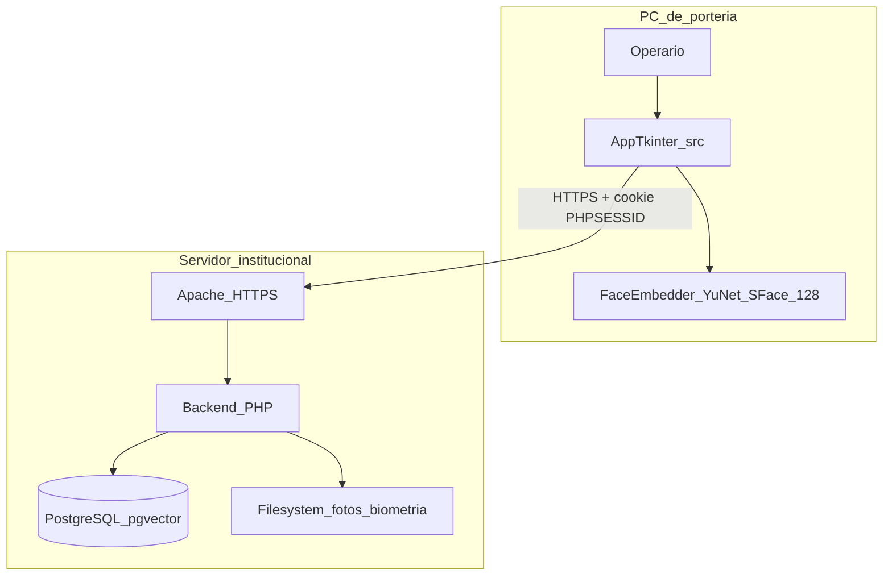

# 03 — Contexto y alcance

**Módulo:** app_desktop  
**Responsable:** Equipo de Desarrollo  
**Última revisión:** 2026-09-03  
**Ejes MSPI:** 3, 5, 6, 8

---

## 3.1 Contexto de negocio

La portería del centro SENA necesita un puesto dedicado que combine identificación biométrica y captura documental, conectado al SGI SmartCSET ya desplegado (Apache HTTPS + PHP + PostgreSQL/pgvector).

## 3.2 Diagrama de contexto (as-built)

## 3.3 Interfaces externas

| Interfaz | Dirección | Protocolo | Notas |
|----------|-----------|-----------|-------|
| Backend auth | App → servidor | HTTPS JSON | `login.php` / `logout.php`, `origen: "desktop"` |
| Portería / biometría | App → servidor | HTTPS JSON | Identificar, enrolar, consultar, registrar |
| Catálogos / entradas | App → servidor | HTTPS JSON | Tipos doc/persona, entradas; CRUD entradas solo admin |
| Cámara | SO → app | OpenCV | Frames en memoria |
| Pistola de códigos | Teclado HID → formulario | Texto | Parseo local en `scan_capture.py` |
| Lector de huella | — | — | **No integrado** (placeholder) |

Inventario de endpoints: [`../07-contrato-integracion.md`](../07-contrato-integracion.md).

## 3.4 Alcance incluido (as-built)

1. Login/logout con sesión PHP real.
2. Pantalla unificada post-login: cámara | formulario | huella (UI).
3. Facial: enrolamiento con foto JPG + identificación 128-d + confirmación visual.
4. Decisión automática ingreso vs salida vía consultar del backend.
5. Manual (`metodo_aut=1`) y pistola (`2`/`3`).
6. Empaquetado Windows onefile + `app_config.json` junto al `.exe`.

## 3.5 Alcance excluido / diferido

| Elemento | Estado |
|----------|--------|
| BD propia / modo offline | No implementado |
| Motor facial en proceso HTTPS separado | Diseño futuro (Fase 2); hoy in-process |
| SDK huella real | Placeholder |
| Cifrado E2 fotos | Diferido SENA |
| Consentimiento biométrico UI | Pendiente Fase 0 |
| Dashboard / Salida / Entradas en menú | Código huérfano |
| Token de dispositivo | Reservado a móvil |

## 3.6 Actores y responsabilidades

| Actor | Dentro del alcance | Fuera |
|-------|-------------------|-------|
| Operario | Operar ingreso unificado | Configurar servidor |
| TI | Instalar `.exe`, editar `app_config.json` | Cambiar reglas PL/pgSQL |
| Backend | Autorizar, validar, persistir | Renderizar UI Tkinter |

## 3.7 Frontera de confianza

- **Dentro del proceso:** embedding facial, cookie jar, frames de cámara.
- **Fuera del proceso (confianza servidor):** reglas de negocio, umbral coseno, MIME de fotos, menú portería, auditoría.
- **Riesgo de frontera:** `verify_tls: false` en lab debilita la confianza del canal; producción debe usar `true`.
