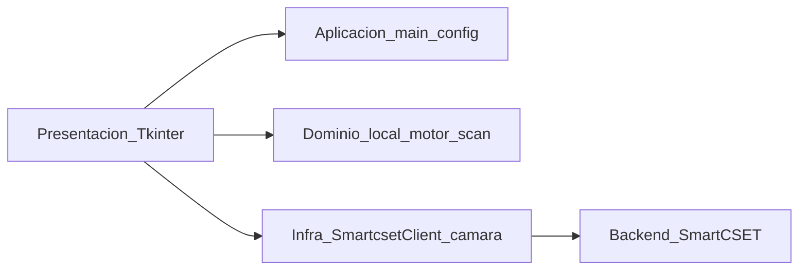

# 04 — Estrategia de solución

**Módulo:** app_desktop  
**Responsable:** Equipo de Desarrollo  
**Última revisión:** 2026-09-03  
**Ejes MSPI:** 3, 5, 7, 8

---

## 4.1 Idea central

**Cliente rico (thick client)** en el PC de portería: procesa biometría localmente (detección + embedding) y **orquesta** el resto por HTTPS hacia SmartCSET. No hay lógica de negocio crítica duplicada ni base de datos local.

## 4.2 Enfoque frente al diseño original

| Tema | Diseño en `REGLAS_APP_ESCRITORIO_SGI.md` §5.2 | As-built |
|------|-----------------------------------------------|----------|
| Procesos | App + motor HTTPS en loopback | **Un solo proceso** Python |
| App ↔ motor | HTTPS 127.0.0.1 + API key | Llamada directa a `FaceEmbedder` |
| Dimensión vector | 512 (borrador temprano) | **128** (SFace) |
| Código | Histórico `app/` | **`src/`** |

Justificación: reutilizar OpenCV ya cargado para la cámara; simplificar despliegue; no abrir superficie de red local. Separación en proceso HTTPS queda como endurecimiento Fase 2.

## 4.3 Pilares de la estrategia

1. **Sesión web real** — misma autenticación y auditoría que la UI web (`PHPSESSID`).
2. **Motor facial in-process** — YuNet (detección) + SFace (embedding 128).
3. **UI operativa mínima** — post-login solo pantalla de ingreso (sin sidebar).
4. **Fallback siempre disponible** — formulario manual + pistola aunque falle facial.
5. **Empaque onefile** — TI despliega `.exe` + edita JSON; operario solo inicia sesión.
6. **TLS configurable** — verificación estricta por defecto en diseño; lab puede desactivar explícitamente.

## 4.4 Descomposición en capas (estrategia)

- Presentación: captura intención del operario y muestra confirmación.
- Dominio local: solo lo que **debe** ocurrir en el PC (embedding, parseo pistola, validación de campos).
- Infraestructura: HTTP thread-safe, rutas frozen/dev, logs rotativos.
- Externos: PHP + PostgreSQL + filesystem de fotos.

## 4.5 Decisiones que anclan la estrategia

Índice completo: [`09-decisiones-indice-adr.md`](09-decisiones-indice-adr.md).

| ADR | Decisión |
|-----|----------|
| [ADR-01](../adr/ADR-01-tkinter-stdlib-http.md) | Tkinter + stdlib HTTP |
| [ADR-02](../adr/ADR-02-sesion-web-real.md) | Sesión web (no token dispositivo) |
| [ADR-03](../adr/ADR-03-motor-facial-in-process.md) | Motor in-process |
| [ADR-04](../adr/ADR-04-sface-128.md) | SFace 128 dims |
| [ADR-05](../adr/ADR-05-url-preconfigurada.md) | URL preconfigurada fuera del login |
| [ADR-06](../adr/ADR-06-pyinstaller-onefile.md) | PyInstaller onefile |

## 4.6 Estrategia de evolución (consciente)

| Corto plazo (operativo) | Medio plazo (no hecho) |
|-------------------------|------------------------|
| Mantener pantalla unificada de ingreso | Exponer Inicio / Salida / Entradas si se pide |
| Placeholder huella | SDK hardware + `metodo_aut=5` real |
| Motor in-process | Proceso HTTPS loopback (Fase 2) |
| `verify_tls` editable | Forzar `true` en builds de producción |
| Tests integración 34 | CI + tests UI Tkinter |

## 4.7 Qué NO se hace a propósito

- No cachear vectores/fotos en disco del PC (solo RAM / UI).
- No seguir redirects HTTP automáticamente (evita HTML de login como JSON).
- No usar login compartido de registro standalone (inactivo en monorepo).
