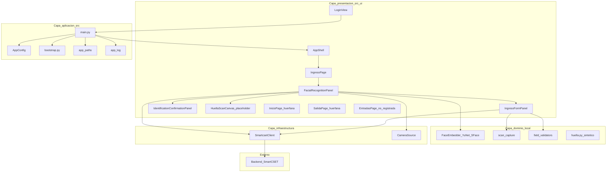

# 05 — Vista de bloques

**Módulo:** app_desktop  
**Responsable:** Equipo de Desarrollo  
**Última revisión:** 2026-09-03  
**Ejes MSPI:** 3, 6, 7, 8

---

## 5.1 Diagrama de bloques (capas as-built)

## 5.2 Contenedores lógicos

| Contenedor | Ubicación | Responsabilidad |
|------------|-----------|-----------------|
| Presentación | `src/ui/` | Login, shell, portería unificada, confirmación |
| Aplicación | `src/main.py`, `bootstrap.py`, `config.py`, `app_paths.py`, `app_log.py` | Ciclo de vida, venv, config, rutas, logs |
| Dominio local | `src/motor/`, `src/ui/scan_capture.py`, `field_validators.py` | Embedding, pistola, sanitización |
| Infraestructura | `src/smartcset_client.py`, `src/ui/camera.py` | HTTP sesión + cámara |
| Empaque | `packaging/` | Spec PyInstaller, hooks, scripts PowerShell |
| Pruebas | `tests/` | Unittest integración + parseo |

## 5.3 Componentes de presentación

| Componente | Archivo | Rol |
|------------|---------|-----|
| `LoginView` | `ui/login_view.py` | Credenciales → `client.login()` |
| `AppShell` | `ui/shell.py` | Topbar + área de contenido; **sin sidebar** |
| `IngresoPage` | `ui/pages/ingreso.py` | Host de `FacialRecognitionPanel` (ruta default) |
| `FacialRecognitionPanel` | `ui/facial_modal.py` | Orquesta cámara, facial, enrolar, modo acceso |
| `IngresoFormPanel` | `ui/ingreso_form_panel.py` | Manual / pistola |
| `IdentificationConfirmationPanel` | `ui/identification_confirmation_modal.py` | Foto servidor + confirmar/cancelar |
| `theme` / `responsive` | `ui/theme.py`, `ui/responsive.py` | Identidad y escalado |

**Huérfanas:** `InicioPage` y `SalidaPage` registradas en `_pages` pero sin navegación; `EntradasPage` ni siquiera registrada en `_pages`.

## 5.4 Dominio local — motor facial

| Pieza | Detalle |
|-------|---------|
| Detector | YuNet ONNX (`face_detection_yunet_2023mar.onnx`) |
| Reconocedor | SFace ONNX (`face_recognition_sface_2021dec.onnx`) |
| Dimensión | `EMBEDDING_DIMENSION = 128` |
| Umbral detección | `YUNET_SCORE_THRESHOLD = 0.22` |
| Max lado | 640 px |
| Ciclo de vida | Singleton `_get_embedder()` evita recargar ONNX |

Huella: `motor/huella.py` + `HuellaScanCanvas` — sintético / animación; no hardware.

## 5.5 Infraestructura — `SmartcsetClient`

- Stdlib HTTP, cookie jar, `RLock`, timeout 15 s.
- No sigue redirects 3xx.
- TLS vía `verify_tls` de `AppConfig`.
- Excepciones: `SmartcsetApiError`, `SmartcsetConnectionError`.

## 5.6 Integración con monorepo (bloques externos)

| Dominio servidor | Ruta monorepo |
|------------------|---------------|
| Auth | `backend/routers/auth/v1/` |
| Portería / biometría | `backend/routers/porteria/v1/` |
| Entradas | `backend/routers/entradas/v1/` |
| Servicios | `backend/services/porteria/` |
| SQL | `database/functions/porteria/` |
| Fotos | `frontend/web/public/uploads/biometria/` |

## 5.7 Relaciones de dependencia (reglas)

- UI llama a `SmartcsetClient`; **no** abre PDO ni SQL.
- Solo `FaceEmbedder` produce vectores; UI no implementa ONNX.
- Páginas huérfanas no deben asumirse en flujos de operación documentados.
