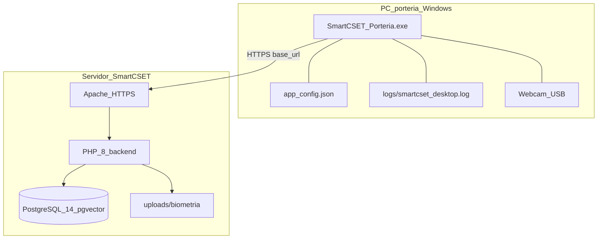

# 07 — Vista de despliegue

**Módulo:** app_desktop  
**Responsable:** Equipo de Desarrollo  
**Última revisión:** 2026-09-03  
**Ejes MSPI:** 5, 7, 8

---

## 7.1 Diagrama de despliegue



## 7.2 Nodos

| Nodo | Software | Artefactos |
|------|----------|------------|
| PC portería | Windows 10/11 | `.exe`, `app_config.json`, `logs/` |
| Servidor app | Apache + PHP 8+ | Routers auth/portería/entradas |
| Servidor BD | PostgreSQL 14+ | `vector`, `tab_enrolamiento_facial`, funciones portería |
| (Dev) Estación desarrollador | Python 3.11+ | `src/`, `runtime/.venv/`, `runtime/app_config.json` |

## 7.3 Modos de ejecución

| Modo | Cómo | `writable_root()` | `resource_root()` |
|------|------|-------------------|-------------------|
| Desarrollo | `python src/main.py` | `app_desktop/runtime/` | `app_desktop/src/` |
| Frozen | Doble clic `.exe` | Directorio del `.exe` | `_MEIPASS` PyInstaller |

Modelos ONNX en Windows empaquetado pueden resolverse hacia `%ProgramData%\SmartCSET\models\` para evitar paths no-ASCII.

## 7.4 Empaquetado

Desde `app_desktop/` (PowerShell):

```powershell
powershell -ExecutionPolicy Bypass -File packaging\build_exe.ps1
```

Resultado: `app_desktop/dist/SmartCSET_Porteria.exe` (onefile: código, ONNX, assets, seed de config).

Primer arranque del `.exe` siembra `app_config.json` (hook `pyi_runtime_hook_config.py`) si no existe.

## 7.5 Configuración por entorno

**Laboratorio (seed típico):**

```json
{
  "base_url": "https://10.5.213.111/smartcset",
  "verify_tls": false
}
```

**Producción institucional (objetivo):**

```json
{
  "base_url": "https://10.5.213.103/smartcset",
  "verify_tls": true
}
```

Desarrollo local suele usar `https://localhost/smartcset`.

## 7.6 Prerrequisitos en servidor

- Extensión `vector` y tabla `tab_enrolamiento_facial`.
- Funciones `fun_guardar_enrolamiento_facial` / `fun_identificar_persona_por_rostro` (firma correcta, vector 128).
- `id_metodo_aut = 4` en catálogo.
- Directorio `frontend/web/public/uploads/biometria/` escribible.
- Usuario con menú de portería (ej. `porteria`).

## 7.7 Checklist post-despliegue (resumen)

1. App abre; login OK.
2. Cámara en vivo; catálogos cargan.
3. Identificación / manual / logout sin sesión colgada.
4. Opcional: `id_metodo_aut = 4` y `usr_insert` real en BD.

Detalle operativo: [`../05-manual-instalacion.md`](../05-manual-instalacion.md).

## 7.8 Actualización

- Reemplazar `.exe`; **conservar** `app_config.json` existente.
- En desarrollo: `git pull` + `python main.py` (bootstrap reinstala deps si cambió `requirements.txt`).
