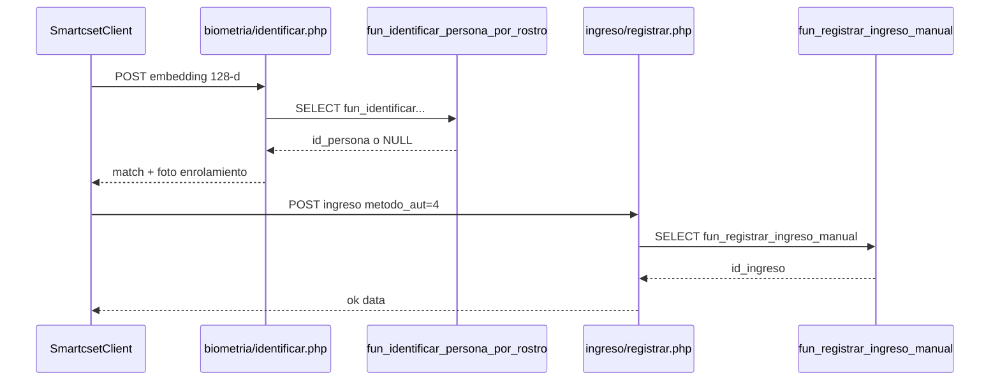

# Catálogo de funciones PL/pgSQL — alcance desktop

**Módulo:** `app_desktop`  
**Responsable:** Equipo de Desarrollo  
**Última revisión:** 2026-09-03  
**Ejes MSPI:** 3, 6, 8  

La app **no llama SQL directo**. Invoca routers PHP; estos usan prepared statements de `backend/core/prepare.php` y servicios de portería.

**AS-BUILT:** embeddings **VECTOR(128)** (SFace). Enrolamiento/identificación facial escriben/leen `tab_personas.val_patron_facial` (+ `ruta_foto_facial`).

---

## 1. Biometría facial

| Función | Firma relevante | Quién la llama |
|---------|-----------------|----------------|
| `fun_guardar_enrolamiento_facial` | `(id_persona, vector, calidad?, ruta_foto?) → NUMERIC` | Router [`backend/routers/porteria/v1/biometria/enrolar.php`](../../../backend/routers/porteria/v1/biometria/enrolar.php) vía `biometriaGuardarEnrolamiento()` + `$stmt_fun_guardar_enrolamiento_facial` |
| `fun_identificar_persona_por_rostro` | `(vector, umbral?) → id_persona \| NULL` | Router [`backend/routers/porteria/v1/biometria/identificar.php`](../../../backend/routers/porteria/v1/biometria/identificar.php) vía `biometriaIdentificarPersona()` + `$stmt_fun_identificar_persona_por_rostro` |

Archivos SQL: `database/functions/porteria/fun_guardar_enrolamiento_facial.sql`, `fun_identificar_persona_por_rostro.sql`.

Cliente desktop: `SmartcsetClient.biometria_enrolar` / `biometria_identificar`.

---

## 2. Ingreso / salida (cuando el cliente registra)

| Función | Rol | Quién la llama |
|---------|-----|----------------|
| `fun_registrar_ingreso_manual` | Orquesta upsert persona + insert log + stats | [`ingreso/registrar.php`](../../../backend/routers/porteria/v1/ingreso/registrar.php) → `$stmt_fun_registrar_ingreso` (prepare portería / core) |
| `fun_upsert_persona_visitante` | Alta/actualización persona | Llamada **interna** desde `fun_registrar_ingreso_manual` |
| `fun_insert_log_ingreso` | Inserta fila en `tab_log_ingresos` (método, entrada, embedding evento…) | Interna desde `fun_registrar_ingreso_manual` |
| `fun_update_persona_tras_ingreso` | Stats persona post-ingreso | Interna |
| `fun_registrar_salida_manual` | Cierra ingreso abierto | [`salida/registrar.php`](../../../backend/routers/porteria/v1/salida/registrar.php) → `$stmt_fun_registrar_salida` |
| `fun_update_log_salida` | Escribe `fec_salida` | Interna desde `fun_registrar_salida_manual` |
| `fun_update_persona_tras_salida` | Stats post-salida | Interna |

Cliente desktop: `ingreso_registrar` / `salida_registrar`.

---

## 3. Sesión (login / logout)

| Función | Quién la llama |
|---------|----------------|
| `fun_ingreso_sesion` | Flujo auth login (router `auth/v1/login.php` + helpers de sesión) |
| `fun_salida_sesion` | Logout / cierre |
| `fun_actualizar_sesion_actividad` / validación sesión | Middleware / touch de sesión en requests autenticados |

Cliente: `login` / `logout` — no invoca las funciones por nombre; el backend sí.

---

## 4. Huella (placeholder desktop)

| Función | Router |
|---------|--------|
| `fun_guardar_enrolamiento_huella` | `biometria/huella_enrolar.php` |
| `fun_identificar_persona_por_huella` | `biometria/huella_identificar.php` |

---

## 5. Diagrama de llamada (facial → ingreso)

---

## Documentos relacionados

- ER: [`diagrama-er.md`](diagrama-er.md)
- Diccionario: [`diccionario-de-datos.md`](diccionario-de-datos.md)
- Contrato HTTP: [`../api/contrato-http.md`](../api/contrato-http.md)
