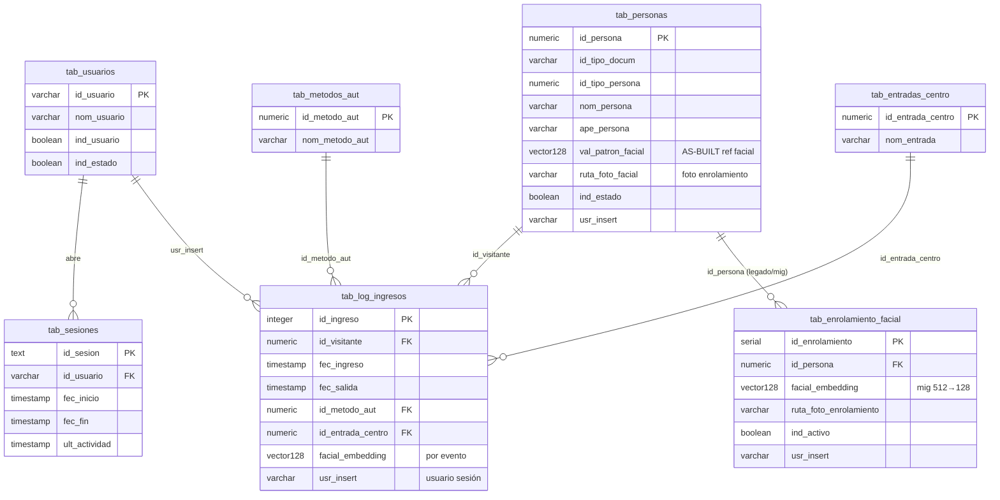

# Diagrama ER — alcance app desktop

**Módulo:** `app_desktop`  
**Responsable:** Equipo de Desarrollo  
**Última revisión:** 2026-09-03  
**Ejes MSPI:** 5, 6  

Solo tablas que el flujo desktop toca vía backend (no es el modelo completo SmartCSET).

**AS-BUILT biométrico:** la referencia facial por persona vive en  
`tab_personas.val_patron_facial` (**VECTOR(128)**) y `ruta_foto_facial`.  
`tab_enrolamiento_facial` aparece por el diseño/migraciones tempranas (Bug 19→128-d); el path PHP/PL actual (`fun_guardar_enrolamiento_facial` / `fun_identificar_persona_por_rostro`) opera sobre **`tab_personas`**. Se incluye abajo por trazabilidad documental pedida al módulo.

---

---

## Lectura rápida

| Tabla | Rol para desktop |
|-------|------------------|
| `tab_usuarios` / `tab_sesiones` | Login real + cookie |
| `tab_personas` | Identidad + **vector 128** de referencia + ruta foto |
| `tab_enrolamiento_facial` | Diseño/migración facial (ver nota AS-BUILT) |
| `tab_log_ingresos` | Ingreso/salida; `id_metodo_aut` (4=facial); auditoría |
| `tab_metodos_aut` | Catálogo 1–5 |
| `tab_entradas_centro` | Puerta seleccionada en registro |

Ver: [`diccionario-de-datos.md`](diccionario-de-datos.md), [`catalogo-funciones.md`](catalogo-funciones.md).
