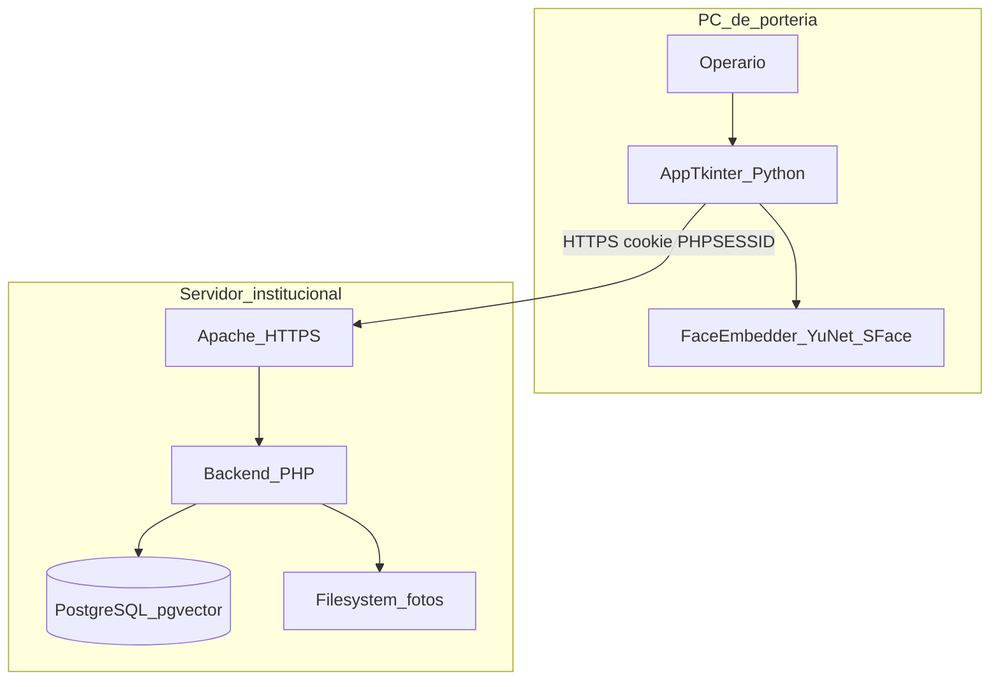
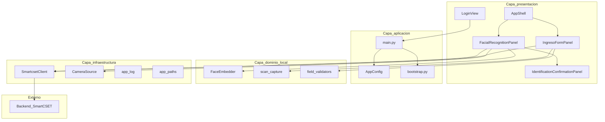
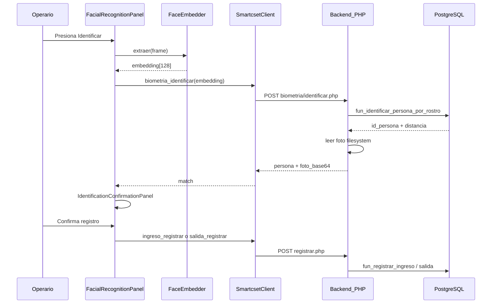
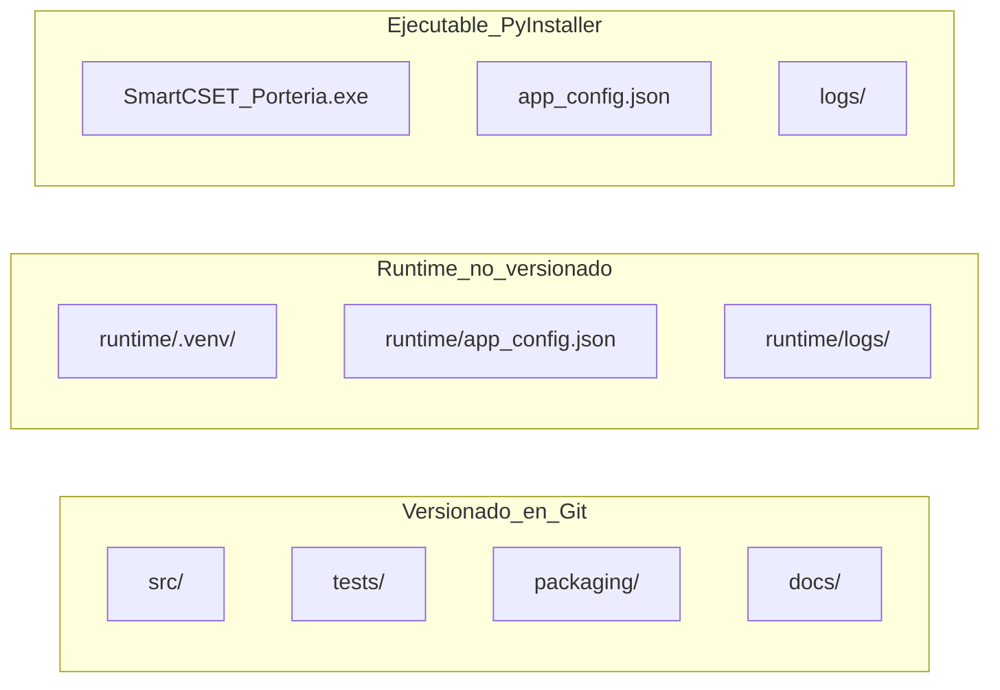

# 03 — Arquitectura del sistema

**Módulo:** App de Escritorio SGI — SmartCSET  
**Versión documental:** 1.0.0  
**Fecha:** 2026-09-01  
**Estado:** As-built

---

## 1. Resumen arquitectónico

SmartCSET App de Escritorio es un **cliente en capas** que corre en el PC de portería. No tiene base de datos propia ni lógica de negocio duplicada: delega reglas críticas al backend PHP y a funciones PL/pgSQL en PostgreSQL.

**Patrón:** Cliente rico (thick client) con procesamiento biométrico local y orquestación HTTP.

**Nota importante:** El diseño original ([`REGLAS_APP_ESCRITORIO_SGI.md`](../REGLAS_APP_ESCRITORIO_SGI.md) §5.2) contemplaba **dos procesos** (app Tkinter + motor biométrico HTTPS en loopback). La implementación actual ejecuta el motor **in-process** dentro del mismo proceso Python, reutilizando OpenCV ya cargado para la cámara.

---

## 2. Diagrama de contexto

---

## 3. Diagrama de capas (as-built)

---

## 4. Componentes principales

### 4.1 Capa de presentación (`src/ui/`)

| Componente | Responsabilidad |
|------------|-----------------|
| `LoginView` | Pantalla de autenticación |
| `AppShell` | Contenedor post-login: topbar + área de contenido |
| `IngresoPage` | Página principal; embebe `FacialRecognitionPanel` |
| `FacialRecognitionPanel` | Orquesta cámara, identificación, enrolamiento y registro |
| `IngresoFormPanel` | Formulario manual y recepción de pistola |
| `IdentificationConfirmationPanel` | Confirmación visual post-identificación |
| `theme.py` / `responsive.py` | Identidad visual y escalado |

### 4.2 Capa de aplicación (`src/`)

| Componente | Responsabilidad |
|------------|-----------------|
| `main.py` | Punto de entrada, ciclo de vida, hooks de excepción |
| `bootstrap.py` | Auto-creación de `runtime/.venv` y re-ejecución |
| `config.py` | Carga/guarda `app_config.json` |
| `app_paths.py` | Rutas para desarrollo vs PyInstaller frozen |
| `app_log.py` | Logging rotativo |

### 4.3 Capa de dominio local (`src/motor/`, `src/ui/scan_capture.py`)

| Componente | Responsabilidad |
|------------|-----------------|
| `FaceEmbedder` | Detección YuNet + embedding SFace (128 dims) |
| `scan_capture` | Parseo de capturas de pistola (QR, PDF417, barras) |
| `field_validators` | Sanitización de documento y nombres |
| `huella.py` | Placeholder de templates de huella (sintéticos) |

### 4.4 Capa de infraestructura

| Componente | Responsabilidad |
|------------|-----------------|
| `SmartcsetClient` | Cliente HTTP stdlib con cookie jar y TLS |
| `CameraSource` | Captura de frames con OpenCV |

---

## 5. Flujo de datos — Identificación facial

---

## 6. Autenticación y sesión

| Aspecto | Implementación |
|---------|----------------|
| Mecanismo | Sesión PHP estándar (mismo que web) |
| Cookie | `PHPSESSID` persistida en `http.cookiejar.CookieJar` |
| Login | `POST /routers/auth/v1/login.php` con `origen: "desktop"` |
| Logout | `GET /routers/auth/v1/logout.php` + clear cookies |
| Protección endpoints | Servidor valida `$_SESSION['id_usuario']` |
| Rate limiting | Heredado del servidor (E3) en intentos de login |

**No se usa:** token de dispositivo (`tab_dispositivos_porteria`) — reservado para app móvil.

---

## 7. Motor biométrico (as-built vs diseño)

| Aspecto | Diseño original (REGLAS §5.2) | Implementación actual |
|---------|------------------------------|----------------------|
| Procesos | 2 (app + motor HTTPS loopback) | 1 (in-process) |
| Comunicación app↔motor | HTTPS 127.0.0.1 + API key | Llamada directa a `FaceEmbedder` |
| Dimensiones vector | 512 (diseño inicial) | **128** (SFace) |
| Modelos | A definir | YuNet + SFace ONNX vendorizados |
| Persistencia local vector | Nunca en disco | Nunca en disco (solo memoria) |

**Justificación documentada en código:** reutiliza OpenCV ya cargado; no agrega superficie nueva de terceros que aislar. Separación en proceso HTTPS queda como endurecimiento Fase 2.

---

## 8. Configuración y rutas de archivos

| Modo | `writable_root()` | `resource_root()` |
|------|-------------------|-------------------|
| Desarrollo | `app_desktop/runtime/` | `app_desktop/src/` |
| Frozen (.exe) | Directorio del `.exe` | `_MEIPASS` (temporal PyInstaller) |

---

## 9. Integración con backend SmartCSET

La app consume endpoints existentes del monorepo. No duplica lógica PHP.

| Dominio | Ubicación en monorepo |
|---------|----------------------|
| Routers auth | `backend/routers/auth/v1/` |
| Routers portería | `backend/routers/porteria/v1/` |
| Routers entradas | `backend/routers/entradas/v1/` |
| Servicios | `backend/services/porteria/` |
| Funciones SQL | `database/functions/porteria/` |
| Migraciones | `database/migrations/` |
| Fotos biométricas | `frontend/web/public/uploads/biometria/` |

Ver contrato detallado: [`07-contrato-integracion.md`](07-contrato-integracion.md).

---

## 10. Empaquetado

PyInstaller genera un ejecutable **onefile** que incluye:

- Código Python compilado
- Modelos ONNX (`motor/models/`)
- Assets (`assets/img/`)
- Seed de configuración (`app_config.porteria.json`)

Al primer arranque del `.exe` se crean junto al ejecutable:

- `app_config.json` (editable por TI)
- `logs/smartcset_desktop.log`

---

## 11. Decisiones arquitectónicas (ADR resumidas)

| # | Decisión | Alternativa descartada | Razón |
|---|----------|----------------------|-------|
| ADR-01 | Tkinter + stdlib HTTP | Electron, Qt | Sin deps pesadas; intranet sin internet |
| ADR-02 | Sesión web real | Token de dispositivo | Misma auditoría que web; usuario identificable |
| ADR-03 | Motor in-process | Proceso HTTPS separado | Misma lib OpenCV; simplifica despliegue |
| ADR-04 | SFace 128 dims | face_recognition 128 / Facenet512 | Liviano; ONNX vendorizado |
| ADR-05 | URL preconfigurada | Campo en login | Operario no configura servidor |
| ADR-06 | PyInstaller onefile | venv + script .bat | Facilidad de despliegue en portería |

---

## Documentos relacionados

- Diseño detallado por módulo: [`04-diseno-detallado.md`](04-diseno-detallado.md)
- Contrato HTTP: [`07-contrato-integracion.md`](07-contrato-integracion.md)
- Instalación: [`05-manual-instalacion.md`](05-manual-instalacion.md)
