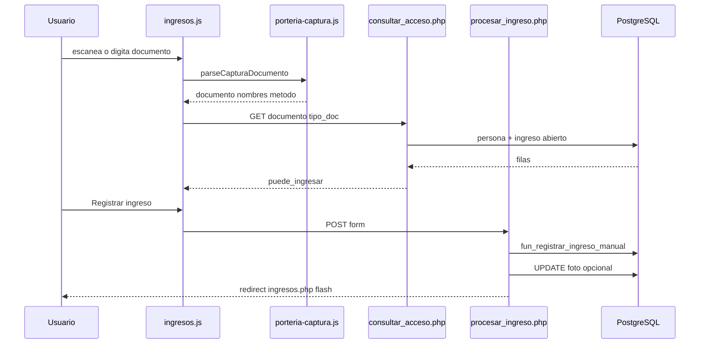

# Portería — documentación del código (línea por línea)

Referencia del flujo **ingreso / salida**: captura PDF417, consulta AJAX, registro en PostgreSQL y foto opcional.

**Orden de carga en el navegador (ingresos.php):**

1. `smartcset-forms.js` — no filtra `data-documento-captura`
2. `porteria-captura.js` → `window.PorteriaCaptura`
3. `porteria-medios.js` → `window.PorteriaMedios`
4. `ingresos.js` o `salidas.js`

---

## `js/porteria-captura.js`

| Línea | Qué hace |
|-------|----------|
| 1-4 | Comentario: convención PDF417 colombiana (`@` entre campos). |
| 5 | IIFE para no contaminar el scope global; recibe `window` o `globalThis`. |
| 6-7 | `METODO_MANUAL = 1` y `METODO_BARRAS = 3` (catálogo `tab_metodos_aut`). |
| 8 | `PDF417_MIN_LEN = 40`: umbral para distinguir escaneo largo de un número corto. |
| 9 | `SCAN_GAP_MS = 45`: si entre teclas pasan más ms, se reinicia contador de “ráfaga” de pistola. |
| 15-19 | `parseCapturaDocumento`: entrada única; vacío → `emptyResult`. |
| 21-23 | Si hay `@` y longitud ≥ 40 → rama PDF417. |
| 25-33 | Rama manual: solo dígitos (máx. 10), sin nombres, `origen: 'manual'`. |
| 36-44 | `emptyResult`: estructura por defecto cuando no hay texto. |
| 50-51 | `parsePdf417Colombia`: parte la cadena por `@`. |
| 54-59 | Busca el primer segmento con 6–10 dígitos = número de cédula. |
| 61-63 | Fallback: dígitos del segmento `[0]`. |
| 65-66 | Apellidos = partes `[1]` y `[2]`; nombres = `[3]` y `[4]`. |
| 68-75 | Devuelve objeto con `origen: 'pdf417'`, `tipo_doc: 'CC'`, `captura_raw` completo (para POST). |
| 78-83 | `joinNameParts`: une textos; ignora segmentos solo numéricos. |
| 86-88 | `metodoAutDesdeOrigen`: pdf417 → 3, si no → 1. |
| 95-96 | `enlazarCapturaDocumento`: aborta si falta input o callback `onCaptura`. |
| 98-99 | Estado local para detectar escaneo rápido (`keyCount`). |
| 101-106 | `keydown`: reinicia contador si la pistola hizo pausa entre caracteres. |
| 108-115 | `Enter` + cadena PDF417: `preventDefault`, parsea y llama `onCaptura(parsed, true)`. |
| 118-120 | Cuenta caracteres imprimibles de la ráfaga. |
| 123-131 | `paste`: si pegan PDF417 completo, reemplaza valor y dispara captura. |
| 134-138 | `input`: si el valor ya es PDF417 completo (pistola sin Enter), dispara captura (`esEscaneo` si ≥8 teclas). |
| 142-149 | Exporta API pública en `window.PorteriaCaptura`. |
| 150 | Cierra IIFE. |

---

## `js/porteria-medios.js`

| Línea | Qué hace |
|-------|----------|
| 4-8 | IIFE; claves `localStorage` y límites de compresión de foto. |
| 17-20 | `init(opts)`: requiere `form` e `inputDoc` del módulo ingreso/salida. |
| 22-33 | Referencias DOM: botones modo escáner/foto, video, preview, `hid_foto_data`, fila del documento. |
| 35-37 | Lee preferencia escáner guardada; `stream` = MediaStream de la cámara. |
| 39-43 | `setBtnActive`: clase `is-active` y `aria-pressed` para accesibilidad. |
| 45-49 | `enfocarDocumento`: solo si modo escáner activo. |
| 52-58 | `aplicarModoEscaner`: clase `is-modo-escaner` en form, hint visible, guarda en `localStorage`. |
| 61-69 | `detenerCamara`: apaga tracks y limpia `video.srcObject`. |
| 72-87 | `iniciarCamara`: `getUserMedia` cámara trasera (`environment`), sin audio. |
| 90-96 | `mostrarPreview`: muestra JPEG en ``, oculta video, muestra “Quitar”. |
| 98-104 | `quitarFoto`: limpia hidden y preview. |
| 106-131 | `comprimirImagen`: redimensiona a máx. 800px y exporta data URL JPEG 82%. |
| 134-137 | `asignarFotoDesdeBlob`: comprime y guarda en `hid_foto_data`. |
| 140-158 | `aplicarModoFoto`: muestra panel; desactiva escáner; enciende o apaga cámara. |
| 161-167 | Clic escáner: toggle; si activa escáner, apaga foto. |
| 170-172 | Clic foto: toggle panel foto. |
| 175-185 | “Capturar”: frame del `<video>` → canvas → blob → hidden. |
| 188-195 | “Archivo”: input file → misma compresión. |
| 197 | “Quitar”: reset foto. |
| 199-215 | `blur` en documento: en modo escáner, devuelve foco salvo selects/textarea/puertas/botones. |
| 218-236 | `limpiarTrasRegistro`: vacía doc, hiddens, resumen salida, foto; reenfoca (tras éxito POST). |
| 239-247 | Aplica escáner al cargar; restaura modo foto si estaba guardado; `resetEscaner` si `data-pt-reset="1"`. |
| 249 | Retorna helpers por si el módulo los necesita después. |
| 252 | Exporta `PorteriaMedios`. |

---

## `js/ingresos.js`

| Línea | Qué hace |
|-------|----------|
| 4 | Espera DOM listo. |
| 5-7 | Dependencias `PorteriaCaptura` y `PorteriaMedios`; sin captura no arranca. |
| 9-21 | Cache de elementos del formulario ingreso (`#form_ingreso`, hiddens, badge, puertas). |
| 23 | Sale si falta documento o form. |
| 25-27 | `timer` debounce; `puedeIngresar` (negocio); `consultaEnCurso` (UI). |
| 29-39 | `setBadge`: estados `known`, `new`, `loading`, `blocked`, `hide`. |
| 42-50 | `setBloqueoMsg`: caja ámbar HTML cuando ya hay ingreso activo. |
| 53-58 | `actualizarSubmit`: deshabilita si falta puerta, doc &lt; 5 dígitos, bloqueo o consulta. |
| 61-64 | `liberarNombres`: quita `readOnly` en nombres/apellidos. |
| 66-81 | `aplicarCaptura`: vuelca parseo a inputs + `hid_captura_raw` + `hid_metodo_aut`. |
| 84-95 | `mostrarIngresoAbierto`: `puedeIngresar = false`, badge y mensaje con hora/puerta. |
| 98-106 | `consultarAcceso`: si doc corto, resetea UI. |
| 109-112 | Marca consulta en curso; badge “Buscando…”. |
| 115-118 | `fetch` GET `consultar_acceso.php?documento=&tipo_doc=`. |
| 121-126 | Error JSON → oculta badge, permite intentar de nuevo. |
| 128 | `puede_ingresar` viene del servidor (`ingreso_abierto === null`). |
| 130-133 | Si hay ingreso abierto → bloqueo visual. |
| 136-152 | Si hay `persona` en BD → rellena y bloquea nombres; si no → badge “nueva”. |
| 154-159 | Error red; `finally` reactiva botón según estado. |
| 167-174 | `onCaptura`: escaneo consulta al instante; manual espera 400 ms. |
| 177 | Registra listeners de pistola/Enter en `#txt_documento`. |
| 179-187 | Clic en chip de puerta → `sel_entrada` + quita error. |
| 190-197 | `input` manual: limpia hiddens PDF417; debounce consulta. |
| 200-202 | Cambio tipo doc → reconsulta. |
| 205-218 | `submit`: valida puerta y `puedeIngresar`; quita readOnly para que el POST envíe nombres. |
| 221-226 | Inicia modos; `data-pt-reset="1"` tras flash success limpia para siguiente escaneo. |
| 230 | Primera pasada de estado del botón. |
| 232-234 | Marca puerta preseleccionada desde sesión PHP. |

---

## `js/salidas.js`

| Línea | Qué hace |
|-------|----------|
| 4-7 | Igual que ingresos: requiere `PorteriaCaptura`. |
| 9-18 | DOM salida: resumen ingreso activo, `hid_id_ingreso`, hiddens captura/método. |
| 22-24 | `puedeSalir` (inverso de ingreso: debe existir ingreso abierto). |
| 26-37 | Badges: `ok`, `known`, `warn`, `error`, `loading`. |
| 40-48 | `setAvisoMsg`: aviso cuando no puede salir. |
| 51-55 | Submit solo si doc válido y `puedeSalir`. |
| 58-63 | `limpiarIngreso`: oculta resumen y vacía `hid_id_ingreso`. |
| 65-83 | `mostrarIngreso`: llena resumen y habilita registrar salida. |
| 86-99 | `aplicarCaptura`: igual que ingreso (sin nombres en formulario salida). |
| 102-119 | `mostrarSinIngresoActivo`: mensaje distinto si persona existe en BD o no. |
| 122-164 | `consultarAcceso` → `consultar_acceso_salida.php`; usa `puede_salir`. |
| 167-174 | `onCaptura` + debounce igual que ingreso. |
| 177 | Enlace pistola. |
| 179-185 | Input manual resetea hiddens. |
| 190-195 | Submit bloqueado sin ingreso activo. |
| 198-207 | `PorteriaMedios.init` con reset tras éxito. |

---

## `src/modulos/includes/acceso_parse_captura.php`

| Línea | Qué hace |
|-------|----------|
| 6 | Incluye `accesoNormalizarDocumento` (solo dígitos, máx. 10). |
| 8-10 | Constantes espejo del JS (métodos y longitud PDF417). |
| 15-36 | `accesoParseCaptura`: misma decisión `@` + longitud que en JS. |
| 42-52 | `accesoCapturaVacia`. |
| 58-85 | `accesoParsePdf417Colombia`: lógica idéntica a `parsePdf417Colombia`. |
| 88-99 | `accesoJoinNameParts`. |
| 107-148 | `accesoDocumentoDesdePost`: prioriza `hid_captura_raw` sobre `txt_documento`; fusiona tipo doc y nombres del POST con los del parseo; normaliza documento en servidor. |

---

## `src/modulos/includes/porteria_consulta.php`

| Línea | Qué hace |
|-------|----------|
| 5-6 | Dependencias documento + búsqueda ingreso abierto. |
| 11-21 | `porteriaBuscarPersona`: ejecuta prepared statement `tab_personas` por id + tipo doc. |
| 27-46 | `porteriaConsultarAcceso`: persona + ingreso donde `fec_salida = fec_ingreso` hoy; `puede_ingresar = (ingreso === null)`. |

---

## `src/modulos/includes/ingresos_registro.php`

| Línea | Qué hace |
|-------|----------|
| 20-26 | `ingresoConsultarAcceso`: delega a `porteriaConsultarAcceso`. |
| 34-49 | `ingresoRegistrarManual`: parsea POST; lee tipo persona, puerta, observaciones. |
| 51-62 | Validaciones de negocio en PHP (tipo doc, tipo persona, nombres). |
| 64-69 | **Doble validación**: si hay ingreso abierto → Exception (aunque JS bloqueara). |
| 72-83 | Llama `fun_registrar_ingreso_manual(doc, tipo, tipoPersona, nom, ape, puerta, obs, usr, metodoAut, capturaPdf417)`. |
| 85-91 | Lee `id_ingreso` retornado por PostgreSQL. |

---

## `src/modulos/consultar_acceso.php`

| Línea | Qué hace |
|-------|----------|
| 2-4 | `prepare.php` (PDO + statements) y registro de ingresos. |
| 5 | Sesión PHP. |
| 7 | Respuesta JSON. |
| 9-12 | 401 sin sesión. |
| 16-21 | Llama consulta con `$_GET['documento']` y `tipo_doc`. |
| 22-27 | JSON: `persona`, `ingreso_abierto`, `puede_ingresar`. |

---

## `src/modulos/consultar_acceso_salida.php`

Igual que `consultar_acceso.php`, pero usa `salidaConsultarAcceso` y añade `puede_salir` (y `puede_ingresar` invertido por compatibilidad).

---

## `src/modulos/procesar_ingreso.php`

| Línea | Qué hace |
|-------|----------|
| 2-5 | Bootstrap, registro, foto. |
| 8-10 | Redirige si no hay sesión. |
| 13-15 | Solo POST. |
| 19-24 | `ingresoRegistrarManual` con `$_POST` completo. |
| 26-29 | Si viene `hid_foto_data` → guarda JPEG y actualiza JSON en `tab_log_ingresos`. |
| 31-34 | Flash success + id último ingreso + puerta preferida en sesión. |
| 35-40 | Errores → flash danger. |
| 43-44 | Redirect PRG a `ingresos.php`. |

---

## `src/modulos/includes/porteria_foto.php`

| Línea | Qué hace |
|-------|----------|
| 6-7 | Límites 500 KB y borde 800 px. |
| 18-20 | No hace nada si no hay data URL o id inválido. |
| 23-25 | Valida formato `data:image/...;base64,...`. |
| 27-37 | Decodifica y valida tamaño. |
| 35 | Redimensiona con GD si está disponible. |
| 40-52 | Escribe en `storage/porteria/{ingresos|salidas}/YYYY-MM-DD/{id_ingreso}_HHMMSS.jpg`. |
| 56-67 | `UPDATE` fusiona en `val_datos_origen`: `foto_registro`, `foto_ruta`, `foto_contexto`, `foto_fec`. |

---

## `database/functions/porteria/fun_registrar_ingreso_manual.sql` (resumen)

| Bloque | Qué hace |
|--------|----------|
| Parámetros | Persona, tipo doc, tipo persona, nombres, puerta, obs, **usuario**, `wid_metodo_aut` (default 1), `wcaptura_pdf417`. |
| Validaciones | Puerta 1–9, método en catálogo. |
| `fun_upsert_persona_visitante` | Crea/actualiza fila en `tab_personas`. |
| `val_datos_origen` | JSON con `origen` (`registro_manual` / `codigo_barras`), documento, flags. |
| `fun_insert_log_ingreso` | Inserta log; **rechaza** segundo ingreso si `fec_salida = fec_ingreso`. |

---

## `src/modulos/ingresos.php` (fragmentos clave)

| Elemento | Qué hace |
|----------|----------|
| `hid_captura_raw` | Cadena PDF417 original para re-parse en servidor. |
| `hid_metodo_aut` | 1 o 3 según origen captura. |
| `data-documento-captura="1"` | Excluye filtro numérico global. |
| `data-pt-reset="1"` | Tras registro OK, JS limpia form en modo escáner. |
| `include porteria_modos_ui.php` | Botones escáner/foto + panel cámara + `hid_foto_data`. |
| Scripts | captura → medios → ingresos.js |

---

## Diagrama de flujo (ingreso)

---

## Archivos relacionados (sin detalle línea a línea)

- `src/modulos/includes/acceso_documento.php` — `accesoNormalizarDocumento`
- `src/modulos/includes/salidas_registro.php` — `salidaRegistrarManual`, `salidaConsultarAcceso`
- `js/smartcset-forms.js` — línea que excluye `data-documento-captura` del filtro `\D`
- `css/porteria_modos.css` — estilos modo escáner/foto
- `src/core/prepare.php` — `$stmt_buscar_persona_doc`, `$stmt_buscar_ingreso_abierto`, `$stmt_fun_registrar_ingreso`

---

*Generado para SmartCSET portería. Actualizar este doc si cambian índices PDF417 o firmas SQL.*
